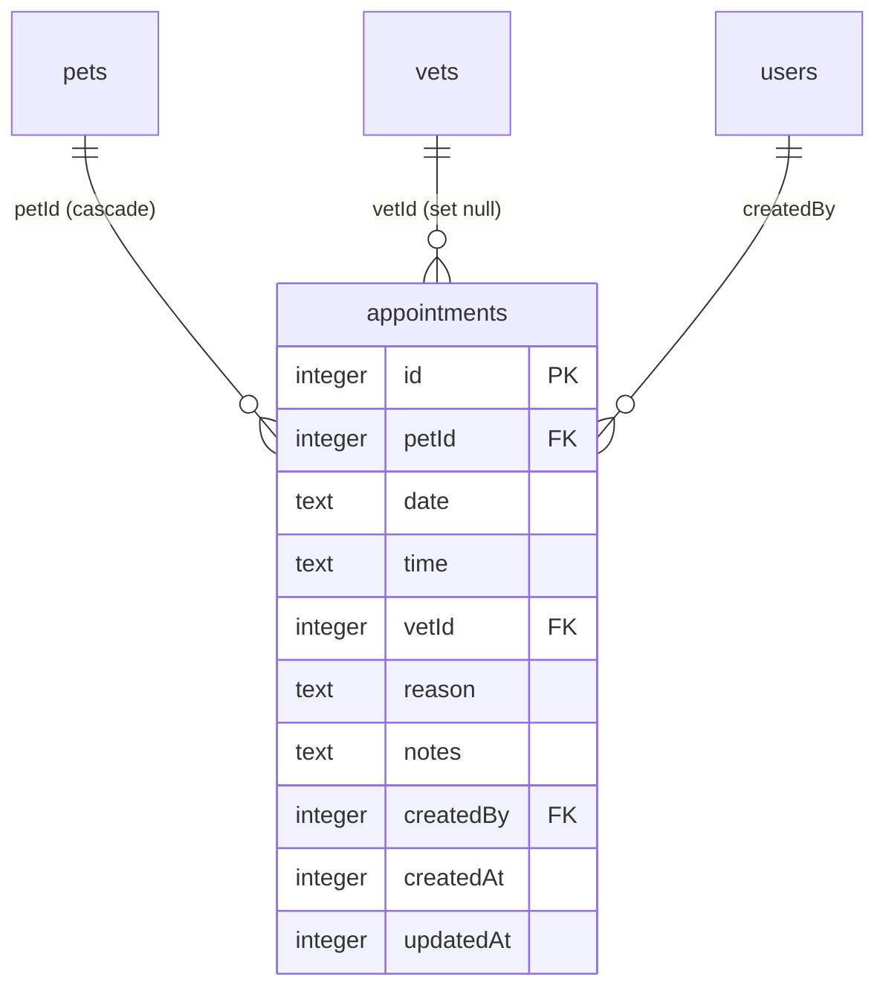
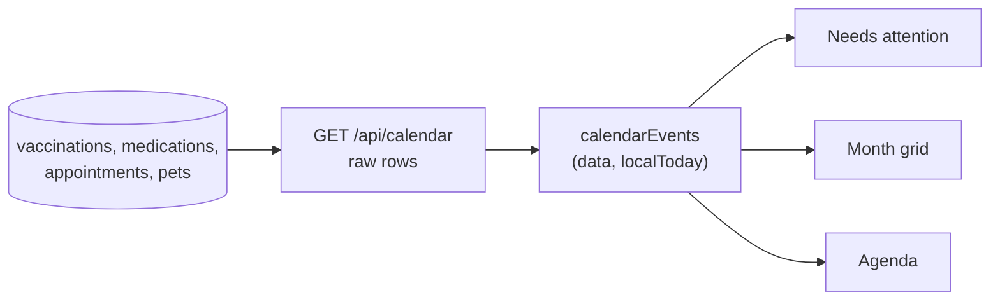
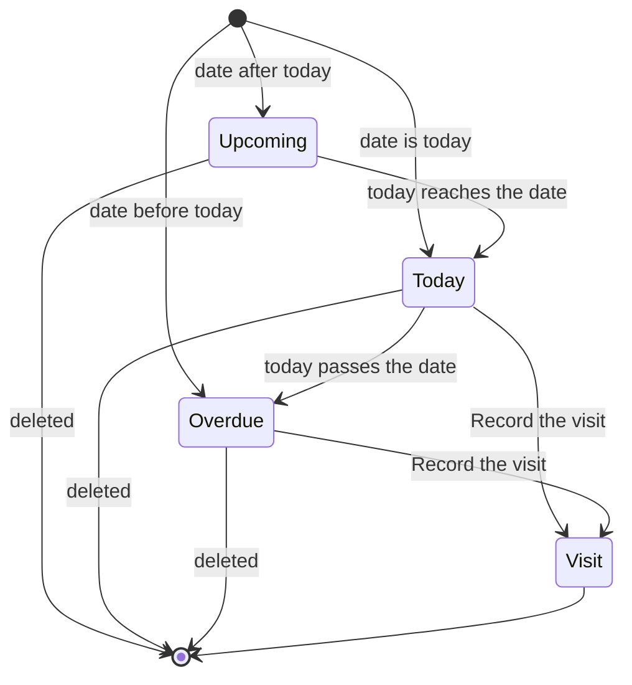

# Requirements Document: Calendar

## Introduction

What is coming up for a household's pets was scattered: vaccine due dates on each pet's Health tab and dashboard card, a medication's last day on its own row, and the next vet visit nowhere at all. The Calendar is one screen, in the main navigation, that lists those dates for every living pet, a month at a time: a month grid on wide screens and an agenda list on phones, with the things that are already late called out above it.

The Calendar holds one new record type, the appointment: a day, an optional time, a vet and a reason for a visit that has not happened yet. Once the day comes, an appointment is turned into a vet visit, with the visit form already filled in from it.

Three decisions shape the feature:

- The Calendar shows only dates the household typed. A vaccine's due date comes from the certificate, a course's last day from its stop date, an appointment from its own form. The app never invents medical facts, so nothing here works out a schedule.
- Statuses depend on today's date, and the server runs in UTC. As with health statuses, the API returns raw rows and the browser computes every Calendar event and status from `localToday()`. The server never reads its clock to decide what is late.
- An iCalendar (`.ics`) feed is not built. A calendar app cannot sign in through Cloudflare Access, so a feed would need a route outside Access protected only by a token in its address, which is a second way into the household's records. Reminders are to come from the app itself (the notifications feature).

The next dose of a recurring medication and the day a prescription runs out are Calendar events too, but the records behind them do not exist yet. They are added to `calendarEvents()` by the features that add those records.

Health records, visits, vets and pet profiles have their own specs and appear here only where the Calendar meets them. Where a criterion is proven by a test, the test file is named. Criteria checked only by hand are marked "(manual)".

## Glossary

- **Appointment**: a row in `appointments`: a pet, a date, and optionally a time, a vet (a link to a saved vet, see `docs/specs/vets/spec.md`), a reason and notes.
- **Calendar_Data**: the body of `GET /api/calendar`: every pet, vaccine dose, medication course with a stop date, and Appointment, as stored.
- **Calendar_Event**: one dated item computed in the browser by `calendarEvents()` in `src/shared/calendar.ts`. Its kind is `vaccine`, `medication` or `appointment`.
- **Event_Status**: `overdue`, `past`, `today` or `upcoming`, computed for a Calendar_Event from Local_Today.
- **Latest_Dose**, **Deceased_Pet**, **Local_Today**: as in `docs/specs/health-records/spec.md`.
- **Month**: a calendar month written `YYYY-MM`.
- **Calendar screen**: `/calendar`. **Month grid**: its week-by-week table of the chosen Month. **Agenda**: its list of the chosen Month's days that have events.

## Requirements

### Requirement 1: Appointment validation

**User Story:** As a household member, I want to book a visit with only what I know so far, so that an appointment made by phone takes a moment to enter.

#### Acceptance Criteria

1. THE `appointmentInput` schema in `src/shared/calendar.ts` SHALL require a date that is a real calendar date in `YYYY-MM-DD` form, past or future, with the message "Use a valid date". (`src/shared/calendar.test.ts`)
2. THE schema SHALL accept a time written `HH:MM` on the 24-hour clock, from `00:00` to `23:59`, and store an empty or null time as no time; anything else is refused with "Use a valid time". (`src/shared/calendar.test.ts`)
3. THE schema SHALL accept an optional reason (up to 200 characters) and notes (2,000), trimming each and storing a blank one as null, and a `vetId` that is a saved vet's id or null. (`src/shared/calendar.test.ts`)

### Requirement 2: Appointments API

**User Story:** As a household member, I want to add, change and cancel appointments, so that the Calendar matches what is booked.

#### Acceptance Criteria

1. WHEN a valid body is posted to `/api/pets/:id/appointments`, THE System SHALL store the Appointment with the pet id, the signed-in user as author and the creation time, and respond 201 with the stored row. (`src/server/routes/calendar.test.ts`)
2. WHEN a valid body is sent with PUT to `/api/appointments/:id`, THE System SHALL replace every editable field, keep the Appointment on its pet, set `updatedAt` and respond 200 with the updated row. (`src/server/routes/calendar.test.ts`)
3. WHEN DELETE is sent to `/api/appointments/:id`, THE System SHALL remove the Appointment and respond 204. (`src/server/routes/calendar.test.ts`)
4. IF the pet or Appointment does not exist, or the id is not a positive integer, THEN THE System SHALL respond 404 with "Pet not found" or "Appointment not found". (`src/server/routes/calendar.test.ts`)
5. IF a body fails the schema, THEN THE System SHALL respond 400 with a `fields` object keyed by field name; IF it names a `vetId` that is not a saved vet, THEN THE System SHALL respond 400 with `vetId: "Unknown vet"`. Neither writes anything. (`src/server/routes/calendar.test.ts`)
6. WHEN a pet is deleted, THE database SHALL remove its Appointments; WHEN a vet is deleted, THE database SHALL keep the Appointments that named it and clear their `vetId`. (`src/server/routes/calendar.test.ts`)
7. THE System SHALL wrap every route in this spec in `authed()` and refuse unauthenticated calls with 401. (`src/server/app.test.ts`)

### Requirement 3: Calendar data

**User Story:** As the browser, I need every pet's dated records in one response, so that I can build the Calendar from the user's own date.

#### Acceptance Criteria

1. WHEN `GET /api/calendar` is called, THE System SHALL return Calendar_Data: `pets` (id, name, chart colour and `deceasedOn`) in case-insensitive name order; `vaccinations` (id, pet id, vaccine, date given and due date) for every dose; `medications` (id, pet id, drug and end date) for every course that has an end date; and `appointments` (id, pet id, date, time, vet id, reason and notes) for every Appointment. (`src/server/routes/calendar.test.ts`)
2. THE response SHALL carry no status and no computed date, and the server SHALL NOT read its own clock to build it. (`src/server/routes/calendar.test.ts` for the body; the clock is manual)

### Requirement 4: Calendar events

**User Story:** As a household member, I want one list of what is due, ending and booked across my pets, judged from my own date.

#### Acceptance Criteria

1. THE `calendarEvents()` function SHALL return one `vaccine` event for each Latest_Dose that has a due date, dated on that due date and titled "{vaccine} due", using `vaccineStatus()` so that a dose superseded by a newer dose of the same vaccine never produces an event. (`src/shared/calendar.test.ts`)
2. THE function SHALL return one `medication` event for each course with an end date, dated on that end date and titled "{drug}: last day". (`src/shared/calendar.test.ts`)
3. THE function SHALL return one `appointment` event for each Appointment, on its date and with its time, titled with its reason, or "Appointment" when it has none. (`src/shared/calendar.test.ts`)
4. THE function SHALL return no event of any kind for a Deceased_Pet, whatever its date of passing. (`src/shared/calendar.test.ts`)
5. THE function SHALL set each event's Event_Status from the `today` it is given and nothing else: `today` when the event's date is that day, `upcoming` when it is later; when it is earlier, `overdue` for a `vaccine` or `appointment` event and `past` for a `medication` event. (`src/shared/calendar.test.ts`)
6. THE function SHALL order events by date, then with untimed events before timed ones and earlier times first, then by pet name, then by title. (`src/shared/calendar.test.ts`)
7. THE `monthWeeks()` function in `src/shared/dates.ts` SHALL return the whole weeks that cover a Month, each of seven consecutive dates starting on the given weekday, so the first and last weeks may hold days of the neighbouring months. (`src/shared/dates.test.ts`)

### Requirement 5: Calendar screen

**User Story:** As a household member, I want to look at any month and see at a glance what is late, on my desktop and on my phone.

#### Acceptance Criteria

1. THE navigation SHALL offer **Calendar** after Pets, in the sidebar and in the phone's bottom tabs. (manual)
2. THE Calendar screen SHALL call `calendarEvents()` with Local_Today, and SHALL show the Month named by the address's `month` parameter, or the Month of Local_Today when there is none or it is not a Month. (`src/web/routes/calendar.test.tsx`)
3. THE screen SHALL offer **Previous month** and **Next month**, a **Today** button that returns to the Month of Local_Today, and the chosen Month's name as its heading; each changes the address, so a Month can be bookmarked and Back returns to the Month before. (`src/web/routes/calendar.test.tsx` for stepping a month; the rest manual)
4. THE screen SHALL offer a pet filter listing "All pets" and each living pet. WHEN a pet is chosen, THE screen SHALL show only that pet's events, in the Month and in the overdue list, and keep the choice in the address's `pet` parameter. (`src/web/routes/calendar.test.tsx`)
5. WHEN any event is `overdue`, THE screen SHALL list every such event above the Month under "Needs attention", whatever Month is shown, oldest first, each with its date and a danger badge reading "Overdue" for a vaccine or "Not recorded" for an Appointment; with none it SHALL show no such block. (`src/web/routes/calendar.test.tsx`)
6. WHEN the main content area is wide (`@3xl/main`), THE screen SHALL show the Month grid: one column per weekday, starting on the first day of the week in the browser's locale (Monday when the browser does not say), with each day's events in the cell, Local_Today's day number highlighted and the days of neighbouring months dimmed and empty. (manual)
7. WHEN the main content area is narrower, THE screen SHALL show the Agenda instead: each day of the Month that has events, in date order, as a heading with the weekday and date followed by its events; with no events in the Month it SHALL say "Nothing this month." (`src/web/routes/calendar.test.tsx` for the list and the empty message; the breakpoint is manual)
8. THE screen SHALL show each event with its pet's name and chart colour, its title, its time when it has one, and its Event_Status: `overdue` in the danger colour, `today` with a "Today" badge, `past` muted. (manual)
9. THE screen SHALL make each event open the record it came from: a `vaccine` or `medication` event leads to that pet's Health tab, and an `appointment` event opens the Appointment form. (`src/web/routes/calendar.test.tsx`)
10. THE screen SHALL work at 360 px and 1440 px wide. (manual)

### Requirement 6: Appointment form

**User Story:** As a household member, I want to book, move and cancel an appointment from the Calendar.

#### Acceptance Criteria

1. THE Calendar screen SHALL offer **Add appointment** when the household has a living pet, opening a dialog titled "Add appointment"; opening an Appointment SHALL use "Edit appointment". (`src/web/routes/calendar.test.tsx`)
2. THE form SHALL offer the living pets, pre-selected to the filtered pet if there is one, a date pre-filled with Local_Today, an optional time, a vet picker (vets spec, Requirement 6), a reason and notes. WHEN editing, THE pet SHALL be shown but not changeable. (manual)
3. WHEN the user saves, THE form SHALL validate with the `appointmentInput` schema the server uses and mark each failing field, with "Check the highlighted fields." beside the actions; field errors the server returns SHALL be shown the same way. (manual)
4. WHEN editing, THE form SHALL offer Delete with a second, confirming press. (manual)
5. WHEN a save or delete succeeds, THE screen SHALL refetch Calendar_Data and close the dialog. (`src/web/routes/calendar.test.tsx`)

### Requirement 7: Turning an appointment into a vet visit

**User Story:** As a household member back from the clinic, I want the appointment to become the visit's record, so that I don't retype it and it stops showing as booked.

#### Acceptance Criteria

1. WHILE an Appointment's date is Local_Today or earlier, THE Appointment form SHALL offer **Record the visit**. (`src/web/routes/calendar.test.tsx`)
2. WHEN **Record the visit** is pressed, THE dialog SHALL show the visit form (visits-and-files spec) titled "Add vet visit", as a vet visit pre-filled with the Appointment's date, vet, reason and notes. (`src/web/routes/calendar.test.tsx`)
3. THE bodies of `POST /api/pets/:id/entries` and `PUT /api/entries/:id` SHALL accept an optional `appointmentId`. WHEN one is given, THE System SHALL save the visit and delete that Appointment in one transaction. (`src/server/routes/calendar.test.ts`)
4. IF `appointmentId` names no Appointment, or one that belongs to another pet, THEN THE System SHALL respond 400 with `appointmentId: "Unknown appointment"` and write nothing. (`src/server/routes/calendar.test.ts`)
5. WHEN the visit is saved, THE Calendar screen SHALL no longer show the Appointment, and the visit SHALL appear on the pet's timeline. (`src/web/routes/calendar.test.tsx` for the Calendar; the timeline is manual)

## Diagrams

### Data Model

### Data Flow

### State Machine: an Appointment

## Constraints

- The app never invents medical facts: every Calendar date is one the household typed. No schedule, interval or reminder date is derived.
- Events and statuses are computed by `calendarEvents()` in `src/shared/calendar.ts` from the `today` it is given; the Calendar screen passes `localToday()`. The server runs in UTC and returns raw rows.
- Vaccine events follow the dashboard's rules because they come from the same `vaccineStatus()`: the latest dose of each vaccine only, and none for a pet that has passed away.
- Appointments live in the `appointments` table (`src/server/db/schema.ts`): `pet_id` cascades on delete, `vet_id` is set null on delete. An Appointment turned into a visit is deleted; the visit is its record.
- An Appointment's time is the clock time at the clinic, stored as typed with no time zone, and shown in the browser's locale format.
- Every `/api/*` handler is wrapped in `authed()` and listed in the 401 checks in `src/server/app.test.ts`. Any signed-in user can read and change any Appointment.
- The Calendar screen refetches Calendar_Data each time it is opened, so changes made on a pet's page show without a reload.
- Every screen works at desktop and phone widths; layout follows the main content width (`@container` queries), not the viewport. The UI is dark only.

## Correctness Properties

### Property 1: Statuses come only from the given date

*For any* Calendar_Data and any two dates T1 and T2, `calendarEvents(data, T1)` and `calendarEvents(data, T2)` hold the same events with the same dates and titles, and differ only in Event_Status; an event dated D has status `today` exactly when D equals the given date, `upcoming` exactly when D is later, and `overdue` or `past` exactly when D is earlier.

**Validates: Requirements 3.2, 4.5, 5.2**

### Property 2: Only the latest dose is on the calendar

*For any* set of doses, the `vaccine` events of a living pet are exactly the entries of `vaccineStatus()` that have a due date: at most one per vaccine name as matched by `vaccineKey()`.

**Validates: Requirements 4.1**

### Property 3: Nothing for a pet that has passed away

*For any* Calendar_Data and any pet with a non-null `deceasedOn`, no Calendar_Event names that pet.

**Validates: Requirements 4.4, 5.4**

### Property 4: A recorded visit replaces its appointment

*For any* accepted visit save that names an `appointmentId`, afterwards the visit exists and the Appointment does not; *for any* refused one, both tables are unchanged.

**Validates: Requirements 7.3, 7.4**

### Property 5: A month's weeks cover it exactly once

*For any* Month and first weekday, `monthWeeks()` returns consecutive dates with no gap or repeat, every date of the Month appears once, and the first and last weeks each hold at least one date of the Month.

**Validates: Requirements 4.7, 5.6**

## Out of Scope

- An iCalendar (`.ics`) feed or any export to another calendar (see the Introduction).
- Notifications and reminders for Calendar events; they are a separate feature that reads the same events.
- The next dose of a recurring medication, a prescription's estimated run-out date, and progress through a short course. Each is added as a Calendar_Event kind by the feature that adds its records.
- Events for the start of a medication, conditions, lab reports, birthdays, or past visits and weigh-ins; the pet's timeline is the history.
- Repeating appointments, appointments for several pets at once, an appointment's duration, and moving an Appointment to another pet.
- Appointments on the pet's page, the dashboard, the vet's page and the PDF health report.
- Week and day views, and dragging an event to another day.
- Per-pet or per-user permissions and edit history.
