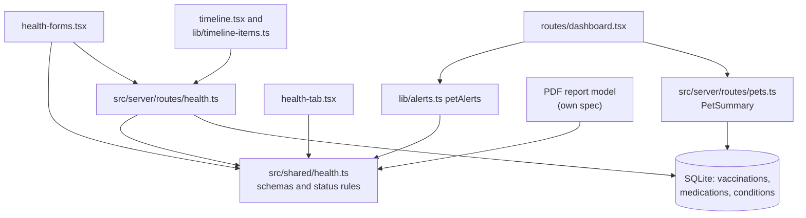
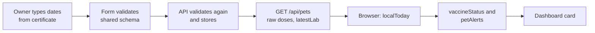
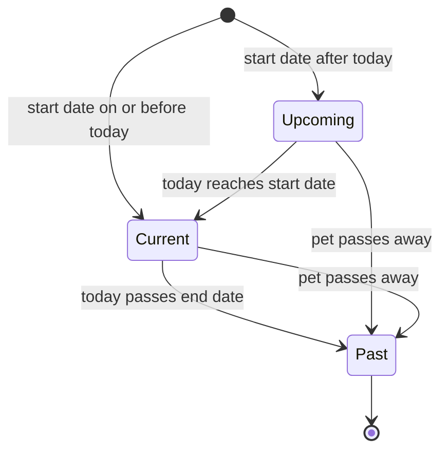
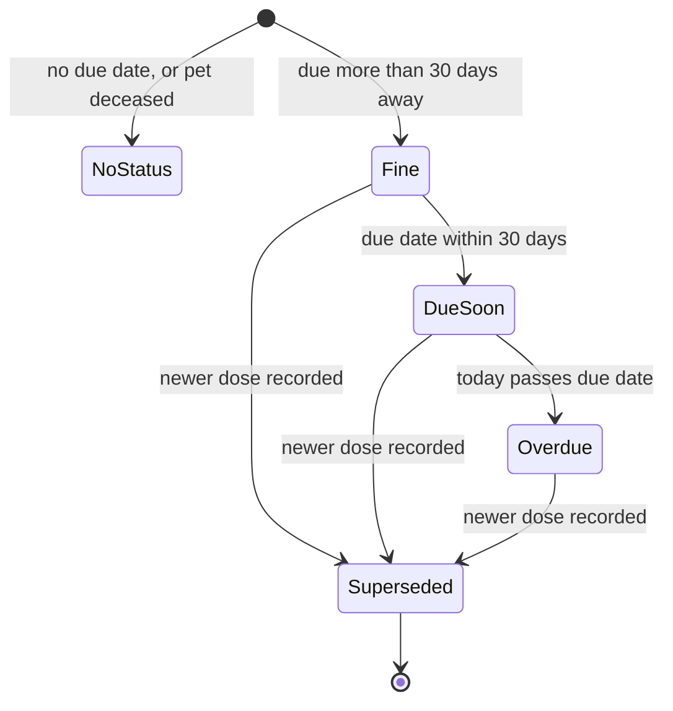

# Requirements Document: Health Records

## Introduction

Whiskerfile keeps three kinds of health record for each pet: vaccinations (one row per dose), medications (one row per course) and conditions (diagnoses, allergies, surgeries, dental work and anything else). The owner adds them from the pet's "Add record" menu, reviews them on the pet's Health tab, sees them on the pet's timeline, and gets warned on the dashboard when a vaccine is overdue or due soon or when the pet's latest lab report has results outside their printed range.

A hard project rule shapes this feature: the app never invents medical facts. It has no vaccine schedules, booster intervals or doses. A vaccine's next due date is typed by the user from the certificate or the clinic's reminder, vaccine names are free text with suggestions only, and dose and frequency are free text as printed on the label. Every status the app shows (overdue, due soon, current, upcoming, past, active, resolved) is derived only from dates the user entered.

Statuses depend on today's date. The server runs in UTC, so it never reads its own clock to decide what is due: the API returns raw records and the browser computes each status from `localToday()`, the user's own calendar date. The PDF report is the one place the server computes statuses, from the `today` the browser sends with the request (see the pdf-health-reports spec).

This spec covers the three record types, their validation and API, the Health tab and forms, the dashboard alert block with the server fields that feed it, and the timeline rows for lab reports, vaccinations, medications and conditions. Pet profiles, visits and files, lab results, PDF reports, AI lab import and the platform (auth, database, backups) have their own specs and appear here only as integration points.

## Glossary

- **Dose**: one vaccinations row: vaccine name, date given, optional next due date, lot, clinic and notes.
- **Course**: one medications row: drug, optional dose and frequency text, start date, optional end date, reason and notes.
- **Condition**: one conditions row with a Condition_Kind, title, date, optional resolved date and notes.
- **Condition_Kind**: one of `diagnosis`, `allergy`, `surgery`, `dental`, `other`, labelled Diagnosis, Allergy, Surgery, Dental, Other.
- **Vaccine_Key**: the name used to match doses of the same vaccine, from `vaccineKey()` in `src/shared/health.ts`.
- **Latest_Dose**: for each Vaccine_Key, the dose with the latest date given; on the same date, the one with the higher id.
- **Due_Status**: `overdue`, `due-soon` or none, computed for a Latest_Dose by `vaccineStatus()`.
- **Due_Soon_Window**: `DUE_SOON_DAYS` = 30 calendar days from today, inclusive.
- **Medication_State**: `current`, `upcoming` or `past`, computed by `medicationState()`.
- **Active_Condition**: a condition with no resolved date, or one resolved after today (`isActiveCondition()`).
- **Local_Today**: the browser's calendar date as `YYYY-MM-DD`, from `localToday()` in `src/shared/dates.ts`.
- **Deceased_Pet**: a pet whose `deceasedOn` date is set (set on the pet profile, see the pet-profiles spec).
- **Pet_Summary**: one element of `GET /api/pets`, the pet plus the fields the dashboard shows.
- **Flagged_Result**: a lab result that `flagResult()` (lab-results spec) marks `high` or `low`.

## Requirements

### Requirement 1: Vaccination validation

**User Story:** As an owner, I want each dose recorded exactly as it appears on the certificate, so that the record matches what the clinic gave.

#### Acceptance Criteria

1. THE `vaccinationInput` schema SHALL require a vaccine name of 1 to 80 characters after trimming, with the message "Enter the vaccine". (`src/shared/health.test.ts`)
2. THE `vaccinationInput` schema SHALL require a date given that is a real calendar date in `YYYY-MM-DD` form, and accept an empty or null due date as no due date. (`src/shared/dates.test.ts` for the date check)
3. IF the due date is before the date given, THEN THE schema SHALL reject it on the `dueDate` field with "Must be on or after the date given". (`src/shared/health.test.ts`)
4. THE schema SHALL accept optional lot (up to 40 characters), clinic (up to 120) and notes (up to 2000), trimming each and storing a blank one as null. (manual)
5. THE System SHALL accept any vaccine name the user types; the names FVRCP, Rabies, FeLV, DHPP, Bordetella, Leptospirosis, Lyme and Canine influenza (`VACCINE_SUGGESTIONS`) SHALL only be offered as suggestions. (manual)

### Requirement 2: Medication and condition validation

**User Story:** As an owner, I want medications and conditions recorded with their own dates, so that I can see what was given and what is still going on.

#### Acceptance Criteria

1. THE `medicationInput` schema SHALL require a drug name of 1 to 80 characters after trimming ("Enter the medication") and a valid start date, and accept optional dose (60), frequency (60), reason (120) and notes (2000) as free text, blank stored as null. (`src/shared/health.test.ts`)
2. IF a course's end date is before its start date, THEN THE schema SHALL reject it on `endDate` with "Must be on or after the start date". (`src/shared/health.test.ts`)
3. THE `conditionInput` schema SHALL require a Condition_Kind, a title of 1 to 120 characters after trimming ("Enter a title") and a valid date, and accept optional resolved date and notes (2000). (`src/shared/health.test.ts`)
4. IF a condition's resolved date is before its date, THEN THE schema SHALL reject it on `resolvedOn` with "Must be on or after the date". (`src/shared/health.test.ts`)
5. IF the kind is not a Condition_Kind, THEN THE API SHALL respond 400. (`src/server/routes/health.test.ts`)

### Requirement 3: Health records API

**User Story:** As an owner, I want to add, edit and delete health records, so that the record stays correct over time.

#### Acceptance Criteria

1. WHEN a valid body is posted to `/api/pets/:id/vaccinations`, `/api/pets/:id/medications` or `/api/pets/:id/conditions`, THE System SHALL store the record with the pet id, the signed-in user as author and the creation time, and respond 201 with the stored row. (`src/server/routes/health.test.ts`)
2. WHEN a valid body is sent with PUT to `/api/vaccinations/:id`, `/api/medications/:id` or `/api/conditions/:id`, THE System SHALL replace every editable field, keep the record on its pet, and respond 200 with the updated row. (`src/server/routes/health.test.ts`)
3. WHEN DELETE is sent to one of those record paths, THE System SHALL remove the record and respond 204. (`src/server/routes/health.test.ts`)
4. IF the pet or record does not exist, or the id is not a positive integer, THEN THE System SHALL respond 404 with "Pet not found", "Vaccination not found", "Medication not found" or "Condition not found". (`src/server/routes/health.test.ts`)
5. IF a body fails its schema, THEN THE System SHALL respond 400 with a `fields` object keyed by field name (`src/server/routes/health.test.ts`); IF the body is not JSON, THEN THE System SHALL respond 400 "Request body must be JSON" (`parseJson` in `src/server/http.ts`).
6. WHEN `GET /api/pets/:id/health` is called, THE System SHALL return `vaccinations`, `medications` and `conditions`, each newest first by its own date (date given, start date, date) then by id descending, each row carrying its author's name. (`src/server/routes/health.test.ts`)
7. THE System SHALL wrap every health route in `authed()` and refuse unauthenticated calls with 401. (`src/server/app.test.ts`)
8. WHEN a pet is deleted, THE database SHALL remove its vaccinations, medications and conditions through `ON DELETE CASCADE` foreign keys. (`src/server/routes/health.test.ts`)

### Requirement 4: Vaccine name matching

**User Story:** As an owner who types vaccine names inconsistently or in my own language, I want doses of the same vaccine grouped together, so that an old dose doesn't look overdue.

#### Acceptance Criteria

1. THE `vaccineKey()` function SHALL lowercase the name and drop everything that is not a Unicode letter or digit, so "FVRCP" matches "fvr-cp" and "Canine Influenza" matches "canine influenza ". (`src/shared/health.test.ts`)
2. THE `vaccineKey()` function SHALL keep letters of any script, so Cyrillic names match across case and two different Chinese names stay distinct. (`src/shared/health.test.ts`)
3. THE `vaccineKey()` function SHALL keep accented letters as distinct letters, so "Leucofeligen" and "Leucofeligén" do not match. (`src/shared/health.test.ts`)
4. IF a name has no letters or digits, THEN THE `vaccineKey()` function SHALL use the trimmed, lowercased name as typed, so "???" and "!!!" stay distinct. (`src/shared/health.test.ts`)

### Requirement 5: Vaccine due status

**User Story:** As an owner, I want to know which vaccines are overdue or coming up, based only on the due dates I entered.

#### Acceptance Criteria

1. THE `vaccineStatus()` function SHALL return one entry per Vaccine_Key, holding its Latest_Dose, sorted by vaccine name. (`src/shared/health.test.ts`)
2. WHEN the Latest_Dose's due date is before Local_Today, THE function SHALL mark it `overdue`. (`src/shared/health.test.ts`)
3. WHEN the Latest_Dose's due date is from Local_Today to Local_Today plus 30 days inclusive, THE function SHALL mark it `due-soon`. (`src/shared/health.test.ts`)
4. WHEN the due date is more than 30 days away, or the dose has no due date, THE function SHALL give it no Due_Status. (`src/shared/health.test.ts`)
5. THE function SHALL never give a Due_Status to a dose superseded by a newer dose of the same Vaccine_Key, however overdue its own due date. (`src/shared/health.test.ts`)
6. WHILE the pet is a Deceased_Pet, THE function SHALL give no dose a Due_Status. (`src/shared/health.test.ts`)

### Requirement 6: Medication state and condition activity

**User Story:** As an owner, I want courses and conditions sorted into what is happening now and what is history.

#### Acceptance Criteria

1. THE `medicationState()` function SHALL return `past` when the end date is before Local_Today, or when the pet's `deceasedOn` is on or before Local_Today. (`src/shared/health.test.ts`)
2. OTHERWISE, THE function SHALL return `upcoming` when the start date is after Local_Today, and `current` when it is not; a course on its end date is still `current`. (`src/shared/health.test.ts`)
3. THE `isActiveCondition()` function SHALL treat a condition as active when it has no resolved date or the resolved date is after Local_Today; a condition resolved today is not active. (`src/shared/health.test.ts`)

### Requirement 7: Health tab

**User Story:** As an owner, I want one screen with the pet's vaccines, current medications and active conditions, so that I can answer a vet's questions quickly.

#### Acceptance Criteria

1. THE Health tab SHALL compute every status from Local_Today and the pet's `deceasedOn`. (manual)
2. THE Vaccinations section SHALL list one row per Latest_Dose in vaccine-name order, showing the name, "Overdue since {date}" (danger badge) or "Due {date}" (warning badge) by Due_Status, otherwise "Next due {date}" as plain text when a due date exists, then "Given {date}", clinic and lot, notes as typed, and "Added by {author}". (manual)
3. THE Vaccinations section SHALL list each earlier dose of the same Vaccine_Key, muted, beneath its Latest_Dose as "Earlier dose · {date}" with the clinic, newest first; with no doses it SHALL show "No vaccinations recorded." (manual)
4. THE Medications section SHALL list current and upcoming courses; an upcoming one SHALL carry a "Starts {date}" badge and read "From {date}", a current one "Since {date}", each with "until {end}" when an end date exists, plus dose, frequency, reason, notes and author; with none it SHALL show "None current." (manual)
5. THE Conditions section SHALL list Active_Conditions with their kind badge and "Since {date}"; with none it SHALL show "None recorded." (manual)
6. WHEN past courses or resolved conditions exist, THE tab SHALL show a muted History section listing them as "Medication · {start} to {end}" and "{Kind} · {date} to {resolved}"; otherwise it SHALL hide that section. (manual)
7. THE tab SHALL give every row an edit button labelled "Edit {what}", 44 px square on phones and 36 px from the `md` breakpoint, that opens the record's edit form. (manual)
8. THE tab SHALL lay out in one column, and in two columns when the main content area is wide (`@5xl/main`), working at desktop and phone widths. (manual)

### Requirement 8: Health forms

**User Story:** As an owner, I want quick forms that catch mistakes before saving and never fill in medical facts for me.

#### Acceptance Criteria

1. THE "Add record" chooser SHALL offer Vaccination, Medication and Condition, opening dialogs titled "Add vaccination", "Add medication" and "Add condition"; editing SHALL use "Edit …" titles. (manual)
2. WHEN a form opens for a new record, THE form SHALL prefill its date (date given, started, or date) with Local_Today and leave every other field empty, with kind Diagnosis for a condition. (manual)
3. THE Vaccine field SHALL be free text with the `VACCINE_SUGGESTIONS` offered through a datalist, and the Next due field SHALL be empty unless typed, with the hint "From the certificate or the clinic's reminder." (manual)
4. WHEN the user saves, THE form SHALL validate with the same shared schema the server uses and mark each failing field, with "Check the highlighted fields." beside the actions; field errors the server returns SHALL be shown the same way. (manual)
5. IF a vaccination's date given, or a condition's date or resolved date, is after Local_Today, THEN THE form SHALL refuse it with "Can't be in the future", and those date inputs SHALL carry `max` = Local_Today. (manual)
6. THE medication form SHALL accept start and end dates in the future, so a course can be entered ahead of time. (manual)
7. WHEN editing, THE form SHALL offer Delete, which turns into "Confirm delete" on the first press, deletes on the second, and disarms when it loses focus. (manual)
8. WHEN a save or delete succeeds, THE form SHALL refresh the pet's cached queries and the pet list, then close. (manual)

### Requirement 9: Dashboard alerts

**User Story:** As an owner with several pets, I want each pet's card to say which vaccines need booking and whether the latest blood work had anything out of range.

#### Acceptance Criteria

1. THE `petAlerts()` function SHALL return as `due` every Latest_Dose with a Due_Status, overdue ones first, each group in vaccine-name order. (`src/web/lib/alerts.test.ts`)
2. THE `petAlerts()` function SHALL return the pet's latest lab report as `lab` only when it has at least one Flagged_Result, otherwise null. (`src/web/lib/alerts.test.ts`)
3. WHILE the pet is a Deceased_Pet, THE `petAlerts()` function SHALL return no due vaccines and no lab alert. (`src/web/lib/alerts.test.ts`)
4. THE dashboard SHALL call `petAlerts()` with Local_Today and, when there is nothing to show, render no alert block. (manual)
5. THE dashboard SHALL render due vaccines as a list labelled "Vaccines due", each badge reading "{vaccine} overdue" (danger) or "{vaccine} due {date}" (warning). (manual)
6. THE dashboard SHALL render the lab alert as "Out of range on the labs of {date}" followed by one badge per Flagged_Result showing code, value as printed, and "High" (danger) or "Low" (warning), with the analyte name as its tooltip. (manual)

### Requirement 10: Pet summary fields for alerts

**User Story:** As the browser, I need each pet's raw doses and its latest flagged lab results in the pet list, so that I can judge what is due from the user's own date.

#### Acceptance Criteria

1. THE `GET /api/pets` response SHALL give each Pet_Summary a `vaccinations` array of every dose's `id`, `vaccine`, `dateGiven` and `dueDate`, newest first by date given then id, empty for a pet with none. (`src/server/routes/health.test.ts`)
2. THE health and pet-list APIs SHALL return vaccine doses without a Due_Status, and the server SHALL NOT use its own clock to compute one; the browser computes it, and the PDF report computes it from the `today` the browser sends. (`src/server/routes/health.test.ts`)
3. THE Pet_Summary SHALL carry `latestLab` as the pet's report with the latest sample date, ties broken by the higher id (the one added last), or null when the pet has no reports. (`src/server/routes/labs.test.ts`)
4. THE `latestLab.flagged` list SHALL hold only results `flagResult()` marks `high` or `low`, each as code, name, value text, unit and flag, in analyte catalog order; in-range, unranged and undecidable results SHALL be left out. (`src/server/routes/labs.test.ts`)

### Requirement 11: Timeline rows

**User Story:** As an owner, I want health records and lab reports on the pet's timeline alongside visits, so that I can see the whole history in date order.

#### Acceptance Criteria

1. THE `timelineItems()` function SHALL place a lab report by its sample date, a dose by its date given, a course by its start date and a condition by its date, sorted newest day first and newest added first within a day. (`src/web/lib/timeline-items.test.ts`)
2. THE timeline SHALL show a lab report as a link to its report page with the date, the lab name (or source label), the result count and codes, and "{n} high", "{n} low" or "In range" badges. (manual)
3. THE timeline SHALL show a dose with a syringe icon, its name and "Vaccinated {date}", the clinic when set, and the author. (manual)
4. THE timeline SHALL show a course with a pill icon, drug and dose, and `medicationDates()` wording: "Starts" or "Started {date}", then ", stopped {end}" once the end date is before Local_Today or ", until {end}" otherwise. (`src/web/lib/timeline-items.test.ts`)
5. THE timeline SHALL show a condition with a heart-pulse icon, title, kind badge and "{date}", adding ", resolved {date}" when resolved. (manual)
6. THE dose, course and condition rows SHALL each have an edit button opening the same form as the Health tab. (manual)

## Diagrams

### Component Diagram

### Data Flow

### State Machine: Medication_State

### State Machine: Due_Status of a dose

## Constraints

- The app never invents medical facts: no vaccine schedules, booster intervals, doses or drug data. Due dates, doses and frequencies are only what the user typed.
- Every status is computed from the user's date by the shared functions in `src/shared/health.ts`. The server runs in UTC, so the API returns raw rows and never reads its own clock to decide what is due; the PDF report uses the `today` the browser sends with the request.
- Validation lives in the shared Zod schemas and runs in both the form and the API.
- Records live in the `vaccinations`, `medications` and `conditions` tables (`src/server/db/schema.ts`), each with a `pet_id` foreign key that cascades on delete and a `created_by` reference to `users`. Rows carry `createdAt` only; there is no edit history.
- Every `/api/*` handler is wrapped in `authed()` and listed in the 401 checks in `src/server/app.test.ts`. Any signed-in user can read and change any pet's records.
- The "Can't be in the future" checks run only in the browser, because only the browser knows the user's date.
- Every screen works at desktop and phone widths; layout follows the main content width (`@container` queries), not the viewport.

## Correctness Properties

### Property 1: Only the latest dose can alert

*For any* list of doses and any today, every entry returned by `vaccineStatus()` holds the Latest_Dose of its Vaccine_Key, and no two entries share a Vaccine_Key.

**Validates: Requirements 4.1, 5.1, 5.5**

### Property 2: Due status follows the typed due date

*For any* Latest_Dose with due date D and today T on a living pet, the status is `overdue` exactly when D is before T, `due-soon` exactly when T ≤ D ≤ T + 30 days, and none otherwise; a dose with no due date has no status.

**Validates: Requirements 5.2, 5.3, 5.4**

### Property 3: Nothing is due for a pet that has passed away

*For any* doses and any non-null `deceasedOn`, `vaccineStatus()` returns no status and `petAlerts()` returns no due vaccines and no lab alert.

**Validates: Requirements 5.6, 9.3**

### Property 4: Medication state partitions courses

*For any* course and today, `medicationState()` returns exactly one of `current`, `upcoming` and `past`, and the Health tab shows the course in the Medications section exactly when it is not `past`.

**Validates: Requirements 6.1, 6.2, 7.4, 7.6**

### Property 5: Date order is enforced

*For any* input whose due, end or resolved date is before its own start date, the matching schema rejects it on that field, in the form and in the API alike.

**Validates: Requirements 1.3, 2.2, 2.4, 8.4**

### Property 6: Name matching ignores case and punctuation only

*For any* two names that differ only in letter case, spacing or punctuation, `vaccineKey()` returns the same key; *for any* two names whose letters or digits differ, including accents and non-Latin scripts, it returns different keys.

**Validates: Requirements 4.1, 4.2, 4.3, 4.4**

### Property 7: Deleting a pet leaves no health rows

*For any* pet with vaccinations, medications and conditions, deleting the pet leaves no row in those tables referring to it.

**Validates: Requirements 3.8**

### Property 8: Lab alerts show only out-of-range results from the latest report

*For any* set of lab reports for a pet, `latestLab` is the report with the greatest (sample date, id), and every entry in `flagged` is `high` or `low` on that report.

**Validates: Requirements 10.3, 10.4, 9.2**

## Out of Scope

- Vaccine schedules, booster intervals, suggested due dates, or any computed date beyond the 30-day due-soon window.
- Dose calculation, drug catalogs, drug interactions or structured dose units; dose and frequency are free text.
- Reminders or notifications outside the app (email, push, calendar).
- Dashboard alerts for medications or conditions; the dashboard warns only about vaccines and the latest lab report.
- Server-side "can't be in the future" checks.
- Matching vaccine names beyond `vaccineKey()`: no synonyms, abbreviation expansion or accent folding.
- Per-pet or per-user permissions, edit history, undo after delete, and moving a record to another pet.
- Lab result entry, flagging rules and report pages (lab-results spec), the PDF report's health sections (pdf-health-reports spec), and visits, weights and files on the timeline (visits-and-files spec).
