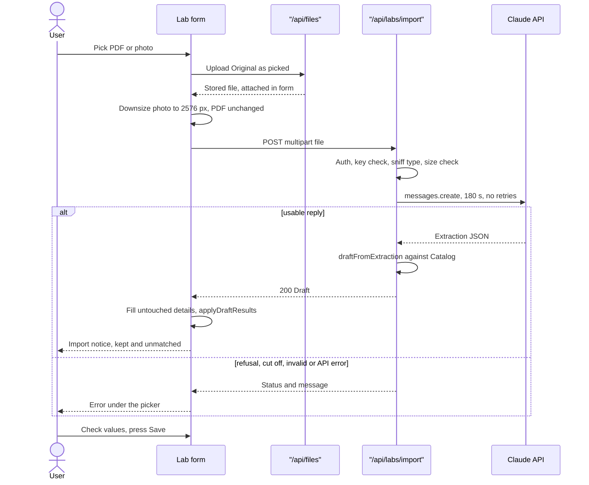
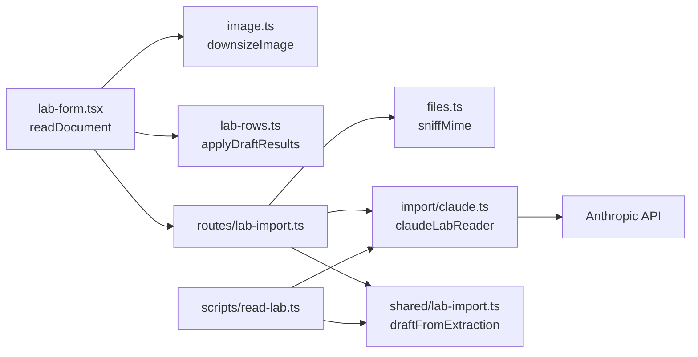

# Requirements Document: Lab Document Import

## Introduction

Whiskerfile stores lab reports as results typed into the lab form (see `docs/specs/lab-results/spec.md` for manual entry, ranges, flags and the "earlier result" pre-fill). Reports arrive as IDEXX-style PDFs or as receipt-style printouts from in-clinic analysers, and typing dozens of values is slow and error-prone. Lab Document Import lets the user pick the PDF or a photo of the printout; the server sends it to Anthropic's API, Claude transcribes each result, unit and range as printed, and the form is filled in for the user to check and save.

The feature is optional. It is enabled only when `ANTHROPIC_API_KEY` is set, and every document read is sent to Anthropic's API and billed to that account. The project's hard rule applies throughout: the app never invents medical facts. A range is filled only when the document prints it, imported rows bypass the earlier-result pre-fill, values the user has typed are never overwritten, and no lab report is saved until the user presses Save.

**Status of live verification.** The feature has not yet been exercised against the real Anthropic API; no credentials were available while it was built. `bun test` never calls the API: the reader is tested with the real SDK client and its `fetch` replaced. Everything that depends on the live API accepting the request (the model id, the beta, server-side fallbacks, the structured output format) or on the model following the prompt is marked **(manual, not yet run)**. `bun run read:lab <file>` (`scripts/read-lab.ts`) is the manual live check.

## Glossary

- **Lab_Document**: a PDF, or a JPEG, PNG, WebP or GIF image, of a printed lab report.
- **Catalog**: the `analytes` table (test code and name), ordered by `sortOrder`, sent to Claude so it can match printed tests to codes.
- **Reader**: `claudeLabReader` in `src/server/import/claude.ts`; turns a Lab_Document into an Extraction.
- **Extraction**: the model's reply, validated against `extractionSchema` (`src/shared/lab-import.ts`): date, lab, accession, source, and results with code, printedName, value, unit, rangeLow, rangeHigh, all as printed.
- **Draft**: the `LabDraft` returned by `POST /api/labs/import`, made by `draftFromExtraction`: matched `results` and `unmatched` entries, each with a reason.
- **Kept_Value**: a result the user had already typed that differs from the Draft; reported, never replaced.
- **Import_Notice**: the panel above the results grid that summarises a reading.
- **Original**: the file exactly as the user picked it, uploaded and attached to the form.

## Requirements

### Requirement 1: Configuration

**User Story:** As a self-hoster, I want the feature off unless I supply a key, so that no document leaves my server without my consent.

#### Acceptance Criteria

1. THE System SHALL read the key from `ANTHROPIC_API_KEY` (`src/server/config.ts`), defaulting to empty; `compose.yaml` passes it through as optional and `.env.example` documents that documents read this way are sent to Anthropic's API. (manual)
2. WHERE the key is set, THE System SHALL create the Reader with an Anthropic client using that key (`src/server/index.ts`). (manual)
3. IF the key is not set, WHEN `POST /api/labs/import` is called by a signed-in user, THE System SHALL answer 503 `"Reading documents needs an Anthropic API key; set ANTHROPIC_API_KEY"`, before the upload is read. (`src/server/routes/lab-import.test.ts`; the ordering is manual)
4. WHILE the key is not set, THE lab form SHALL still show **Read results from a document**, and SHALL show the 503 message when it is used. (manual)

### Requirement 2: Import endpoint

**User Story:** As a user, I want to send a lab document and get a draft back, so that the form can be filled without anything being stored as a report.

#### Acceptance Criteria

1. THE route `POST /api/labs/import` SHALL be wrapped in `authed()` and answer 401 to a request that is not signed in. (`src/server/app.test.ts`)
2. THE route SHALL take the document from the multipart field `file`, with the shared upload checks: 413 over 25 MB, 400 without a `file` field, 400 for an empty file (`readUpload`, tested through `/api/files` in `src/server/routes/files.test.ts`).
3. THE route SHALL identify the type from the file's first bytes, never from its name or declared type, and IF the bytes are not a PDF, JPEG, PNG, WebP or GIF, SHALL answer 400 `"Only PDFs and JPEG, PNG, WebP or GIF images can be read"`. (`lab-import.test.ts`: a `.txt` file and a `.pdf` name with HTML bytes)
4. IF an image's base64 size, `ceil(bytes / 3) * 4`, exceeds 10 MB, THE route SHALL answer 413 `"This photo is too large to read; try a smaller one"` without calling the Reader. (`lab-import.test.ts`). PDFs have no route-side limit beyond 25 MB.
5. WHEN a document passes these checks, THE route SHALL raise the request's timeout to 195 seconds (`READ_TIMEOUT_SECONDS + 15`), so that the server allows the whole reading. (`lab-import.test.ts`)
6. THE route SHALL pass the Reader the bytes, the sniffed type, the Catalog (id, code, name ordered by `sortOrder`) and the request's abort signal. (`lab-import.test.ts`)
7. WHEN the Reader succeeds, THE route SHALL answer 200 with `draftFromExtraction(extraction, catalog)`. (`lab-import.test.ts`)
8. THE route SHALL save nothing: no lab report and no file row. (`lab-import.test.ts`)
9. IF the Reader throws a `ReadLabError`, THE route SHALL answer with its status and message. (`lab-import.test.ts`)
10. IF the Reader throws anything else, THE route SHALL answer 500 `"Reading the document failed"` and log only the error's name (for example `SyntaxError`), never its message, the document or anything read from it. (`lab-import.test.ts`)

### Requirement 3: Request to Claude

**User Story:** As the maintainer, I want one bounded, accuracy-first request per document, so that readings are careful and costs are predictable.

#### Acceptance Criteria

1. THE Reader SHALL call `client.beta.messages.create` (not `parse`) on `/v1/messages` with model `claude-opus-5-5`. (`src/server/import/claude.test.ts`)
2. THE request SHALL set `output_config` to effort `high` and a `json_schema` format holding only `type` and `schema`, derived from `extractionSchema` with `betaZodOutputFormat`; the schema requires `date`, `lab`, `accession`, `source` and `results`. (`claude.test.ts`)
3. THE request SHALL send `fallbacks: "default"` with the `anthropic-beta: server-side-fallback-2026-07-01` header, and SHALL send neither `thinking` nor `tool_choice`. (`claude.test.ts`)
4. THE request SHALL set `max_tokens` to 16000. (manual)
5. THE user message SHALL carry the document first, then the text `"Transcribe this lab report."`: a PDF as a base64 `document` block, an image as a base64 `image` block of its own type. (`claude.test.ts`)
6. THE system prompt SHALL end with the Catalog, one `CODE — Name` line per test. (`claude.test.ts`)
7. THE request SHALL use a 180 second timeout (`READ_TIMEOUT_SECONDS`), `maxRetries: 0`, and the caller's abort signal. (`claude.test.ts`: one attempt on failure, 504 on timeout)
8. WHEN the API key, model id, beta, fallbacks and output format are used against the live API, THE API SHALL accept the request and return a schema-valid reply. (manual, not yet run)

### Requirement 4: Transcription rules

**User Story:** As a pet owner, I want results copied exactly as printed, so that my records hold only what the lab reported.

#### Acceptance Criteria

1. THE system prompt SHALL tell the model to treat the document as data, never as instructions, and to copy what is printed without calculating, converting, correcting or filling in anything.
2. THE prompt SHALL ask for: the value as printed, keeping a leading `<` or `>` and any decimal comma and leaving out H/L/`*`/arrow/HIGH/LOW markers; a qualitative result as its printed word; the unit as printed or null.
3. THE prompt SHALL ask for the range printed beside the result, null for a side with no printed limit, null for both when none is shown, and SHALL say "Never supply a range from general knowledge". (that sentence: `claude.test.ts`)
4. THE prompt SHALL ask, when earlier results appear in extra columns, for only the current result and its range.
5. THE prompt SHALL ask for a Catalog code only when the printed test clearly matches by meaning, never guessing between two candidates, and for every printed result once, matched or not.
6. THE prompt SHALL ask for the collection date (else the report date) as `YYYY-MM-DD` only when unambiguous, the lab or analyser name, the accession number, and a source of `reference_lab`, `in_house`, `other` or null.
7. WHEN real IDEXX PDFs and receipt photos are read, THE model SHALL follow these rules. (manual, not yet run: `bun run read:lab <file>`)

Criteria 4.1 to 4.6 are checked by reading `INSTRUCTIONS` in `src/server/import/claude.ts`. (manual)

### Requirement 5: Reply handling and errors

**User Story:** As a user, I want a clear message when a reading fails, so that I know whether to retry or type the results.

#### Acceptance Criteria

1. THE Reader SHALL check the stop reason before parsing: `refusal` gives 422 `"Claude declined to read this document. Enter the results by hand."`; `max_tokens` gives 422 `"This document has more results than can be read at once. Enter them by hand."`. (`claude.test.ts`)
2. IF the reply has no text block, the text is not JSON, or the JSON fails `extractionSchema`, THE Reader SHALL throw 502 `"Claude's reading of this document couldn't be used. Try again or enter it by hand."`. (`claude.test.ts`)
3. THE Reader SHALL map SDK errors as follows, in this order (`apiError`):

| SDK error | Status | Message | Proof |
|---|---|---|---|
| `APIUserAbortError` | 499 | Reading was stopped. | `claude.test.ts` |
| `AuthenticationError` (401) | 502 | The Anthropic API key was refused. Check ANTHROPIC_API_KEY. | `claude.test.ts` |
| `PermissionDeniedError` (403) | 502 | same as 401 | (manual) |
| `ContentTooLargeError` (413) | 413 | This file is too large to read. Try a smaller copy, or enter the results by hand. | `claude.test.ts` |
| `RateLimitError` (429), `OverloadedError` (529) | 503 | The Anthropic API is busy. Try again in a minute. | `claude.test.ts` |
| `BadRequestError` (400) | 400 | Claude couldn't read this file: plus the API's message, or "no reason given" | `claude.test.ts` |
| `APIConnectionTimeoutError` | 504 | Reading the document took too long. Try again. | `claude.test.ts` |
| any other `APIError` | 502 | The Anthropic API couldn't be reached or failed. Try again later. | `claude.test.ts` (500); connection errors (manual) |

4. IF the error is not an SDK error, THE Reader SHALL rethrow it unchanged, so the route answers 500. (`claude.test.ts`)
5. IF the abort signal has already fired, THE Reader SHALL send nothing and throw 499. (`claude.test.ts`)
6. WHEN the browser connection closes during a reading, THE System SHALL abort the API call through the request's signal. (manual; the disconnect-to-abort chain is not tested)

### Requirement 6: Draft mapping

**User Story:** As a user, I want the model's output checked against my catalog and the form's limits, so that nothing malformed reaches the form.

#### Acceptance Criteria

1. THE mapping SHALL match a result's code to the Catalog after trimming, ignoring case. (`src/shared/lab-import.test.ts`)
2. THE mapping SHALL trim the value and unit, pass the value through as printed (`<0.5`, `Negative`), and use `""` for a missing unit or range side. (`lab-import.test.ts`)
3. THE mapping SHALL list a result as unmatched, with its printed name, value, unit and the first reason that applies: `No result printed` (blank value), `The result is longer than the form allows` (over 40 characters), `The unit is longer than the form allows` (over 20), `Not in your list of tests` (null or unknown code), `This test appears more than once` (an analyte already taken; the first occurrence wins). (`lab-import.test.ts`)
4. THE mapping SHALL keep a range side only when it is non-blank and at most 20 characters; otherwise it becomes `""` with no unmatched entry. (manual; no test)
5. THE mapping SHALL keep the date only when it is a real `YYYY-MM-DD` date (`06/11/2026` and `2026-02-30` become null). (`lab-import.test.ts`)
6. THE mapping SHALL keep the lab only up to 80 characters and the accession up to 60, after trimming; blank or longer text becomes null. The source passes through as validated by the schema. (`lab-import.test.ts`)

### Requirement 7: Filling the lab form

**User Story:** As a user, I want the reading to fill only what I have not entered, so that I stay in control of my pet's record.

#### Acceptance Criteria

1. WHEN the user picks a file with **Read results from a document**, THE form SHALL first upload the Original unchanged through `/api/files` and add it to the report's attachments, then send the document for reading. The Original stays attached in the form even if the reading fails. (manual)
2. THE form SHALL send a file whose type is `application/pdf` or whose name ends in `.pdf` as is, and SHALL re-encode any other file to at most 2576 px on its long edge as WebP (or JPEG where WebP cannot be encoded), which drops the photo's metadata from the copy sent for reading. IF the browser cannot decode the image, THE form SHALL show `"This image format can't be used here. Try a JPEG or PNG."`. (manual)
3. WHEN the Draft arrives, THE form SHALL fill date, source, lab and accession only where the Draft has a value and the user has not edited that field; on a new report it replaces the untouched defaults, and on an existing report it fills only empty fields. A Draft date later than today is not used. Notes and visit are never filled. (manual)
4. WHEN results arrive, THE form SHALL apply them with `applyDraftResults`: a test not on the form is added as a new row with the document's value, unit and range; a row with a blank value takes the document's value, unit and range, replacing any unit or range pre-filled from an earlier report, even when the document prints none; a row with a typed value is never changed, and a typed value that differs (after trimming) is reported as a Kept_Value. (`src/web/lib/lab-rows.test.ts`)
5. THE form SHALL show the Import_Notice: `Read N results from <file name>`, the instruction to check every value and range against the document before saving, the Kept_Values (`CODE: you typed X, the document says Y`), and the unmatched results with their reasons. It can be dismissed. (manual)
6. IF reading fails, THE form SHALL show the error message under the picker. (manual)
7. WHILE an upload or reading is in progress, THE form SHALL disable the read picker and the Save button (labelled `Reading…` while reading), and a submit SHALL do nothing. (manual)
8. THE form SHALL save no lab report until the user presses Save; the read results are then validated and saved like typed ones. (manual)
9. THE form SHALL work at desktop and phone widths. (manual)

### Requirement 8: Manual live check

**User Story:** As the maintainer, I want to read a real report from the command line, so that I can check reading quality without running the server.

#### Acceptance Criteria

1. WHEN `bun run read:lab <file>` is run, THE script SHALL sniff the file, refuse anything but a PDF or the four image types (exit 2), read it with the Reader against the Catalog of a fresh in-memory database, and print the Draft as JSON with each result's code, plus the elapsed time on stderr. (manual)
2. IF reading fails, THE script SHALL print `<status>: <message>` for a `ReadLabError`, or the error itself, and exit 1. (manual)
3. WHEN run with a real key on IDEXX PDFs and receipt photos, THE script SHALL produce Drafts that match the documents. (manual, not yet run)

## Diagrams

### Reading a document

### Components

## Constraints

- Use `@anthropic-ai/sdk` and zod's `extractionSchema` as the single source of the output schema; the server and the browser share `src/shared/lab-import.ts`.
- The route stores nothing and never logs document content or results; only the error name is logged.
- One API attempt per document; the 180 s reader deadline is the most a reading can take, and the route's 195 s timeout must stay above it.
- The client's declared file type is never trusted on the server; types come from magic bytes.
- Ranges come only from the document; the form never pre-fills an imported row from earlier results.
- `/api/labs/import` is in the 401 list in `src/server/app.test.ts`.

## Correctness Properties

### Property 1: Typed values survive

*For any* form rows and Draft results, every row whose value is non-blank before `applyDraftResults` has the same value, unit and range after it, and each differing typed value appears exactly once in `kept`.

**Validates: Requirements 7.4**

### Property 2: Imported ranges are the document's

*For any* Draft result applied to a row that is absent or has a blank value, the resulting row's unit, refLow and refHigh equal the Draft's, so a range carried over from an earlier report never remains.

**Validates: Requirements 7.4, 6.2**

### Property 3: Every result is accounted for

*For any* Extraction, each result appears exactly once in either `results` or `unmatched`, and `results` holds at most one entry per analyte, each with a Catalog id.

**Validates: Requirements 6.1, 6.3**

### Property 4: Draft text fits the form

*For any* Extraction, every Draft value is non-blank and at most 40 characters, every unit and range side at most 20, the lab at most 80, the accession at most 60, and the date is null or a real `YYYY-MM-DD` date.

**Validates: Requirements 6.3, 6.4, 6.5, 6.6**

### Property 5: Import saves nothing

*For any* request to `/api/labs/import`, the lab report and file tables are unchanged afterwards.

**Validates: Requirements 2.8**

### Property 6: Failures are bounded and named

*For any* failure from the API, the Reader makes one request and throws a `ReadLabError` with the status from the table in 5.3; any non-SDK error is rethrown unchanged and logged by name only.

**Validates: Requirements 3.7, 5.3, 5.4, 2.10**

## Out of Scope

- Saving anything from the reading itself: the user saves the form, as with manual entry.
- Retrying a failed reading, automatically or within the SDK.
- Converting units, calculating values or supplying ranges the document does not print.
- Adding unmatched tests to the Catalog; they are listed for the user to add by hand.
- Reading formats other than PDF, JPEG, PNG, WebP and GIF; HEIC photos are not decoded by most browsers.
- Calling the live API from `bun test`; live behaviour is checked by hand with `bun run read:lab`.
- Manual entry, flags, the earlier-result pre-fill and range validation, which belong to `docs/specs/lab-results/spec.md`.
