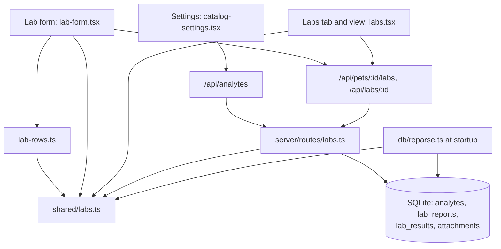
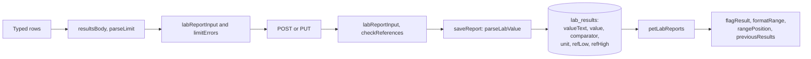
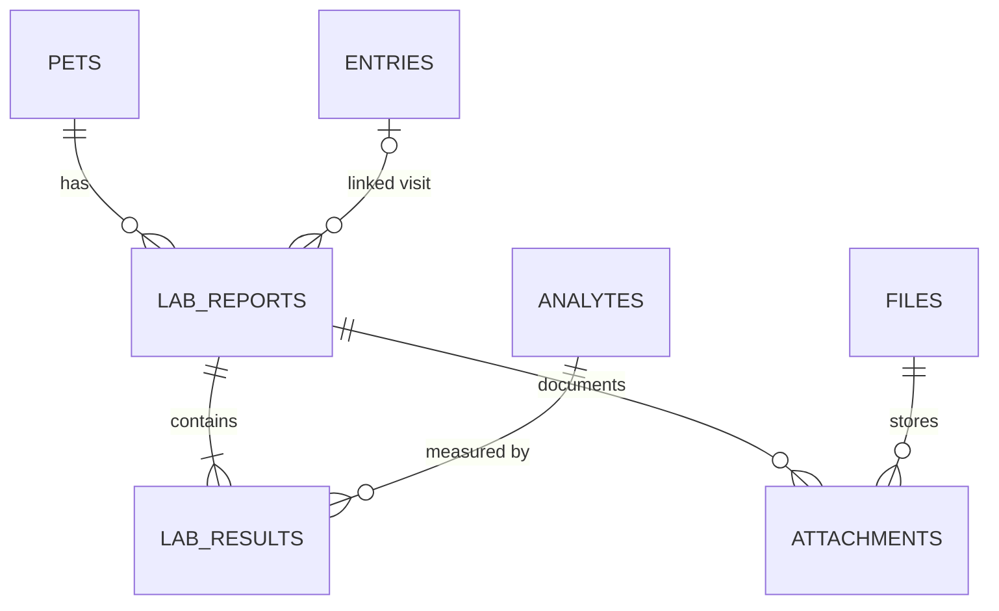

# Requirements Document: Lab Results

## Introduction

Lab results are the core of a pet's medical history in Whiskerfile. They arrive as IDEXX reference-lab PDFs or as receipt-style printouts from in-clinic analyzers, and every vet prints them a little differently. This feature lets the household type a report in by hand, test by test, exactly as it is printed, and then read it back with flags, range bars and the change since the previous result.

The project has one hard rule: the app never invents medical facts. There are no built-in reference ranges, schedules or doses. Each result stores the range printed beside it on its own document, and a high or low flag is worked out from that range every time it is shown, never stored. When a printed value cannot be read without guessing (such as `1,035`, which could be 1035 or 1.035), the app keeps the text and reads no number from it.

This spec covers the test catalog, lab reports and their results, the reading rules for printed values, flags, range display, the previous-result comparison, the entry form and the Labs tab. Filling the form from a document ("Read results from a document") belongs to the lab-document-import spec (`docs/specs/lab-document-import/spec.md`). Trend charts and cross-pet comparison, PDF health reports, the dashboard, records (visits and files) and the platform (auth, backups) have their own specs and appear here only as integration points.

## Glossary

- **Analyte**: a test that can appear on a report, such as creatinine (`CREA`). Row in `analytes`.
- **Catalog**: the household's list of analytes, seeded with common tests and editable in Settings.
- **Category**: one of `chemistry`, `electrolytes`, `cbc`, `endocrine`, `urinalysis`, `other` (`ANALYTE_CATEGORIES`).
- **Lab_Report**: one set of results from one sample, with date, source, lab, accession, notes, optional visit and documents. Row in `lab_reports`.
- **Source**: who ran the test: `reference_lab` ("Reference lab"), `in_house` ("In-clinic analyzer") or `other`.
- **Lab_Result**: one analyte's result on a report. Row in `lab_results`.
- **Value_Text**: the result exactly as printed (`1.20`, `<0.5`, `Negative`).
- **Parsed_Value**: the number and comparator read from Value_Text by `parseLabValue` (`src/shared/labs.ts`); both null when no number can be read.
- **Comparator**: `<`, `<=`, `>` or `>=`; `<` and `>` exclude the printed number, `<=` and `>=` include it.
- **Limit_Result**: a result with a comparator, such as `<0.5`.
- **Printed_Range**: `refLow` and/or `refHigh` as printed on the report; either may be missing.
- **Flag**: `high`, `low`, `normal` or none, from `flagResult`.
- **Previous_Result**: the same analyte's result on the most recent earlier report of the same pet.
- **Prefill**: the unit and range a newly added row starts with, from `prefillFor`.
- **Entry_Grid**: the results table on the lab form (`src/web/routes/lab-form.tsx`).
- **Document**: an uploaded file attached to a report as its original (`attachments.lab_report_id`).

## Requirements

### Requirement 1: Test catalog

**User Story:** As a pet owner, I want the common tests already listed, so that I can enter a report without setting anything up.

#### Acceptance Criteria

1. THE System SHALL seed 62 analytes in `drizzle/0007_seed_analytes.sql`, each with a code, name, category and an optional US conventional default unit, and with no reference range. (manual)
2. THE System SHALL return the catalog from `GET /api/analytes` ordered by sort order, then id. (`src/server/routes/labs.test.ts`)
3. THE System SHALL keep analyte codes unique (`analytes_code_unique`).
4. THE Catalog_Settings card (`src/web/components/catalog-settings.tsx`) SHALL list analytes in collapsible sections per Category, in Category order, with the count of tests, and SHALL omit a Category with no tests. (manual)
5. THE Catalog_Settings card SHALL show each test's code, name and default unit, hiding the unit below the `sm` width. (manual)

### Requirement 2: Managing the catalog

**User Story:** As a pet owner, I want to add, rename and remove tests, so that tests my vet runs that are not seeded can be recorded.

#### Acceptance Criteria

1. WHEN a test is added or edited, THE System SHALL require a code of 1 to 16 letters, digits, `/`, `+` or `-`, stored upper-cased, a name of 1 to 80 characters, a Category, and an optional default unit of up to 20 characters stored as null when blank. (`src/shared/labs.test.ts`)
2. WHEN a test is added through `POST /api/analytes`, THE System SHALL give it a sort order 10 above the highest existing one, so it lists last, and answer 201. (`src/server/routes/labs.test.ts`)
3. IF an added or edited code is already in the catalog, THEN THE System SHALL answer 400 with the field error `code: "Already in the catalog"`. (`src/server/routes/labs.test.ts`)
4. WHEN a test is edited through `PUT /api/analytes/:id`, THE System SHALL update its code, name, Category and default unit, which existing results show because they are joined to the catalog when read; IF the test does not exist, THEN THE System SHALL answer 404. (`src/server/routes/labs.test.ts`)
5. IF any Lab_Result uses a test, THEN `DELETE /api/analytes/:id` SHALL answer 409 "Lab results use this test, so it can't be removed" and keep it; otherwise it SHALL delete it (204), or answer 404 for an unknown id. (`src/server/routes/labs.test.ts`)
6. WHEN the add/edit dialog is submitted, THE Catalog_Settings card SHALL validate with `analyteInput` before sending, show field errors beside their fields, and show a refused delete's message in the dialog. (manual)

### Requirement 3: Lab reports

**User Story:** As a pet owner, I want each report kept with its date, lab and original document, so that I can trace every number back to the paper.

#### Acceptance Criteria

1. THE System SHALL require a valid ISO sample date and a Source, and accept an optional lab (up to 80 characters), accession (up to 60) and notes (up to 4000), each stored as null when blank. (`src/shared/labs.test.ts`)
2. THE System SHALL require 1 to 200 results and at most 20 Documents per report, and refuse the same analyte twice with "Already in this report" on the repeated row. (`src/shared/labs.test.ts`, `src/server/routes/labs.test.ts`)
3. IF a report names a visit of another pet, an unknown analyte or an unknown file, THEN THE System SHALL answer 400 with `entryId: "Not a visit of this pet"`, `results.N.analyteId: "Unknown test"` (the first unknown) or `fileIds: "Unknown file"`, and write nothing. (`src/server/routes/labs.test.ts`)
4. WHEN a report is created (`POST /api/pets/:id/labs`, 201) or edited (`PUT /api/labs/:id`, 200), THE System SHALL save the report, its results and its Documents in one transaction; IF the pet or report does not exist, THEN THE System SHALL answer 404. (`src/server/routes/labs.test.ts`)
5. WHEN a report is edited, THE System SHALL update results of analytes still on it in place (keeping their ids), delete results no longer on it, add new ones, and keep the original author. (`src/server/routes/labs.test.ts`)
6. WHEN a report is saved, THE System SHALL date every attached Document with the report's date; WHEN `fileIds` is given, THE System SHALL attach exactly those files, and WHEN it is omitted, THE System SHALL leave the Documents as they were. (`src/server/routes/labs.test.ts`)
7. WHEN a report is deleted (204), THE System SHALL remove its results and attachments and keep the stored files; a second delete SHALL answer 404. (`src/server/routes/labs.test.ts`)
8. WHEN the linked visit is deleted, THE System SHALL keep the report and clear its visit link; WHEN the pet is deleted, THE System SHALL remove its reports and results. (`src/server/routes/labs.test.ts`)
9. THE System SHALL keep a report's Documents out of the pet's own file list, and `PUT /api/attachments/:id` SHALL answer 404 for them. (`src/server/routes/labs.test.ts`)
10. THE System SHALL return a pet's reports from `GET /api/pets/:id/labs` newest first (by date, then id), each with its author's name, its results in catalog order with code, name and Category, and its Documents. (`src/server/routes/labs.test.ts`)

### Requirement 4: Results stored as printed

**User Story:** As a pet owner, I want the result kept exactly as the lab printed it, so that nothing is lost or reinterpreted.

#### Acceptance Criteria

1. THE System SHALL store each result's Value_Text (trimmed, 1 to 40 characters), its unit (up to 20 characters, null when blank) and its Printed_Range as finite numbers or null. (`src/shared/labs.test.ts`)
2. IF `refLow` is greater than `refHigh`, THEN THE System SHALL refuse the result with "Must be at least the low limit" on `refHigh`. (`src/shared/labs.test.ts`)
3. WHEN a result is saved, THE System SHALL store the Parsed_Value of its Value_Text alongside it, read on the server. (`src/server/routes/labs.test.ts`)
4. THE System SHALL never supply a reference range itself: no seed, default or catalog field holds one.

### Requirement 5: Reading printed values

**User Story:** As a pet owner, I want numbers read from results the way reports print them, so that flags and trends work, without the app guessing.

#### Acceptance Criteria

1. THE `parseLabValue` function SHALL ignore surrounding and inner whitespace and read plain decimals (`1.20`, `.5`). (`src/shared/labs.test.ts`)
2. WHEN Value_Text starts with `<`, `<=`, `≤`, `>`, `>=` or `≥`, THE function SHALL read the matching Comparator (`≤` as `<=`, `≥` as `>=`) and the number after it. (`src/shared/labs.test.ts`)
3. THE function SHALL read a leading hyphen or Unicode minus sign (U+2212) as a negative number, including after a Comparator (`<-3`). (`src/shared/labs.test.ts`)
4. THE function SHALL read unambiguous thousands groups (`2,000,000`, `1,234.5`) and decimal commas (`4,5`, `0,500`, `12,25`). (`src/shared/labs.test.ts`)
5. IF a comma is followed by exactly one group of three digits after a non-zero lead (`1,035`, `>2,000`), THEN THE function SHALL read no number. (`src/shared/labs.test.ts`)
6. IF Value_Text is not a number in these forms (`Negative`, `2+`, `Trace`, `1.2.3`, `--1`, `1e3`), THEN THE function SHALL return no number and no Comparator. (`src/shared/labs.test.ts`)

### Requirement 6: Re-reading stored results at startup

**User Story:** As a pet owner, I want old results to follow the current reading rules, so that a rule fixed later also fixes results entered before it.

#### Acceptance Criteria

1. WHEN the database is opened, after migrations apply, THE System SHALL re-read every stored result's Parsed_Value from its Value_Text (`reparseLabResults`, `src/server/db/reparse.ts`). (`src/server/db/reparse.test.ts`)
2. THE System SHALL update only rows whose stored number or Comparator differs, in one transaction, so a second run changes nothing. (`src/server/db/reparse.test.ts`)

### Requirement 7: Flags

**User Story:** As a pet owner, I want results outside their printed range marked, and never marked when that cannot be told.

#### Acceptance Criteria

1. THE System SHALL work out each Flag from the stored Parsed_Value and Printed_Range when shown, and SHALL NOT store it.
2. WHEN a plain number is below `refLow` or above `refHigh`, THE System SHALL flag it `low` or `high`; at or between the limits of a one- or two-sided range it SHALL flag it `normal`. (`src/shared/labs.test.ts`)
3. IF a result has no number or no range, THEN THE System SHALL give no Flag. (`src/shared/labs.test.ts`)
4. WHEN a Limit_Result is shown, THE System SHALL flag it only when every value it allows is on one side: `<x` low when x ≤ refLow, `≤x` low when x < refLow, `>x` high when x ≥ refHigh, `≥x` high when x > refHigh, `normal` when it lies within a one-sided range, and no Flag when its values straddle a limit (`≤0.8` against a low limit of 0.8). (`src/shared/labs.test.ts`)
5. THE System SHALL show `high` as a red "High" badge and `low` as an amber "Low" badge, and no badge for `normal`. (manual)

### Requirement 8: Ranges and range position

**User Story:** As a pet owner, I want to see each printed range and where the result sits in it, so that I can judge how far out a value is.

#### Acceptance Criteria

1. THE `formatRange` function SHALL show `0.8–2.4` for two limits, `≤ 14` for a high limit only, `≥ 1.035` for a low limit only, and nothing without a range. (`src/shared/labs.test.ts`)
2. WHEN a result has a number and a two-sided range with `refHigh` above `refLow`, THE Range_Bar SHALL place the range in the middle 60% of the bar and the result's dot at `0.2 + 0.6 × (value − low) / (high − low)`, clamped to the bar's ends; otherwise it SHALL show no bar. (`src/shared/labs.test.ts`)
3. THE Range_Bar dot SHALL take the Flag's colour (grey with no Flag) and be dimmed for a Limit_Result. (manual)

### Requirement 9: Previous-result comparison

**User Story:** As a pet owner, I want each result shown next to the last one for the same test, so that I can see what changed.

#### Acceptance Criteria

1. THE `previousResults` function SHALL take, for each result, the same analyte's result on the most recent earlier report of the pet, earlier meaning an earlier date or the same date with a lower id. (`src/shared/labs.test.ts`)
2. WHEN both results are plain numbers (no Comparator) in the same unit, THE System SHALL show their difference rounded to six decimal places, with `+` or a minus sign; otherwise it SHALL show no change. (`src/shared/labs.test.ts`)
3. WHEN the units differ, including one result with no unit, THE Report_View SHALL show the previous unit (or "no unit") highlighted with the hint "Different unit from this result". (manual)
4. IF no earlier result exists, THEN THE Report_View SHALL show "—". (manual)

### Requirement 10: Entering results

**User Story:** As a pet owner, I want a keyboard-friendly grid that starts from my pet's earlier reports, so that typing in a long panel is quick.

#### Acceptance Criteria

1. WHEN a new report is started, THE Lab_Form SHALL default the sample date to today, the Source to "Reference lab", and offer the pet's other reports' labs as suggestions for the lab field. (manual)
2. THE Lab_Form SHALL offer only the pet's vet visits (date · reason) or "Not linked to a visit" for the visit link, and SHALL let several Documents be attached and removed before saving. (manual)
3. THE Lab_Form SHALL add tests by "Add a test…" (tests not yet on the form, grouped by Category), by a chip per Category (all its tests not yet present), and by "Same tests as <date>" (the tests on the pet's latest other report). (manual)
4. WHEN a test is added, THE Lab_Form SHALL leave its result blank and Prefill its unit and range from the pet's most recent other result for that test, preferring one whose lab matches the lab field (trimmed, case-insensitive), else the catalog's default unit and no range. (`src/shared/labs.test.ts`)
5. WHEN Enter is pressed in a cell, THE Entry_Grid SHALL move to the same column in the next row (Shift+Enter: previous row) and select its text instead of submitting; each row's remove button SHALL come last in its Tab order. (manual)
6. WHILE a row's result and limits read as numbers, THE Entry_Grid SHALL preview its High or Low badge. (manual)
7. THE Entry_Grid SHALL lay rows out as a table when its own width reaches the `@2xl` container size and as cards below it, with flag and remove beside the test name. (manual)

### Requirement 11: Validating rows

**User Story:** As a pet owner, I want mistakes shown on the row they belong to, so that I can fix them before saving.

#### Acceptance Criteria

1. THE Lab_Form SHALL send only rows with a result typed in. (`src/web/lib/lab-rows.test.ts`)
2. THE `parseLimit` function SHALL read a blank limit as none, a signed decimal or exponent number as itself, the Unicode minus as a hyphen, and commas as `parseLabValue` does; an ambiguous comma, a Comparator or other text SHALL be refused as "Enter a number". (`src/web/lib/lab-rows.test.ts`)
3. THE System SHALL show every stored limit so that reading it back gives the same number. (`src/web/lib/lab-rows.test.ts`)
4. WHEN the form is submitted, THE Lab_Form SHALL check limits and `labReportInput` locally, refuse a future sample date with "Can't be in the future", and send nothing while any error remains. (manual)
5. THE System SHALL move local and server errors about `results.N` onto the Nth sent row, skipping blank rows, and keep other errors on their own fields; the form SHALL then say "Check the highlighted fields." (`src/web/lib/lab-rows.test.ts`)
6. WHILE a Document is uploading or being read, THE Lab_Form SHALL not save. (manual)

### Requirement 12: The Labs tab and report view

**User Story:** As a pet owner, I want a list of reports and a readable view of each, so that I can find what was out of range.

#### Acceptance Criteria

1. THE Labs_Tab (`src/web/components/labs.tsx`) SHALL list the pet's reports newest first with the date, the lab (or Source when none), the result count and codes, and badges "N high", "N low", or "In range" when every result is `normal`; with no reports it SHALL show "No lab results yet." and "Add lab results". (manual)
2. THE Report_View SHALL show the date, Source, high and low counts, lab, accession, linked visit, "Added by", notes and Documents, with links back to the list and to Edit. (manual)
3. THE Report_View SHALL group results by Category in Category order, skipping empty ones, with test name and code, result as printed with its badge, unit, range ("—" when none), Range_Bar and Previous_Result. (manual)
4. WHILE the width is below `md`, THE Report_View SHALL show unit and range under the value; the Range_Bar SHALL hide below `sm` and the Previous column below `lg`. (manual)
5. WHEN a report is saved, THE Lab_Form SHALL wait for the pet's data to refetch, then open the report's view; WHEN deleted after "Confirm delete", it SHALL return to the list. (manual)
6. IF the report in an edit or view URL does not exist, THEN THE System SHALL show "This lab report doesn't exist." (manual)

### Requirement 13: Access

**User Story:** As a household member, I want lab data behind sign-in, so that only my household sees it.

#### Acceptance Criteria

1. THE System SHALL wrap every lab and catalog route in `authed()` and answer 401 without a session. (`src/server/app.test.ts`)

## Diagrams

### Component Diagram

### Data Flow

### Data Model

## Constraints

- Tables `analytes`, `lab_reports`, `lab_results` and the `attachments.lab_report_id` column are defined in `src/server/db/schema.ts` and created by `drizzle/0006_labs.sql`; the seed is `drizzle/0007_seed_analytes.sql`. `lab_results` is unique on (report, analyte).
- Reading, flagging, range and comparison logic lives in `src/shared/labs.ts` and is used unchanged by server and browser; the server, not the client, computes the stored Parsed_Value.
- Validation uses the shared zod schemas `labReportInput`, `labResultInput` and `analyteInput` on both sides.
- No reference range, flag or interpretation is ever stored or supplied by the app; only Value_Text, Parsed_Value, unit and Printed_Range are stored.
- Every `/api/*` route here is wrapped in `authed()` and listed in the 401 lists of `src/server/app.test.ts`.
- Integration points: report Documents use the shared file store (`/api/files`, `FileChip`, `uploadOriginal`); reports feed the timeline, files tab, trends, comparison, the dashboard's flagged results (`latestLab` on `/api/pets`) and PDF reports, each specified elsewhere.

## Correctness Properties

### Property 1: Stored number matches printed text

*For any* stored Lab_Result, after a save or a startup re-read, its `value` and `comparator` equal `parseLabValue(valueText)`.

**Validates: Requirements 4.3, 6.1**

### Property 2: Re-reading is idempotent

*For any* database, running `reparseLabResults` a second time changes no rows.

**Validates: Requirements 6.2**

### Property 3: Ambiguous commas are never read

*For any* text whose number part is a non-zero digit run of one to three digits, a comma and exactly three digits, `parseLabValue` returns no number.

**Validates: Requirements 5.5**

### Property 4: Flags are sound for limit results

*For any* Limit_Result and Printed_Range, `flagResult` returns `high`, `low` or `normal` only if every value the result allows has that Flag against the range; otherwise it returns none.

**Validates: Requirements 7.2, 7.4**

### Property 5: Prefill never invents a range

*For any* analyte and set of earlier reports, the range from `prefillFor` is either the range of one of the pet's earlier results for that analyte or empty.

**Validates: Requirements 4.4, 10.4**

### Property 6: Limits survive display

*For any* finite stored limit `n`, `parseLimit(limitText(n))` equals `n`.

**Validates: Requirements 11.3**

### Property 7: One result per test per report

*For any* saved report, no analyte appears twice, and editing keeps the id of every result whose analyte stays on the report.

**Validates: Requirements 3.2, 3.5**

### Property 8: Tests in use cannot be removed

*For any* analyte referenced by at least one Lab_Result, deleting it fails with 409 and leaves the catalog unchanged.

**Validates: Requirements 2.5**

### Property 9: Documents share the report's date

*For any* saved report, every attachment linked to it carries the report's date.

**Validates: Requirements 3.6**

## Out of Scope

- Built-in, default or species-specific reference ranges, and any interpretation beyond high, low or normal against the printed range.
- Storing flags; flagging qualitative results (`Negative`, `2+`, `Trace`).
- Unit conversion; results in different units are shown side by side but never subtracted.
- Reading exponent notation in results (`1e3`) or space-grouped thousands as a deliberate format.
- Reordering the catalog (sort order is set only when a test is added), merging tests, and deleting a test that has results.
- Filling the form from a PDF or photo ("Read results from a document", `applyDraftResults`): see `docs/specs/lab-document-import/spec.md`.
- Trend charts, cross-pet comparison, the dashboard summary, PDF health reports and the timeline and files tabs, which consume lab reports under their own specs.
