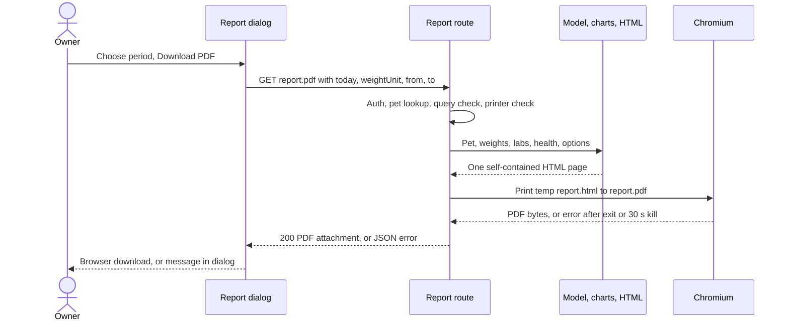
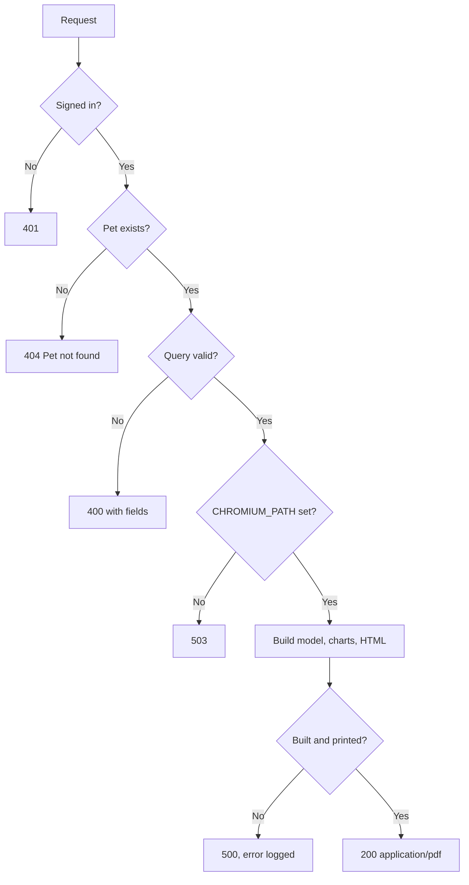

# Requirements Document: PDF Health Reports

## Introduction

A PDF health report gives an owner one document to hand a vet: the pet's details, weight, lab results with trend charts, vaccinations, medications and conditions, for all records or a chosen period. The **Report** button on a pet's page downloads it.

The server builds the report. `GET /api/pets/:id/report.pdf` reads the pet's records, works out a Report_Model, renders it with React `renderToStaticMarkup` into one self-contained HTML page (inline print CSS, the app's fonts and the pet's photo as data URLs, charts as SVG strings drawn by ECharts server-side rendering with the shared `PRINT_THEME`), writes that page to a temporary file and has headless Chromium print it to PDF. An earlier plan had Chromium print an SPA route reached with an internal single-use token. It was replaced, so every route stays behind `authed()` and Chromium never calls back into the app.

The browser sends its own date and weight unit, because the server runs in UTC and does not know the reader's preferences. Without `CHROMIUM_PATH` the route answers 503. The Docker image installs Debian `chromium` and runs under `tini`.

Integration points owned by other specs: pet profiles (pet fields, photo and its preview, chip registry), weigh-ins (`measurements` of kind `weight`, stored in grams), lab reports (`petLabReports`, `flagResult`, `labSeries`), vaccinations, medications and conditions (`petHealth`, `vaccineStatus`, `medicationState`), trend charts (`weightTrendOption`, `labTrendOption`, `PRINT_THEME` in `src/shared/trend-options.ts`), display units (`useUnits`) and Cloudflare Access sign-in (`authed()`).

## Glossary

- **Report_Route**: `GET /api/pets/:id/report.pdf` in `src/server/routes/reports.ts`.
- **Reader_Date**: the `today` query parameter, the reader's local date (`YYYY-MM-DD`). Statuses, ages and the file name use it.
- **Report_Period**: the optional `from` and `to` dates. A missing bound is open.
- **In_Period**: a dated record is In_Period when its date is on or after `from` (if set) and on or before `to` (if set).
- **Overlap_Rule**: a record with a start and an optional end (a medication course, a condition) belongs to the period when it starts on or before `to` (if set) and has no end or ends on or after `from` (if set).
- **Report_Model**: the output of `reportModel()` in `src/server/report/model.ts`.
- **Report_Page**: the HTML document returned by `reportHtml()` in `src/server/report/html.tsx`.
- **Printer**: the `RenderPdf` function from `chromiumPdf()` in `src/server/report/pdf.ts`.
- **Trend**: a lab test with two or more results in one unit in the period, drawn as a chart.
- **Latest_Dose**: a vaccine's most recent dose across all the pet's doses, matched by `vaccineKey`.
- **Report_Dialog**: `ReportButton` and its dialog in `src/web/components/report-dialog.tsx`.

## Requirements

### Requirement 1: Report download

**User Story:** As an owner, I want a pet's health report as a PDF file, so that I can send or print it for a vet.

#### Acceptance Criteria

1. THE Report_Route SHALL be wrapped in `authed()`, and an unauthenticated request SHALL get 401. (`src/server/app.test.ts`)
2. WHEN the request succeeds, THE Report_Route SHALL answer 200 with `Content-Type: application/pdf`, `Content-Disposition: attachment; filename="<slug>-health-report-<Reader_Date>.pdf"` and the Printer's bytes as the body. (`src/server/routes/reports.test.ts`)
3. THE slug SHALL be the pet's name NFKD-normalised, lowercased, with each run of characters other than `a-z0-9` replaced by `-` and leading and trailing dashes removed; `Tom & "Jerry" <b>` gives `tom-jerry-b`. (`src/server/routes/reports.test.ts`)
4. IF the slug comes out empty, THE Report_Route SHALL use `pet`. (manual)
5. WHEN a report request arrives, THE Report_Route SHALL raise that request's idle timeout to `PDF_TIMEOUT_SECONDS + 5` (35 s), since Bun drops a request idle for 10 s. (manual)

### Requirement 2: Query validation

**User Story:** As an owner, I want a report dated and measured the way I read them, so that statuses and weights match what I see in the app.

#### Acceptance Criteria

1. THE Report_Route SHALL require `today` as a real calendar date (`YYYY-MM-DD`) and `weightUnit` as `kg` or `lb`. (`src/server/routes/reports.test.ts`)
2. THE Report_Route SHALL accept optional `from` and `to`, each a real calendar date. (`src/server/routes/reports.test.ts`)
3. IF `from` and `to` are both valid and `to` is earlier than `from`, THE Report_Route SHALL reject the request with the field `to` ("Must be on or after the start"); `to` equal to `from` is accepted. (`src/server/routes/reports.test.ts`)
4. IF the query is invalid, THE Report_Route SHALL answer 400 with `{ error: "Some fields are invalid", fields }`, where `fields` maps each invalid parameter to its first message; a missing `today` and `weightUnit`, or `today=2026-02-30&weightUnit=stone`, give the fields `today` and `weightUnit`. (`src/server/routes/reports.test.ts`)

### Requirement 3: Failure responses

**User Story:** As an owner, I want a clear reason when a report can't be made, so that I know whether to fix the request or the server.

#### Acceptance Criteria

1. IF the id is not a positive integer or no pet has it, THE Report_Route SHALL answer 404 "Pet not found" before validating the query. (`src/server/routes/reports.test.ts`)
2. IF no Printer is configured, THE Report_Route SHALL answer 503 with `{ error: "PDF reports need Chromium; set CHROMIUM_PATH" }`, after validating the query. (`src/server/routes/reports.test.ts`)
3. IF the Printer throws, or building the page fails before printing (the model, charts, photo, fonts or HTML), THE Report_Route SHALL log `Report for pet <id> failed:` with the error and answer 500 with `{ error: "The PDF couldn't be made. The server log says why." }`. (`src/server/routes/reports.test.ts`)

### Requirement 4: Report period

**User Story:** As an owner, I want to limit a report to a period, so that a vet sees only the records that matter for a visit.

#### Acceptance Criteria

1. WHILE no Report_Period is set, THE Report_Model SHALL include every record. (`src/server/report/model.test.ts`)
2. THE Report_Model SHALL keep weights, lab reports and vaccination doses that are In_Period, by weigh-in date, report date and date given. (`src/server/report/model.test.ts`)
3. THE Report_Model SHALL keep medications and conditions that meet the Overlap_Rule, so a condition begun before the period and still ongoing is kept. (`src/server/report/model.test.ts`)
4. THE Report_Page header SHALL show the period as "<from> to <to>", "Since <from>", "Up to <to>" or "All records". (manual)

### Requirement 5: Statuses as of the Reader_Date

**User Story:** As an owner, I want due dates and medication states judged by my date, so that the report agrees with the app on the day I print it.

#### Acceptance Criteria

1. THE Report_Model SHALL compute vaccine statuses with `vaccineStatus` over all the pet's doses, not only those in the period: the Latest_Dose of each vaccine is `overdue` when its due date is before the Reader_Date and `due-soon` when it falls within 30 days; earlier doses carry no status and are marked not latest. (`src/server/report/model.test.ts`)
2. THE Report_Model SHALL give each medication `medicationState` as of the Reader_Date: `past` once ended, `upcoming` before it starts, otherwise `current`. (`src/server/report/model.test.ts`)
3. THE Report_Model SHALL give the pet's age from its birth date to the Reader_Date with `formatAge`, and none when the birth date is unknown. (`src/server/report/model.test.ts`)
4. WHILE the pet has a `deceasedOn` date, THE Report_Model SHALL give the age at death, no vaccine status, and every medication as `past` when death is on or before the Reader_Date. (`src/server/report/model.test.ts`)

### Requirement 6: Weights

**User Story:** As an owner, I want weights in my unit with a chart, so that the vet sees the trend without converting.

#### Acceptance Criteria

1. THE Report_Model SHALL convert each weight from grams to the requested unit with `fromGrams`, rounded to two decimals, oldest first. (`src/server/report/model.test.ts`)
2. THE Report_Page SHALL show the latest weight to two decimals with its unit and date, and, with more than one weigh-in, their count and first date. (`src/server/routes/reports.test.ts` checks `9.04 lb`; the rest is manual)
3. WHEN the period holds two or more weights, THE Report_Route SHALL draw a weight chart; with one it SHALL draw none, and with none the section SHALL read "No weights recorded.". (`src/server/routes/reports.test.ts` checks the chart; the rest is manual)

### Requirement 7: Lab trends

**User Story:** As an owner, I want a trend chart for each repeated test, so that the vet sees changes across reports.

#### Acceptance Criteria

1. THE Report_Model SHALL build one Trend per test from the in-period lab reports with `labSeries`, which draws only the unit of the most recent numeric result. (`src/server/report/model.test.ts`)
2. THE Report_Model SHALL keep only Trends with two or more drawn points, so a test with two results in different units gets no Trend. (`src/server/report/model.test.ts`)
3. THE Report_Model SHALL order Trends by the test catalog's `sortOrder`, not by the order results are met. (`src/server/report/model.test.ts`)
4. WHEN at least one Trend exists, THE Report_Page SHALL show a "Lab trends" section in two columns, each chart titled with the test name, its code when it differs, and the unit, and SHALL say how many results in another unit were not drawn; with no Trend the section SHALL be left out. (manual)

### Requirement 8: Report contents

**User Story:** As a vet, I want every record laid out in consistent tables, so that I can read the report quickly.

#### Acceptance Criteria

1. THE Report_Page header SHALL show the photo (when there is one), the name, species, breed and age, and the facts Sex, Born ("About" when estimated, "Unknown" when not known), Coat, Eyes, Microchip with registry, Passed away (each only when set) and Records (the period), followed by the pet's notes. (`src/server/routes/reports.test.ts` checks the age and notes; the rest is manual)
2. THE Report_Page SHALL show the sections Weight, Lab trends (Requirement 7.4), Lab results, Vaccinations, Medications and Conditions in that order, and a footer "Prepared <Reader_Date> from Whiskerfile." with a note on reference ranges. (manual)
3. THE Lab results section SHALL list lab reports newest first, each headed by date, lab name (or source label) and accession, with a table of test, result, unit, range and a High or Low flag, and the report's notes; with none it SHALL read "No lab reports.". (`src/server/report/model.test.ts` checks order and flags; the layout is manual)
4. THE Vaccinations table SHALL show vaccine, given, next due, clinic and lot; next due SHALL be the date for a Latest_Dose, "Superseded" for an earlier dose with a due date, and SHALL add "Overdue" or "Due soon". (manual)
5. THE Medications table SHALL show drug (marked "current" or "not started"), dose and frequency, dates ("<start> to <end>" or "<start> onwards") and reason; the Conditions table SHALL show title, type, dates ("<date> to <resolved>" or "ongoing") and notes. Empty tables SHALL read "None recorded.". (manual)
6. THE Report_Page SHALL print each vaccination's and medication's notes under its name, and each condition's notes in its own column. (`src/server/routes/reports.test.ts`)
7. THE Report_Page SHALL give each kind of table fixed column widths (`table-layout: fixed` with a `colgroup`), repeat table headers on each printed page (`thead` as `table-header-group`), avoid breaking rows, charts and lab reports across pages, and use page margins of 14 mm, 14 mm and 16 mm. (manual)

### Requirement 9: Self-contained, safe page

**User Story:** As an owner, I want the report to show my typed text as text and load nothing from outside, so that a pet's notes can never run code or reach the network.

#### Acceptance Criteria

1. THE Report_Page SHALL escape all typed text, including the pet's name in the `<title>` ("<name>: health report") and in the body. (`src/server/routes/reports.test.ts`)
2. THE Report_Page SHALL carry `<meta http-equiv="Content-Security-Policy" content="default-src 'none'; img-src data:; font-src data:; style-src 'unsafe-inline'">`. (`src/server/routes/reports.test.ts`)
3. THE Report_Page SHALL embed Inter Variable and JetBrains Mono (Latin subsets, read from `node_modules` and cached once the read succeeds, so one failed read is retried on the next report instead of breaking every later one) and the pet's photo as data URLs, using the photo's preview when one exists and leaving the photo out when its file is missing. (the retry: `src/server/routes/reports.test.ts`; the rest is manual)
4. THE Report_Page SHALL insert charts as raw SVG strings drawn only from the app's own chart options. (manual)

### Requirement 10: Charts

**User Story:** As a vet, I want printed charts that look like the app's, so that a trend reads the same on paper.

#### Acceptance Criteria

1. THE charts module SHALL draw charts with ECharts' SVG renderer in server-side mode (`ssr: true`) and return `renderToSVGString()`, disposing each chart afterwards. (`src/server/routes/reports.test.ts` checks an `<svg` in the page)
2. THE weight chart SHALL be 680 by 220 and each trend chart 330 by 160, drawn with `weightTrendOption` and `labTrendOption` under `PRINT_THEME` in the pet's chart colour. (manual)
3. THE chart options built with `PRINT_THEME` SHALL have no data zoom, no animation and no tooltip, and use paper colours. (`src/shared/trend-options.test.ts`)

### Requirement 11: Chromium printer

**User Story:** As a self-hoster, I want printing to work as any user and never hang, so that one stuck print can't wedge the server.

#### Acceptance Criteria

1. WHEN printing, THE Printer SHALL make a temporary directory `whiskerfile-report-*`, write the page to `report.html` in it, and run Chromium on its `file://` URL with `--headless --no-sandbox --disable-gpu --disable-dev-shm-usage --no-first-run --no-default-browser-check --no-pdf-header-footer`, `--user-data-dir` inside that directory and `--print-to-pdf` to `report.pdf` there. (manual)
2. THE Printer SHALL set `HOME`, `XDG_CONFIG_HOME` and `XDG_CACHE_HOME` inside the temporary directory, so it needs no writable home. (manual)
3. THE Printer SHALL send Chromium's stderr to a file, not a pipe, so a helper that outlives the browser can't hold the wait open. (`src/server/report/pdf.test.ts`)
4. IF Chromium runs longer than `PDF_TIMEOUT_SECONDS` (30 s), THE Printer SHALL kill it with SIGKILL. (manual)
5. IF Chromium exits non-zero, is killed, or leaves no PDF, THE Printer SHALL throw `Chromium exited with <code>: <tail>` or `Chromium was stopped (<signal>): <tail>`, where the tail is the last three stderr lines joined by ` / `. (`src/server/report/pdf.test.ts` checks the exit-code form; the killed form is manual)
6. THE Printer SHALL remove its temporary directory after every run, whether it succeeded or failed. (`src/server/report/pdf.test.ts`)
7. WHERE `CHROMIUM_PATH` is set when tests run, a real Chromium SHALL print a report whose bytes start with `%PDF-`. (`src/server/routes/reports.test.ts`, skipped without `CHROMIUM_PATH`)

### Requirement 12: Configuration and image

**User Story:** As a self-hoster, I want reports to work in the Docker image out of the box and be optional elsewhere, so that I can run the app without a browser if I choose.

#### Acceptance Criteria

1. WHERE `CHROMIUM_PATH` names a binary, THE server SHALL configure `chromiumPdf` with it; WHILE it is empty or unset, no Printer SHALL be configured and reports SHALL answer 503. (manual)
2. THE Docker image SHALL install Debian `chromium` and `tini` without recommended packages and set `CHROMIUM_PATH=/usr/bin/chromium`. (manual)
3. THE Docker image SHALL run under `ENTRYPOINT ["/usr/bin/tini", "--"]`, so Chromium's leftover helper processes are reaped instead of left as zombies under Bun as PID 1. (manual)

### Requirement 13: Report button and dialog

**User Story:** As an owner, I want a Report button on a pet's page that asks for an optional period, so that I can download the report in a couple of clicks on desktop or phone.

#### Acceptance Criteria

1. THE pet profile page SHALL show a **Report** button beside **Edit**, which opens a "Health report" dialog with optional From and To date inputs, each limiting the other with `min` and `max`. (manual)
2. WHEN the owner submits, THE Report_Dialog SHALL request the report with `today` from `localToday()`, `weightUnit` from the owner's display unit (`useUnits`), and `from` and `to` only when filled in. (manual)
3. WHEN the PDF arrives, THE Report_Dialog SHALL download it under the server's file name (`health-report.pdf` if none is given) and close. (manual)
4. WHILE the request is pending, THE Report_Dialog SHALL label the submit button "Preparing…", disable Cancel and submit, and ignore backdrop clicks; closing with the header close button or Escape cancels the request, so no download finishes behind a closed dialog. (manual)
5. IF the request fails, THE Report_Dialog SHALL highlight the From or To field the server names and say "Check the highlighted fields."; when the server names neither (such as `today` or `weightUnit` from an old client), or on any other failure, it SHALL show the server's error message (such as the 503 message); reopening the dialog SHALL clear the error. (manual)
6. THE Report_Dialog SHALL fill the screen on phone widths, stack its date inputs and buttons there, and set them side by side from the `sm` breakpoint. (manual)

## Diagrams

### Request flow

### Response decisions

## Constraints

- Every `/api/*` handler, this one included, is wrapped in `authed()` and listed in the 401 checks in `src/server/app.test.ts`. No internal, token-based or unauthenticated route serves the report.
- The page is static HTML from `renderToStaticMarkup`; it runs no script, and its policy forbids every file and network load. Chromium runs with `--no-sandbox` because containers rarely allow its namespaces, which is acceptable only because of that policy.
- Charts reuse `weightTrendOption`, `labTrendOption` and `PRINT_THEME` from `src/shared/trend-options.ts`, so print and screen agree.
- The server does not guess the reader's date or unit; the browser sends both.
- Outside Docker, `CHROMIUM_PATH` points at any Chromium or headless-shell binary; Playwright's `chromium-headless-shell` (`headless_shell`) works where full Chrome's headless mode can hang.

## Correctness Properties

### Property 1: Period membership

*For any* set of records and any Report_Period, every kept weight, lab report and vaccination dose is In_Period, every kept medication and condition meets the Overlap_Rule, and no record meeting its rule is dropped.

**Validates: Requirements 4.2, 4.3**

### Property 2: Statuses ignore the period

*For any* Report_Period, each vaccination's status and latest flag, and each medication's state, equal what `vaccineStatus` and `medicationState` give for all the pet's records on the Reader_Date.

**Validates: Requirements 5.1, 5.2, 5.4**

### Property 3: Trends are drawable and ordered

*For any* lab reports, every Trend has at least two points in a single unit, and Trends are in non-decreasing catalog `sortOrder`.

**Validates: Requirements 7.1, 7.2, 7.3**

### Property 4: Typed text cannot become markup

*For any* pet name, notes or record text, the Report_Page contains it only escaped, and the page contains no `<script>` element.

**Validates: Requirements 9.1, 9.2**

### Property 5: Safe file name

*For any* pet name, the slug matches `^[a-z0-9]+(-[a-z0-9]+)*$` or is `pet`.

**Validates: Requirements 1.3, 1.4**

### Property 6: No leftovers

*For any* print, succeeded, failed or killed, the Printer's temporary directory no longer exists when it returns or throws.

**Validates: Requirements 11.5, 11.6**

## Out of Scope

- Printing an SPA route through an internal single-use token (the original plan, replaced by the static page).
- Non-Latin text in the embedded fonts: only the Latin subsets of Inter and JetBrains Mono are embedded, so other scripts fall back to whatever fonts Chromium finds, if any (known limitation).
- Reports for several pets at once, scheduled or emailed reports, and storing generated PDFs.
- Choosing sections, a temperature unit, or a page size; the PDF uses Chromium's default paper size.
- Chromium's own sandbox, and any page script or network access.
- Server-side detection of the reader's date, time zone or units.
- Hiding the Report button when Chromium is not configured; the dialog shows the 503 message instead.
