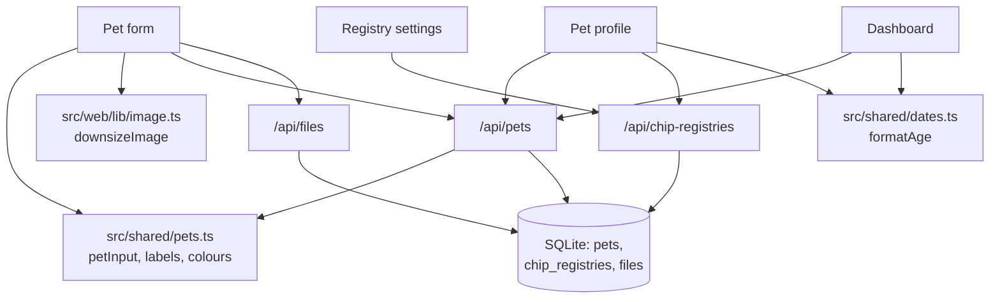
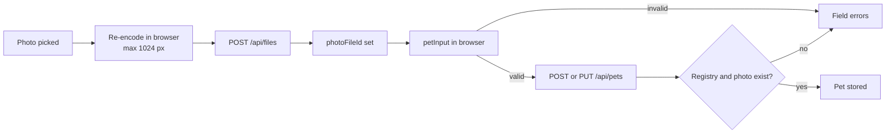
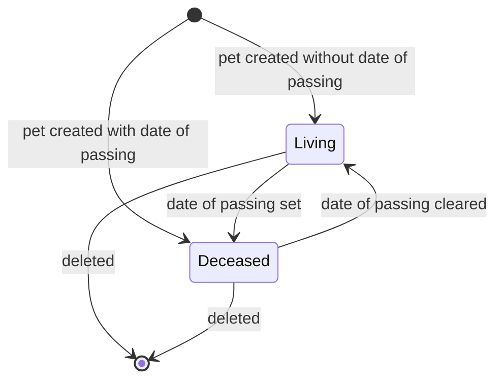

# Requirements Document: Pet Profiles

## Introduction

Pet profiles are the root of Whiskerfile. Every other record (visits, weights, files, lab reports, vaccinations, medications, conditions, PDF reports) belongs to a pet. A profile holds the pet's identity: name, species, breed, sex and spay/neuter status, date of birth (exact or estimated), date of passing, coat and eye colour, microchip number and registry, a photo, free-form notes, and the colour used for the pet's lines in charts.

The users are a few household members behind Cloudflare Access. Everyone has equal access: any signed-in member can add, edit or delete any pet. Cats come first (the form defaults to Cat), but dogs and other species are supported.

This spec documents the feature as built. It covers the pets and chip-registry API, the shared validation in `src/shared/pets.ts`, age calculation in `src/shared/dates.ts`, photo downsizing in `src/web/lib/image.ts`, the pet form (`src/web/routes/pet-form.tsx`), the profile header and Details card (`src/web/routes/pet-profile.tsx`), registry settings (`src/web/components/registries-settings.tsx`) and the dashboard pet list (`src/web/routes/dashboard.tsx`). Records and files, labs, trends, health records, PDF reports, AI lab import and the platform (auth, backups) have their own specs and appear here only as integration points.

Criteria name the test that proves them. Criteria marked "(manual)" are checked only by hand in a browser or by reading the code.

## Glossary

- **Household_Member**: A person signed in through Cloudflare Access. All members have the same rights.
- **Pet**: A row in the `pets` table: `id`, `name`, `species`, `breed`, `sex`, `reproductive`, `dob`, `dobEstimated`, `coatColor`, `eyeColor`, `chartColor`, `microchip`, `chipRegistryId`, `photoFileId`, `notes`, `deceasedOn`, `createdBy`, `createdAt`, `updatedAt`.
- **Pet_Input**: The `petInput` Zod schema in `src/shared/pets.ts`, used by both the server and the Pet_Form.
- **Calendar_Date**: A `YYYY-MM-DD` string that names a real date (no time zone, see `src/shared/dates.ts`).
- **Date_Of_Birth**: `dob`, an optional Calendar_Date.
- **Estimated_DOB**: A Date_Of_Birth with `dobEstimated` true.
- **Date_Of_Passing**: `deceasedOn`, an optional Calendar_Date.
- **Deceased_Pet**: A pet with a Date_Of_Passing.
- **Age**: `formatAge(dob, deceasedOn ?? today, dobEstimated)`: the short age text, measured to the Date_Of_Passing for a Deceased_Pet.
- **Chart_Color**: One of the eight hex colours in `CHART_COLORS`, used for the pet's lines in every chart.
- **Chip_Registry**: A row in `chip_registries` (`id`, unique `name`, optional `website`, optional `phone`).
- **Pet_Photo**: The `PetPhoto` component: the stored photo, or a species icon when there is none.
- **Pet_Summary**: The `PetSummary` type returned by `GET /api/pets`: a Pet plus the dashboard data listed in Requirement 10.
- **Pet_Form**: The add and edit pet page (`/pets/new`, `/pets/:id/edit`).
- **Dashboard_Card**: One pet's card on the dashboard (`/`).

## Requirements

### Requirement 1: Pet API

**User Story:** As a Household_Member, I want to add, read, change and delete pets, so that the household keeps one shared profile per animal.

#### Acceptance Criteria

1. WHEN a valid Pet_Input is posted to `POST /api/pets`, THE System SHALL store the pet with `createdBy` set to the signed-in user and `createdAt`/`updatedAt` set to now, and answer 201 with the stored Pet. (`src/server/routes/pets.test.ts`; `createdBy` and timestamps manual)
2. WHEN `GET /api/pets/:id` names an existing pet, THE System SHALL answer with that Pet; IF the id is not a positive integer or no pet has it, THE System SHALL answer 404 "Pet not found". (`src/server/routes/pets.test.ts`)
3. WHEN a valid Pet_Input is sent to `PUT /api/pets/:id`, THE System SHALL replace every editable field, set `updatedAt`, and answer with the updated Pet; IF the pet does not exist, THE System SHALL answer 404. (`src/server/routes/pets.test.ts` checks a renamed pet and the 404; the other fields and `updatedAt` are manual)
4. WHEN `DELETE /api/pets/:id` names an existing pet, THE System SHALL delete it and answer 204; IF it does not exist, THE System SHALL answer 404. (`src/server/routes/pets.test.ts`)
5. WHEN a pet is deleted, THE System SHALL delete its visits, home exams, measurements, attachments, lab reports and results, vaccinations, medications and conditions through foreign-key cascades, and SHALL keep the stored files. (`src/server/routes/records.test.ts`, `src/server/routes/labs.test.ts`, `src/server/routes/health.test.ts`, `src/server/routes/attachments.test.ts`)
6. IF a request to any pet or registry route has no signed-in user, THE System SHALL answer 401. (`src/server/app.test.ts`)

### Requirement 2: Validation and normalisation

**User Story:** As a Household_Member, I want bad input refused with a message on the field at fault, so that profiles stay clean.

#### Acceptance Criteria

1. THE System SHALL require a trimmed `name` of 1 to 80 characters, with the message "Name is required" when blank. (`src/shared/pets.test.ts`, `src/server/routes/pets.test.ts`; the 80-character limit is manual)
2. THE System SHALL require `species` in `cat, dog, rabbit, ferret, bird, reptile, other`, `sex` in `female, male, unknown`, `reproductive` in `altered, intact, unknown`, and a boolean `dobEstimated`. (`src/shared/pets.test.ts` for species; the rest manual)
3. THE System SHALL trim the optional text fields and store a blank one as null: `breed`, `coatColor` (80 characters max), `eyeColor` (40), `microchip` (32), `notes` (4000). (`src/shared/pets.test.ts`; the length limits are manual)
4. THE System SHALL accept `dob` and `deceasedOn` only as a Calendar_Date, empty string or null, store empty as null, and reject an invalid date with "Use a valid date". (`src/shared/pets.test.ts`, `src/server/routes/pets.test.ts`)
5. IF both dates are set and `deceasedOn` is before `dob`, THE System SHALL reject the pet on `deceasedOn` with "Must be on or after the birth date"; the same day is accepted. (`src/shared/pets.test.ts`; message text and same-day case manual)
6. IF the body is not JSON, THE System SHALL answer 400 "Request body must be JSON"; IF it fails Pet_Input, THE System SHALL answer 400 "Some fields are invalid" with a `fields` map holding the first message for each bad field. (`src/server/routes/pets.test.ts`)
7. IF `chipRegistryId` names no Chip_Registry, THE System SHALL answer 400 with `fields.chipRegistryId` "Unknown registry"; IF `photoFileId` names no file or a file that is not JPEG, PNG, WebP or GIF, THE System SHALL answer 400 with `fields.photoFileId`. (`src/server/routes/pets.test.ts`)
8. THE System SHALL refuse a `dob` or `deceasedOn` later than tomorrow in UTC with "Can't be in the future" (`isFutureDate`, `src/shared/dates.ts`: the server doesn't know the browser's time zone, and tomorrow in UTC covers every zone's today); the Pet_Form refuses anything after the user's own local today first (Requirement 8.5). (`src/shared/pets.test.ts`, `src/server/routes/pets.test.ts`)

### Requirement 3: Species, sex and spay/neuter labels

**User Story:** As a Household_Member, I want plain-English labels, so that "altered" reads as Spayed or Neutered.

#### Acceptance Criteria

1. THE System SHALL show species as Cat, Dog, Rabbit, Ferret, Bird, Reptile or Other, and sex as Female, Male or Unknown (`SPECIES_LABEL`, `SEX_LABEL`). (manual)
2. THE System SHALL label `reproductive` as "Intact" or "Unknown", and `altered` as "Spayed" for a female, "Neutered" for a male and "Spayed / neutered" for unknown sex. (`src/shared/pets.test.ts`; unknown-sex case manual)

### Requirement 4: Birth, age and passing

**User Story:** As a Household_Member, I want the pet's age worked out from its birth date, so that I never have to update it, even when the date is a guess or the pet has died.

#### Acceptance Criteria

1. THE System SHALL count elapsed whole years, months and days the way birthdays are counted, clamping to the end of shorter months, and return null when either date is invalid or the end is before the start. (`src/shared/dates.test.ts`)
2. THE System SHALL format Age as `N d` under one week, `N wk` under one month, `N mo` under one year, `N yr` on a whole year, and `N yr M mo` otherwise, prefixed with `~` for an Estimated_DOB, and SHALL show no age when the Date_Of_Birth is after the end date. (`src/shared/dates.test.ts`)
3. WHILE a pet is a Deceased_Pet, THE System SHALL measure its Age to the Date_Of_Passing instead of today, on the Dashboard_Card, the profile header and the PDF report. (`src/server/report/model.test.ts` for the report; the UI is manual)
4. WHERE a pet has no Date_Of_Birth, THE System SHALL show no Age. (manual)
5. WHEN a Date_Of_Passing is cleared in the Pet_Form, THE System SHALL treat the pet as living again. (manual)

### Requirement 5: Chart colour

**User Story:** As a Household_Member, I want each pet to keep one colour in every chart, so that I can tell pets apart when they are compared.

#### Acceptance Criteria

1. THE System SHALL accept only a Chart_Color from `CHART_COLORS` as `chartColor`. (`src/shared/pets.test.ts`)
2. WHEN a pet is created without `chartColor`, THE System SHALL assign the palette colour used by the fewest existing pets (living and deceased), the earliest in the palette on a tie. (`src/shared/pets.test.ts`, `src/server/routes/pets.test.ts`)
3. WHEN a pet is created with a `chartColor`, THE System SHALL store that colour. (`src/server/routes/pets.test.ts`)
4. WHEN a pet is updated without `chartColor`, THE System SHALL keep its current colour. (`src/server/routes/pets.test.ts`)
5. THE Dashboard_Card SHALL show the Chart_Color as a dot before the name and as the sparkline colour; weight, trend and compare charts use it too (see their specs). (manual)

### Requirement 6: Microchip and registries

**User Story:** As a Household_Member, I want the chip number and its registry on the profile, so that I can update or check the registration when needed.

#### Acceptance Criteria

1. THE System SHALL seed eight Chip_Registries (24Petwatch, AKC Reunite, AVID, HomeAgain, Michelson Found Animals Registry, PetLink, Save This Life, SmartTag) with no website or phone. (`src/server/routes/pets.test.ts` checks AKC Reunite; full list in `drizzle/0002_seed_chip_registries.sql`)
2. WHEN `GET /api/chip-registries` is called, THE System SHALL return every Chip_Registry sorted by name. (manual)
3. THE System SHALL require a registry `name` of 1 to 80 characters, accept an optional `website` (200 max) only when it parses as an `http:` or `https:` URL with a host name, and an optional `phone` (40 max), storing blanks as null. (`src/shared/pets.test.ts` for the website rules and blanks; name and phone limits manual)
4. WHEN a registry is posted or updated, THE System SHALL answer 201 or 200 with the row; IF its name is already used, THE System SHALL answer 409 "A registry with that name already exists" with `fields.name` "Already exists". (`src/server/routes/pets.test.ts` for 201, the updated row and the 409 on POST; the message, `fields.name` and a duplicate on PUT are manual)
5. IF a registry being deleted is set on any pet, THE System SHALL answer 409 "`<pet name>`'s microchip uses this registry. Change it first."; otherwise THE System SHALL delete it (204), or answer 404 for an unknown id. (`src/server/routes/pets.test.ts`)
6. THE Settings page SHALL list registries with their website host and phone, add one through an "Add registry" dialog, and edit or delete one through its pencil button; delete has no extra confirmation, and a failed delete (such as the 409 while in use) SHALL show its message even when earlier field errors are still displayed. (manual)
7. THE Details card's Microchip row SHALL show the chip number in monospace (when set), then, when a registry is set, the registry name (a new-tab link when it has a website) and its phone (when set) — a registry saved without a chip number still shows — then, when a chip number is set, a "Look up registry (AAHA)" link to `https://www.aaha.org/petmicrochiplookup`; WHERE neither is set, THE card SHALL show "None recorded". (manual)

### Requirement 7: Pet photo

**User Story:** As a Household_Member, I want to add a photo from my phone, so that each profile is easy to recognise without storing large files or my location.

#### Acceptance Criteria

1. WHEN a photo is picked by button or dropped on the picker, THE Pet_Form SHALL re-encode it in the browser at most 1024 px on its longer side, as WebP (quality 0.85) or as JPEG (0.88) where WebP encoding is unavailable, which drops all image metadata including location. (manual)
2. IF the browser cannot decode the image (for example HEIC), THE Pet_Form SHALL show "This image format can't be used here. Try a JPEG or PNG." (manual)
3. THE Pet_Form SHALL upload the re-encoded image through `POST /api/files` (visits-and-files spec) and set `photoFileId` to the stored file, allowing one upload at a time. (manual)
4. WHEN the upload finishes, THE Pet_Form SHALL show the new photo in its preview at once; "Remove" SHALL clear `photoFileId` without deleting the file. (manual)
5. THE Pet_Photo SHALL load the stored file from `/api/files/:id`; pet photos do not get a separate preview file. (manual)
6. WHERE a pet has no photo, THE Pet_Photo SHALL show a species icon (cat, dog, rabbit, bird, turtle for reptile, paw print for ferret and other) labelled with the pet's name. (manual)

### Requirement 8: Pet form

**User Story:** As a Household_Member, I want one form for adding and editing a pet, so that I can fill in what I know and correct it later.

#### Acceptance Criteria

1. THE Pet_Form SHALL group fields into photo, About (name, species, breed, sex, spay/neuter), Birth (date of birth, "The date is an estimate", date of passing), Appearance (coat colour, eye colour, colour in charts), Microchip (chip number, registry) and Notes. (manual)
2. WHEN adding a pet, THE Pet_Form SHALL default species to Cat, sex and spay/neuter to Unknown, and leave the chart colour unset with the hint "Chosen automatically if left unset." (manual)
3. THE spay/neuter options SHALL be labelled for the selected sex (Requirement 3.2), and the registry list SHALL start with "Not registered / unknown". (manual)
4. WHEN the form is submitted, THE Pet_Form SHALL validate it with Pet_Input, show the first message beside each bad field and "Check the highlighted fields.", and show the server's field errors the same way. (manual)
5. IF the date of birth or date of passing is after the browser's local today, THE Pet_Form SHALL refuse it with "Can't be in the future"; both date inputs also set `max` to today. (manual)
6. WHILE a photo is uploading, THE Pet_Form SHALL not save and SHALL label the submit button "Uploading photo…". (manual)
7. WHEN the save succeeds, THE Pet_Form SHALL open the pet's profile; Cancel SHALL return to the profile when editing or the dashboard when adding. (manual)
8. WHEN editing, THE Pet_Form SHALL offer "Delete pet", which opens a dialog that enables Delete only once the pet's exact name is typed, then deletes the pet and returns to the dashboard. (manual)

### Requirement 9: Profile header and Details

**User Story:** As a Household_Member, I want the key facts at the top of a pet's page, so that I can read them out at the vet.

#### Acceptance Criteria

1. THE profile SHALL show the pet's name as the page title, with "Report" (pdf-health-reports spec) and "Edit" actions. (manual)
2. THE profile SHALL show badges for species, Age (when known) and "In memory" for a Deceased_Pet. (manual)
3. THE Details card SHALL list Breed (when set), Sex, Spayed / neutered, Born ("About" before the date for an Estimated_DOB, when set), Passed away (when set), Coat and Eyes (when set), and Microchip (Requirement 6.7). (manual)
4. WHERE the pet has notes, THE profile SHALL show them above the records with their line breaks kept. (manual)
5. WHILE the screen is narrower than the `lg` breakpoint, THE profile SHALL show a small photo with the badges above the records and move the Details card below them; on wider screens the card sits on the left with a large photo. (manual)
6. IF the address names no pet — an unknown id, or one that is not an integer (`/pets/abc`, `/pets/1.5`) — THE profile and the edit page SHALL show "Pet not found" instead of an empty content area. (manual)

### Requirement 10: Dashboard pet list

**User Story:** As a Household_Member, I want every pet on one page with what needs attention, so that I can see the household at a glance.

#### Acceptance Criteria

1. WHEN `GET /api/pets` is called, THE System SHALL return a Pet_Summary for every pet in case-insensitive name order (SQLite's NOCASE collation, so "bella" sorts before "Zeus"): the Pet's fields plus `weights` (its 12 most recent weights in grams, oldest first), `lastVetVisit` (the latest vet visit date, home exams excluded, or null), `vaccinations` (every dose's `id`, `vaccine`, `dateGiven`, `dueDate`, newest first) and `latestLab` (`{ id, date, flagged }` for its latest report by date then id, where `flagged` lists the high or low results as `{ code, name, valueText, unit, flag }` in catalog order, or null). (`src/server/routes/records.test.ts`, `src/server/routes/health.test.ts`, `src/server/routes/labs.test.ts`)
2. THE dashboard SHALL list living pets first and Deceased_Pets last, keeping name order within each group. (manual)
3. THE Dashboard_Card SHALL link to the pet's profile and show the Pet_Photo, Chart_Color dot, name, species and breed, and badges for Age, sex (unless unknown), spay/neuter (unless unknown) and "In memory · `<date>`" for a Deceased_Pet. (manual)
4. WHERE the pet has a vet visit, THE Dashboard_Card SHALL show "Last vet visit `<date>`". (manual)
5. WHERE the pet has a weight, THE Dashboard_Card SHALL show the latest in the member's weight unit to two decimals with its date, the change from the previous weight when it is at least 0.005, and a sparkline in the Chart_Color when there are two or more weights. (manual)
6. THE Dashboard_Card SHALL show vaccine-due and out-of-range lab alerts for living pets, as specified in the health-records spec. (`src/web/lib/alerts.test.ts`)
7. WHERE there are no pets, THE dashboard SHALL show "No pets yet" with an "Add pet" link; otherwise "Add pet" sits in the page header. (manual)
8. THE dashboard SHALL lay cards out in one, two or three columns by the width of the main area, not the viewport. (manual)

## Diagrams

### Component Diagram

### Data Flow: saving a pet with a photo

### State Machine: living and deceased

## Constraints

- Validation lives in `src/shared/pets.ts` and runs in both the server and the browser; the server is the authority.
- Calendar dates are `YYYY-MM-DD` text, never timestamps; ages are computed on read, never stored.
- Pet data lives in the `pets` table; child tables reference it with `ON DELETE CASCADE`, and SQLite foreign keys are switched on at startup (`src/server/db/index.ts`).
- Every `/api/*` handler is wrapped in `authed()` and listed in the 401 tests in `src/server/app.test.ts`.
- Uploaded files are content-addressed and never modified; the file type is sniffed from the bytes, never taken from the client.
- The UI is dark only and must work at phone and desktop widths; routing uses `wouter`.

## Correctness Properties

### Property 1: Blank means null

*For any* Pet_Input whose optional text fields are empty or whitespace and whose date fields are empty strings, the parsed pet should hold null for each of them and a trimmed name.

**Validates: Requirements 2.3, 2.4**

### Property 2: Passing is never before birth

*For any* pet the System accepts with both dates set, `deceasedOn` should be on or after `dob`.

**Validates: Requirements 2.5**

### Property 3: Least-used colour

*For any* list of colours in use, `nextChartColor` should return a palette colour whose count in the list is the minimum, and the earliest such colour in `CHART_COLORS`.

**Validates: Requirements 5.2**

### Property 4: Colour is stable on edit

*For any* pet and any update that omits `chartColor`, the pet's Chart_Color after the update should equal its colour before.

**Validates: Requirements 5.4**

### Property 5: Elapsed time is well formed

*For any* two valid Calendar_Dates `from <= to`, `elapsed` should return non-negative years, months in 0..11 and days below the length of a month; *for any* `to < from` it should return null.

**Validates: Requirements 4.1, 4.2**

### Property 6: References are valid

*For any* pet the System stores, `chipRegistryId` is null or names an existing Chip_Registry, and `photoFileId` is null or names a stored JPEG, PNG, WebP or GIF file.

**Validates: Requirements 2.7, 6.5**

### Property 7: Deleting a pet leaves no records behind

*For any* pet with records of every kind, deleting it should leave no row in any child table referring to it, and the same number of stored files.

**Validates: Requirements 1.5**

### Property 8: Summary weights are bounded and ordered

*For any* pet with N weights, its Pet_Summary should hold min(N, 12) weights, the most recent ones, sorted by date ascending.

**Validates: Requirements 10.1**

## Out of Scope

- Chip number format checks (such as 15-digit ISO chips) and any registry lookup beyond the AAHA link.
- Removing files: replacing or removing a photo, or deleting a pet, leaves the stored file and its bytes.
- A separate small preview for pet photos, cropping, or more than one photo per pet.
- Per-member ownership or permissions; every Household_Member can change or delete any pet.
- Archiving, hiding or undoing a deleted pet; a Date_Of_Passing is the only way to mark a pet as gone, and deletion is permanent (backups still hold it).
- Searching, filtering, paging or custom ordering of the pet list.
- Confirmation before deleting a Chip_Registry.
- The vaccine-due and lab alert rules (health-records spec), visit and weight records (visits-and-files spec), and PDF report content (pdf-health-reports spec).
