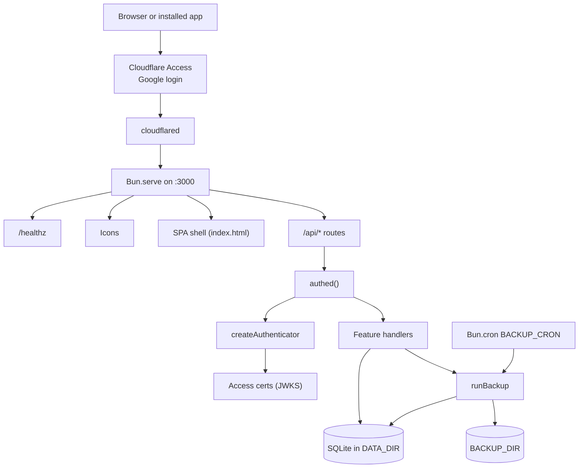
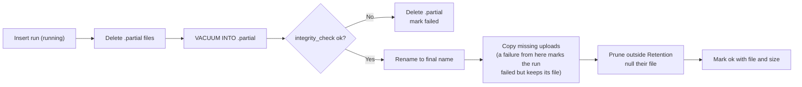
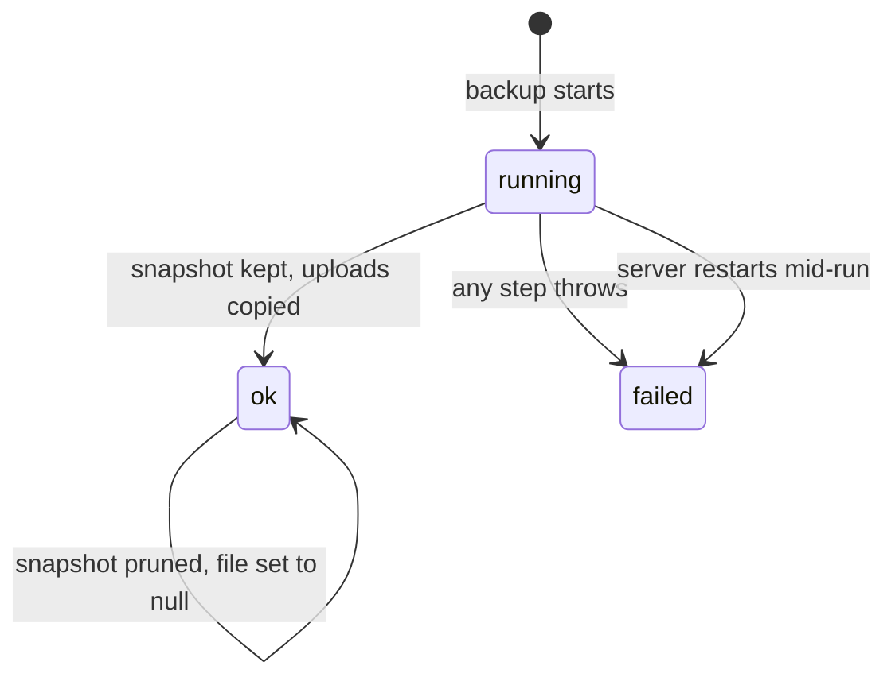

# Requirements Document: Platform Foundation

## Introduction

Whiskerfile is a self-hosted pet medical records app for one household. A single Bun process serves the JSON API under `/api` and the React single-page app, and stores everything in one SQLite database plus a folder of uploaded files. This spec covers the platform every feature stands on: sign-in, the signed-in user and their display units, configuration, the server process, the database and its migrations, backups, the Docker deployment, and the app shell with its design tokens and layout rules.

Users are a few household members with equal access. The app runs at home in Docker and is reached only through a Cloudflare Tunnel; Cloudflare Access (Google login) decides who may reach it. The app container publishes no host port. The app itself trusts no network position: every `/api` request must carry a valid Cloudflare Access token, and the first valid request from a new email creates that user.

Backups copy the database and uploaded files to a separate folder on a schedule and on demand, check each database snapshot before keeping it, and thin old snapshots to a fixed retention. Restore is a documented manual procedure.

Pets, records, labs, trends, health records, PDF reports and AI lab import have their own specs. They appear here only as integration points: their routes are mounted through the same `authed()` wrapper, they share the `AppContext`, and their screens render inside the app shell.

## Glossary

- **Access_Token**: The Cloudflare Access JWT sent in the `Cf-Access-Jwt-Assertion` request header.
- **Access_Mode**: Auth mode in which every `/api` request must carry a valid Access_Token. It applies whenever `AUTH_MODE` is anything other than `dev`.
- **Dev_Mode**: Auth mode (`AUTH_MODE=dev`) in which every request is signed in as the fixed user `dev@localhost`. Set by `bun run dev`.
- **Team_Domain**: `CF_ACCESS_TEAM_DOMAIN`, e.g. `myteam.cloudflareaccess.com`. The issuer is `https://<Team_Domain>`.
- **AUD_Tag**: `CF_ACCESS_AUD`, the Access application's audience tag.
- **authed()**: The wrapper from `authedWith()` in `src/server/http.ts` that resolves the user and answers 401 when there is none.
- **Display_Units**: A user's `weightUnit` (`kg`/`lb`) and `temperatureUnit` (`c`/`f`); null means follow the browser's locale.
- **Data_Dir**: `DATA_DIR` (default `./data`; `/data` in the image), holding `whiskerfile.sqlite` and `uploads/`.
- **Backup_Dir**: `BACKUP_DIR` (default `./backups`; `/backups` in the image), the folder the app writes backups to.
- **BACKUP_PATH**: The compose variable naming the host folder mounted at `/backups`. The app never reads it.
- **Backup_Run**: A row in `backup_runs` with status `running`, `ok` or `failed`, start and finish times, snapshot `file`, `sizeBytes` and `error`.
- **Snapshot**: A database copy named `whiskerfile-YYYYMMDDTHHMMSSmmmZ.sqlite` in `<Backup_Dir>/db/`.
- **Partial_File**: A file ending in `.partial`, written before being renamed to its final name.
- **Retention**: The rule that keeps the newest Snapshot from each of the 7 most recent days, 4 most recent Monday-to-Sunday weeks and 12 most recent months that have one, bucketed in UTC.
- **App_Shell**: `src/web/components/app-shell.tsx`, the sidebar, phone top bar and bottom tabs around every screen.
- **Main_Container**: The `<main>` element, declared as the CSS container `main` (`@container/main`).

## Requirements

### Requirement 1: Cloudflare Access sign-in

**User Story:** As a household member, I want the app to accept only requests Cloudflare Access has signed for our application, so that nobody else can read our pets' records.

#### Acceptance Criteria

1. WHILE in Access_Mode, WHEN an `/api` request has no `Cf-Access-Jwt-Assertion` header, THE System SHALL answer 401 with `{"error":"Not signed in"}` (src/server/app.test.ts for the status; body manual)
2. WHILE in Access_Mode, THE System SHALL reject with 401 a token that is malformed, has another audience, has another issuer, has expired, or is signed by a key outside the team's key set (src/server/app.test.ts)
3. IF a valid token has no non-empty string `email` claim (such as a service token), THE System SHALL answer 401 (src/server/app.test.ts)
4. THE System SHALL verify tokens against the issuer `https://<Team_Domain>`, the audience AUD_Tag, and the remote key set at `https://<Team_Domain>/cdn-cgi/access/certs` (manual)
5. IF a request is rejected, THE System SHALL create no user row (src/server/app.test.ts)

### Requirement 2: Users and Dev_Mode

**User Story:** As a household member, I want my account to exist the first time I sign in, so that nobody has to manage users in the app.

#### Acceptance Criteria

1. WHEN a valid token's email has no user yet, THE System SHALL create a user with the email in lower case, `name` set to the part before `@`, and `createdAt` set to now (src/server/app.test.ts)
2. WHEN later requests carry the same email in any letter case, THE System SHALL resolve the same user and create no second row (src/server/app.test.ts)
3. IF two first requests for one email race, THE System SHALL keep one row, because the insert resolves the unique-email conflict instead of failing (manual)
4. WHILE in Dev_Mode, THE System SHALL sign every request in as `dev@localhost` without reading any header (src/server/app.test.ts)
5. WHEN the server starts in Dev_Mode, THE System SHALL log a warning that every request is signed in and the server must not be exposed (manual)
6. THE System SHALL give every user equal access; there are no roles or per-user record permissions (manual)

### Requirement 3: API protection surface

**User Story:** As the operator, I want every API route behind the same check, so that a new route can't be left open by mistake.

#### Acceptance Criteria

1. THE System SHALL wrap every `/api/*` handler, including each feature's routes and the `/api/*` fallback, in authed() (src/server/app.test.ts)
2. WHEN a request without a valid token reaches any listed GET route or any listed write route (POST, PUT, PATCH, DELETE), THE System SHALL answer 401 (src/server/app.test.ts)
3. WHEN a signed-in request names an unknown `/api` path, THE System SHALL answer 404 `{"error":"Not found"}`; without a valid token the same path answers 401 (src/server/app.test.ts for the 401; manual for the 404)
4. THE System SHALL serve `/healthz`, the manifest icons and the single-page app without checking a token, leaving them to Cloudflare Access at the edge (manual)
5. THE System SHALL answer invalid JSON bodies with 400 `"Request body must be JSON"` and schema failures with 400 plus a `fields` map keyed by field path (src/server/routes/pets.test.ts, src/server/routes/records.test.ts)

### Requirement 4: Signed-in user and display units

**User Story:** As a household member, I want to choose how weights and temperatures are shown to me, so that I read them in the units I think in.

#### Acceptance Criteria

1. WHEN a signed-in user sends `GET /api/me`, THE System SHALL return their user row, including Display_Units (src/server/app.test.ts)
2. WHEN a new user is created, THE System SHALL leave both Display_Units null (src/server/routes/records.test.ts)
3. WHEN `PATCH /api/me` carries both `weightUnit` (`kg`, `lb` or null) and `temperatureUnit` (`c`, `f` or null), THE System SHALL save them for that user only and return the updated row (src/server/routes/records.test.ts)
4. IF either field is missing or outside its values, THE System SHALL answer 400 and change nothing (src/server/routes/records.test.ts)
5. WHERE a Display_Unit is null, THE web app SHALL use pounds and Fahrenheit for an `en-US` browser and kilograms and Celsius otherwise (manual)
6. THE Settings Units card SHALL offer Automatic (naming the locale's unit), Pounds/Kilograms and Fahrenheit/Celsius, and save on change; stored readings are never converted (manual)

### Requirement 5: Configuration and server process

**User Story:** As the operator, I want one process configured by environment variables, so that the same code runs in development and in Docker.

#### Acceptance Criteria

1. THE System SHALL read `PORT` (default 3000), `DATA_DIR`, `BACKUP_DIR`, `BACKUP_CRON` (default `0 3 * * *`), `AUTH_MODE`, `CF_ACCESS_TEAM_DOMAIN`, `CF_ACCESS_AUD`, `CHROMIUM_PATH` and `ANTHROPIC_API_KEY` from `src/server/config.ts` (manual)
2. IF Access_Mode is in effect and Team_Domain or AUD_Tag is empty, THE System SHALL refuse to start with an error naming both variables and `AUTH_MODE=dev` (manual)
3. THE System SHALL serve `GET /healthz` as `ok`, the three manifest icons at `/icon.svg`, `/icon-192.png` and `/icon-512.png` with their content types and `Cache-Control: public, max-age=86400`, the API, and the single-page app at every other path (src/server/static.test.ts for icons; manual for the rest)
4. WHERE `CHROMIUM_PATH` is set, THE System SHALL provide the PDF printer to routes, and WHERE `ANTHROPIC_API_KEY` is set, the lab document reader; otherwise those features answer 503 (manual; covered by their own specs)
5. THE System SHALL reject request bodies over 32 MB before reading them (manual)
6. WHILE `NODE_ENV` is not `production`, THE System SHALL serve the frontend with hot reload and browser console forwarding; in production it bundles the frontend at first request (manual)

### Requirement 6: Database and migrations

**User Story:** As the operator, I want the schema to update itself when a new version starts, so that upgrading is just restarting the container.

#### Acceptance Criteria

1. WHEN the server starts, THE System SHALL create Data_Dir if missing and open `<Data_Dir>/whiskerfile.sqlite`, creating it if absent (src/server/backup.test.ts)
2. THE System SHALL set `journal_mode = WAL` and `synchronous = NORMAL` on the file database, and `foreign_keys = ON` on every connection (manual)
3. WHEN the database is opened, THE System SHALL apply every pending Drizzle migration from the repository's `drizzle/` folder, resolved from the source file rather than the working directory, before serving, then re-read stored lab results under the current parsing rule (src/server/db/reparse.test.ts; src/server/db/index.test.ts for the resolution)
4. THE schema SHALL hold `users` (unique email) and `backup_runs`, with timestamps stored as epoch milliseconds (manual)
5. WHERE the data directory is `:memory:`, THE System SHALL open an in-memory database with the same migrations, used by tests (src/server/app.test.ts)

### Requirement 7: Running a backup

**User Story:** As the operator, I want the database and files copied every night and whenever I ask, so that a failed disk does not lose our records.

#### Acceptance Criteria

1. THE System SHALL run a backup on `BACKUP_CRON`, read in the process's time zone (`TZ`), and log `Backup failed: <error>` when one fails (manual)
2. WHEN a signed-in user sends `POST /api/backups`, THE System SHALL run a backup with no request idle timeout and return the finished Backup_Run (src/server/app.test.ts; timeout manual)
3. WHEN a backup runs, THE System SHALL record a `running` Backup_Run, write the Snapshot with `VACUUM INTO` as a Partial_File, run `PRAGMA integrity_check` on it, and rename it to its final name only when the check returns `ok` (src/server/backup.test.ts)
4. WHEN the Snapshot is kept, THE System SHALL copy each upload in `<Data_Dir>/uploads/` that `<Backup_Dir>/uploads/` lacks, through a Partial_File, skipping uploads that are themselves Partial_Files (src/server/backup.test.ts)
5. WHEN a backup finishes, THE System SHALL mark it `ok` with `file`, `sizeBytes` and `finishedAt`; IF any step fails, THE System SHALL mark it `failed` with the error message and delete the Partial_File, keeping `file` and `sizeBytes` on the run WHEN the Snapshot had already been renamed, so the kept Snapshot stays listed and downloadable (src/server/backup.test.ts)
6. WHEN a backup is requested while another is in flight, THE System SHALL return the in-flight run instead of starting a second (manual)
7. WHEN the server starts, THE System SHALL mark every `running` Backup_Run `failed` with `Interrupted by a restart` (manual)
8. WHEN a backup starts, THE System SHALL delete Partial_Files left in `<Backup_Dir>/db/` and `<Backup_Dir>/uploads/` by a cut-off run (src/server/backup.test.ts)

### Requirement 8: Retention, listing, download and restore

**User Story:** As the operator, I want old snapshots thinned automatically and recent ones downloadable, so that the backup disk does not fill and I can get a copy out.

#### Acceptance Criteria

1. WHEN a backup succeeds, THE System SHALL delete every Snapshot outside Retention and set `file` to null on the runs that named them; files that are not Snapshot names are left alone (src/server/backup.test.ts)
2. THE Retention SHALL keep at most 23 Snapshots: 7 daily, 4 weekly and 12 monthly buckets, a Snapshot that fills several buckets counted once, and only the newest Snapshot of a day (src/server/backup.test.ts)
3. WHEN a signed-in user sends `GET /api/backups`, THE System SHALL return, newest first, every run that still has a Snapshot plus the 20 runs with the highest ids (src/server/app.test.ts)
4. WHEN a signed-in user requests `GET /api/backups/:id/download` for a run with a Snapshot, THE System SHALL send the file as an attachment named after it; IF the id is invalid, unknown or pruned, THE System SHALL answer 404 `Snapshot not available` (src/server/app.test.ts)
5. THE Settings Backups card SHALL list each returned run with its local start time, an OK/Failed/Running badge, its size from `sm` width up, a download link when it has a Snapshot and its error when it failed, plus **Back up now** (disabled with `Backing up…` while running) and the empty text `No backups have run yet.` (manual)
6. THE README SHALL document restore as: stop the stack, copy a Snapshot over `data/whiskerfile.sqlite`, delete the `-wal` and `-shm` files, copy `<backup folder>/uploads/` into `data/uploads/`, and start again (manual)

### Requirement 9: Docker deployment

**User Story:** As the operator, I want one compose file that runs the app behind a tunnel, so that the app is reachable only through Cloudflare.

#### Acceptance Criteria

1. THE image SHALL build from `oven/bun:1.4.4-slim`, install Chromium and tini, run the source with `bun src/server/index.ts` under `/usr/bin/tini --` as a non-root user, and set `NODE_ENV=production`, `DATA_DIR=/data`, `BACKUP_DIR=/backups` and `CHROMIUM_PATH=/usr/bin/chromium` (manual)
2. THE image SHALL check health every 30 s by fetching `http://localhost:3000/healthz` with a 3 s timeout (manual)
3. THE compose `app` service SHALL publish no host port, run as `${APP_UID:-1000}:${APP_GID:-1000}`, mount `./data` at `/data` and `${BACKUP_PATH:-./backups}` at `/backups`, and pass only `CF_ACCESS_TEAM_DOMAIN`, `CF_ACCESS_AUD`, `BACKUP_CRON`, `ANTHROPIC_API_KEY` and `TZ` (default `UTC`) (manual)
4. IF `CF_ACCESS_TEAM_DOMAIN`, `CF_ACCESS_AUD` or `TUNNEL_TOKEN` is unset, THE compose file SHALL refuse to start (`:?`) (manual)
5. THE compose `cloudflared` service SHALL run `tunnel --no-autoupdate run` with `TUNNEL_TOKEN`, reaching the app at `http://app:3000` on the compose network (manual)
6. THE `.env.example` SHALL list every variable compose reads, with `APP_UID`/`APP_GID` explained (manual)

### Requirement 10: App shell, tokens and screen widths

**User Story:** As a household member, I want the same navigation on my laptop and my phone, so that I can look up a record wherever I am.

#### Acceptance Criteria

1. WHILE the viewport is at least `md` (768 px), THE App_Shell SHALL show a sticky full-height sidebar with the Whiskerfile mark, Pets, Compare and Settings links, the user's email, and a Collapse control (manual)
2. WHEN the user collapses the sidebar, THE App_Shell SHALL narrow it to a 68 px icon rail with link titles as tooltips, and remember the choice in `localStorage` key `whiskerfile.sidebar.rail`, falling back to expanded when storage is unavailable (manual)
3. WHILE the viewport is below `md`, THE App_Shell SHALL show a top bar with the mark and a fixed bottom tab bar with the same three links, padded for the device safe area (manual)
4. THE App_Shell SHALL mark the current section's link with `aria-current="page"`; Pets is current at `/` and under `/pets` (manual)
5. THE web app SHALL be dark only: `index.html` sets `class="dark"` and `color-scheme: dark`, and colours come from the tokens on `:root` in `src/web/index.css` exposed as Tailwind colours, with Inter and JetBrains Mono (Latin subsets) as the fonts (manual)
6. THE Main_Container SHALL be a CSS container named `main`, so screens lay out by the width beside the sidebar (`@2xl/main` and similar), and every screen SHALL work at desktop and phone widths (manual)
7. WHEN no client route matches, THE web app SHALL show "Page not found" inside the App_Shell (manual)
8. THE web app SHALL ship a manifest (`display: standalone`, `start_url: /`) fetched with credentials so it passes Cloudflare Access, and every icon it names SHALL be served (src/server/static.test.ts)

## Diagrams

### Component Diagram

### Data Flow: one backup run

### State Machine: Backup_Run

## Constraints

- One Bun process; routes use `Bun.serve` route tables and HTML imports. No Express, Vite or separate frontend build.
- SQLite through `bun:sqlite` and Drizzle; schema in `src/server/db/schema.ts`, migrations generated into `drizzle/` with `bun run db:generate` and applied at startup.
- JWT verification uses `jose`; no other auth library or session store.
- Every new `/api` route is wrapped in authed() and added to the 401 lists in `src/server/app.test.ts`.
- Pure logic shared with the browser lives in `src/shared/` with its own tests.
- Client routing uses `wouter`; server state uses TanStack Query.
- The production image runs from source because the `bun build` CLI does not apply the Tailwind plugin from `bunfig.toml`.
- The app container publishes no host port; the tunnel is the only way in.

## Correctness Properties

### Property 1: No user without a valid token

*For any* `/api` path and method and any request whose token is missing, malformed, expired, signed by another key, or names another issuer or audience, the response is 401 and the `users` table is unchanged.

**Validates: Requirements 1.1, 1.2, 1.3, 1.5, 3.2**

### Property 2: One user per email

*For any* sequence of valid tokens whose emails differ only in letter case, exactly one user row exists, with the lower-cased email.

**Validates: Requirements 2.1, 2.2, 2.3**

### Property 3: Snapshot names round-trip

*For any* instant `t`, `snapshotTime(snapshotName(t))` equals `t` to the millisecond, and two different instants give different names; any other file name gives null.

**Validates: Requirements 7.3, 8.1**

### Property 4: Retention is bounded and keeps the newest

*For any* set of Snapshot names, `snapshotsToKeep` returns at most 23 names, always includes the newest, keeps at most one name per UTC day, and ignores names that are not Snapshots.

**Validates: Requirements 8.1, 8.2**

### Property 5: A final-named backup file is whole

*For any* backup run, cut off or not, every file in `<Backup_Dir>/db/` or `<Backup_Dir>/uploads/` without the `.partial` suffix is a complete copy, and every Snapshot kept passed `PRAGMA integrity_check`.

**Validates: Requirements 7.3, 7.4, 7.5, 7.8**

### Property 6: One backup at a time

*For any* number of backup requests made while a run is in flight, all of them resolve to that same Backup_Run and only one Snapshot is written.

**Validates: Requirements 7.6**

### Property 7: Downloadable means listed

*For any* set of Backup_Runs, every run with a non-null `file` appears in `GET /api/backups`, and every run that `GET /api/backups/:id/download` serves has a non-null `file`.

**Validates: Requirements 8.3, 8.4**

## Out of Scope

- Roles, admins, invitations, per-user permissions or removing users; the Access policy decides who may sign in.
- Signing in through the `CF_Authorization` cookie, service tokens, or any login screen in the app; an expired session is handled by Cloudflare at the edge.
- Token checks on `/healthz`, icons and the SPA shell.
- Restoring from the UI or the API, verifying a restore, or uploading a Snapshot; restore is the manual README procedure.
- Deleting a Snapshot by hand, pruning uploads that are no longer referenced, encrypting backups, or copying them off-site.
- A light theme or theme switching.
- A configurable port in compose, `AUTH_MODE` in compose, or TLS in the app; the tunnel terminates TLS.
- Offline use or a service worker; the manifest only makes the app installable.
- Pets, records, labs, trends, health records, PDF reports and AI lab import, covered by their own specs.
