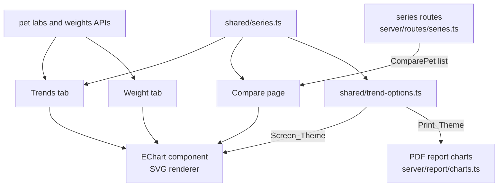
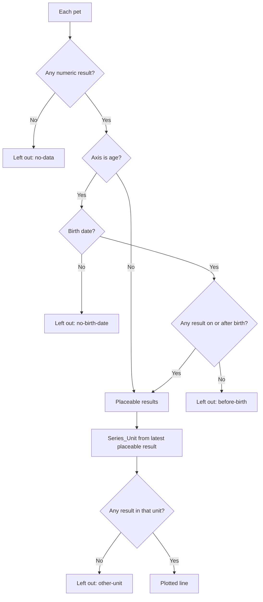

# Requirements Document: Trends and Compare

## Introduction

Whiskerfile charts a pet's numbers over time. The Trends tab on a pet's page draws a chart for each chosen metric: weight, and every lab test with a numeric result. The Weight tab draws the same weight chart above its table. The Compare page puts one metric for several pets on a single chart, against the date or against each pet's age.

All of these charts are built the same way. Pure functions in `src/shared/series.ts` turn stored readings into series. Pure functions in `src/shared/trend-options.ts` turn those series into ECharts option objects. Both run without a browser and are unit tested. A small React component (`src/web/components/charts/echart.tsx`) draws an option with tree-shaken ECharts and its SVG renderer. Two API routes (`src/server/routes/series.ts`) feed the Compare page.

Dates are stored as `YYYY-MM-DD` text. Charts turn each date into midnight UTC and display in UTC, so a point stays on its own calendar day in any time zone. Lab results are plotted in one unit per chart. Anything that cannot be drawn (another unit, no number, no birth date) is counted or named, never dropped silently from the page.

The PDF health report reuses these chart options with a print theme; its layout is specified in `docs/specs/pdf-health-reports/spec.md`. Lab entry, flags and the analyte catalog, and weight entry have their own specs and appear here only as data sources.

## Glossary

- **Calendar_Date**: a date stored as `YYYY-MM-DD` text, with no time or zone.
- **Numeric_Result**: a lab result whose printed text parsed to a number (`value` not null), including limit values such as `<0.5`.
- **Limit_Value**: a Numeric_Result printed with a comparator (`<`, `<=`, `>`, `>=`).
- **Series_Unit**: the one unit a chart plots: the unit of the most recent Numeric_Result considered. A missing unit and an empty unit count as the same unit.
- **Lab_Series**: the output of `labSeries`: `unit`, `points`, `otherUnits` and `unread`.
- **Range_Band**: the shaded area under a lab chart showing each result's printed reference range.
- **Left_Out**: a pet missing from a comparison, with a reason: `no-data`, `other-unit`, `no-birth-date` or `before-birth`.
- **Screen_Theme**: `CHART_THEME`, the app's dark-theme chart colours, interactive.
- **Print_Theme**: `PRINT_THEME`, paper colours, not interactive.
- **Zoom_Slider**: the ECharts `slider` dataZoom under a chart.
- **Metric**: something that can be charted: weight, or one lab test (analyte).

## Requirements

### Requirement 1: Calendar dates stay on their day

**User Story:** As an owner in any time zone, I want each reading plotted on the date it was taken, so that a chart never shows a result a day early or late.

#### Acceptance Criteria

1. THE `dateToUtc` function SHALL return midnight UTC of a Calendar_Date in milliseconds (`Date.UTC(y, m - 1, d)`). (`src/shared/series.test.ts`)
2. THE lab, weight and compare chart options SHALL set `useUTC: true`. (`src/shared/trend-options.test.ts` checks the lab chart; the others share the same base)
3. THE lab and weight charts, and the Compare chart against date, SHALL use an x axis of type `time`. (`src/shared/trend-options.test.ts`)
4. WHEN a chart is viewed in a browser set to a time zone east or west of UTC, THE System SHALL show each point and its tooltip on its stored Calendar_Date. (manual)

### Requirement 2: One lab test as one series

**User Story:** As an owner, I want a test's history drawn in a single unit, so that a change of lab or unit never draws a false jump.

#### Acceptance Criteria

1. THE `labSeries` function SHALL order results oldest first by date, then by `order` (the report id) within a day. (`src/shared/series.test.ts`)
2. THE `labSeries` function SHALL set the Series_Unit to the unit of the most recent Numeric_Result, or null when that result has no unit. (`src/shared/series.test.ts`)
3. THE `labSeries` function SHALL plot only Numeric_Results in the Series_Unit. (`src/shared/series.test.ts`)
4. THE `labSeries` function SHALL count Numeric_Results in another unit as `otherUnits` and results without a number (such as `Negative`) as `unread`, without plotting them. (`src/shared/series.test.ts`)
5. THE `labSeries` function SHALL keep each point's printed text and comparator, and SHALL set its flag with `flagResult` from the shared lab rules. (`src/shared/series.test.ts`)

### Requirement 3: Reference range band

**User Story:** As an owner, I want each result's printed range shaded under the line, so that I can see at a glance when a value left its range.

#### Acceptance Criteria

1. THE `rangeBand` function SHALL return, per point, its x (`dateToUtc` of its date), `low` = `refLow` and `height` = `refHigh - refLow` WHEN both limits are present and `refHigh >= refLow`. (`src/shared/series.test.ts`)
2. IF a point has only one limit, no limits, or `refHigh < refLow`, THE `rangeBand` function SHALL return null `low` and `height` for it, so the band breaks there. (`src/shared/series.test.ts`)
3. THE lab chart SHALL draw the band as two series, `range-low` and `range`, stacked in stack `range` with `stackStrategy: "all"`, so a range with a negative lower limit (such as -2 to 2) is drawn from that limit rather than from zero. (`src/shared/trend-options.test.ts`)
4. THE band series SHALL be stepped (`step: "middle"`), silent, without symbols or visible lines, with `connectNulls: false`, and only `range` SHALL be filled, in the theme's band colour. With `step: "middle"` the band splits at the midpoint between results, so each result — the latest included — sits over the range printed on its own report, and the band SHALL be stretched half a neighbouring gap past the first and last results (30 days either side when there is no gap, within the padded axis), so a single result shows its range. (`src/shared/trend-options.test.ts`)
5. THE Trends tab SHALL caption each lab chart: "Shaded: the reference range printed on each report. Hollow points are results given as a limit, such as <0.5." (manual)

### Requirement 4: Ages and multi-pet comparison series

**User Story:** As an owner of several pets, I want one test for all of them on one chart, by date or by age, so that I can see how each compares at the same age.

#### Acceptance Criteria

1. THE `ageInYears` function SHALL return the age on a date as `years + months / 12 + days / 365.25`, counted from the birth date with the shared `elapsed` rule, and null IF the date is before the birth date or either date is invalid. (`src/shared/series.test.ts`)
2. WHEN a pet has no Numeric_Result, THE `compareSeries` function SHALL leave it out as `no-data`. (`src/shared/series.test.ts`)
3. WHEN the axis is `age` AND a pet has no birth date, THE `compareSeries` function SHALL leave it out as `no-birth-date`. (`src/shared/series.test.ts`)
4. WHEN the axis is `age`, THE `compareSeries` function SHALL drop results dated before the pet's birth date, and SHALL leave the pet out as `before-birth` IF none remain. (`src/shared/series.test.ts`)
5. THE `compareSeries` function SHALL set one Series_Unit from the latest remaining Numeric_Result across all pets (by date, then `order`), so results that cannot be placed never choose the unit. (`src/shared/series.test.ts`)
6. IF a placeable pet has no result in the Series_Unit, THE `compareSeries` function SHALL leave it out as `other-unit`. (`src/shared/series.test.ts`)
7. THE `compareSeries` function SHALL give each plotted pet its Series_Unit points, oldest first, with x = `dateToUtc(date)` on the date axis or `ageInYears(dob, date)` on the age axis, and SHALL keep plotted pets in input order. (`src/shared/series.test.ts`)
8. THE `compareSeries` function SHALL sort Left_Out pets by name (`localeCompare`). (`src/shared/series.test.ts`)
9. THE `compareSeries` function SHALL count, on each plotted pet, the results not drawn: `unread` (no number), `otherUnits` (another unit) and, on the age axis, `beforeBirth` (dated before the birth date). (`src/shared/series.test.ts`)

### Requirement 5: Chart layout, themes, padding and zoom

**User Story:** As an owner, I want charts that read well on screen and on paper, whether a pet has one reading or years of them.

#### Acceptance Criteria

1. THE chart option builders SHALL default to the Screen_Theme and accept the Print_Theme, which uses darker text, darker flag colours, a visible grid and band, and `interactive: false`. (`src/shared/trend-options.test.ts`)
2. WHILE the theme is not interactive, THE options SHALL set `animation: false`, `tooltip.show: false`, a grid bottom of 24, and SHALL have no `dataZoom` key at all. (`src/shared/trend-options.test.ts`)
3. WHEN every x on a time axis falls within one day, THE `timePadding` function SHALL set the axis `min` and `max` 30 days either side; otherwise, and for no points, it SHALL set neither. (`src/shared/trend-options.test.ts`)
4. THE Compare chart against age SHALL use no time padding and a `value` x axis named "Age (years)". (`src/shared/trend-options.test.ts`)
5. WHILE the theme is interactive AND a lab or weight chart has 8 or more points (on Compare: any one pet has 8 or more), THE options SHALL include one Zoom_Slider (height 20, bottom 8, `filterMode: "none"`) and a grid bottom of 56; otherwise `dataZoom` SHALL be an empty list. (`src/shared/trend-options.test.ts`)
6. THE time axis SHALL hide overlapping labels and name the month on day ticks (`{MMM} {d}`), and the y axis SHALL scale to the data rather than start at zero. (manual)
7. THE tooltip SHALL trigger per point and be confined to the chart. (manual)
8. WHEN a reader swipes vertically over a chart on a phone, THE page SHALL scroll; zooming is done with the Zoom_Slider, not by dragging in the chart. (manual)

### Requirement 6: Points and tooltips

**User Story:** As an owner, I want flagged and limit results to stand out, and tooltips that show what the report printed.

#### Acceptance Criteria

1. THE lab chart SHALL draw its values line in the pet's colour, and colour each point with the theme's flag colour WHEN its flag is `high` or `low`, otherwise in the pet's colour. (`src/shared/trend-options.test.ts`)
2. THE lab and Compare charts SHALL draw a Limit_Value as a hollow point (`emptyCircle`) and other results as filled points (`circle`). (`src/shared/trend-options.test.ts`)
3. THE lab tooltip SHALL show the date formatted as elsewhere in the app, the printed text in bold, the unit, " · High" or " · Low" for a flagged result, and "Range" with the printed range when there is one. (`src/shared/trend-options.test.ts`)
4. THE weight tooltip SHALL show the date and the weight as formatted by the caller, in bold, followed by the reader's unit. (`src/shared/trend-options.test.ts`)
5. THE Compare chart SHALL draw one line per pet in its colour with no Range_Band, and its tooltip SHALL show "pet name · date" and the label in bold with the unit. (`src/shared/trend-options.test.ts`)
6. THE tooltips SHALL pass every piece of data text (dates, printed values, units, ranges, pet names) through `escapeHtml`, which escapes `& < > " '`. (`src/shared/trend-options.test.ts`)

### Requirement 7: Chart component

**User Story:** As a developer, I want one component that draws any option, so that every screen chart behaves the same.

#### Acceptance Criteria

1. THE `EChart` component SHALL register only the line chart, grid, tooltip and slider-zoom components and the SVG renderer, and SHALL draw with `renderer: "svg"`. (manual)
2. WHEN the option or `animation` prop changes, THE `EChart` component SHALL replace the chart's option (`notMerge: true`), with the `animation` prop, only when given, overriding the option's own. (manual)
3. WHEN its container changes size, THE `EChart` component SHALL resize the chart. (manual)
4. WHEN it unmounts, THE `EChart` component SHALL stop observing its container and dispose the chart. (manual)
5. THE `EChart` component SHALL render a `role="img"` container with the given `aria-label`. (manual)

### Requirement 8: Trends tab

**User Story:** As an owner, I want to choose which of a pet's numbers to chart, starting with what the latest report flagged.

#### Acceptance Criteria

1. THE Trends tab SHALL be reached at `/pets/:id/trends` and offer a Weight chip WHEN the pet has a weight, and a chip for each test with at least one Numeric_Result, grouped under category headings in catalog category order and ordered by the test's sort order. Each chip shows the test code and name and reports its state with `aria-pressed`. (manual)
2. WHEN the tab opens, THE Trends tab SHALL select Weight (if any weight exists) and up to three tests from the latest report (newest date, then highest id) flagged `high` or `low`; IF none is flagged, the first three tests in that report with a number. (manual)
3. WHEN a chip is pressed, THE Trends tab SHALL add or remove that metric's chart; charts appear with Weight first, then tests in sort order. (manual)
4. THE Trends tab SHALL head each test chart with its name, code and Series_Unit, and WHEN results were not drawn SHALL add "Not shown: N in another unit, M without a number." (manual)
5. THE Trends tab SHALL draw the weight chart with `weightTrendOption` in the reader's weight unit, two decimals, in the pet's colour, even for a single weight. (manual)
6. IF the pet has no weights and no Numeric_Results, THE Trends tab SHALL show "Nothing to chart yet. Weights and lab results with numbers appear here."; IF nothing is selected, "Choose what to chart." (manual)
7. THE Trends tab SHALL show chips above the charts at narrow widths, and a sticky 18rem chip panel beside them at wide widths. (manual)

### Requirement 9: Weight tab chart

**User Story:** As an owner, I want the weight history drawn as a dated chart above the table.

#### Acceptance Criteria

1. WHEN a pet has more than one weight, THE Weight tab SHALL draw `weightTrendOption` in the reader's weight unit, two decimals, in the pet's colour; with one weight it SHALL show no chart. (manual)
2. THE Weight tab SHALL build the chart option only when the weights, unit or colour change, so re-renders keep the slider's zoom. (manual)

### Requirement 10: Compare page

**User Story:** As an owner of several pets, I want to pick a metric and an axis and see every pet's line, with any pet that could not be drawn named.

#### Acceptance Criteria

1. THE Compare page SHALL be reached at `/compare` from the main navigation. (manual)
2. THE Compare page SHALL offer the metrics from `/api/series/metrics` in a select: Weight first when offered, then tests in one group per category, labelled "code · name"; it SHALL start on the first metric returned. (manual)
3. THE Compare page SHALL offer "Date" and "Age" as a radio group, starting on Date. (manual)
4. THE Compare page SHALL show a chip for each pet with data for the chosen metric; WHEN a chip is pressed, the pet SHALL be hidden or shown, and a hidden pet SHALL be neither plotted nor named. WHEN the metric changes, every pet SHALL be shown again. (manual)
5. WHEN the metric is weight, THE Compare page SHALL convert grams to the reader's weight unit and label points with two decimals; for a test it SHALL label points with the printed text. (manual)
6. THE Compare page SHALL colour each pet with its chart colour (falling back to `#a855f7`) and head the chart with the metric's name, code and unit. (manual)
7. WHEN any pet is Left_Out, THE Compare page SHALL list "Not shown: Name (reason), ..." with the reasons "no results", "results in another unit", "no birth date" and "results before its birth date". (manual)
8. WHEN a plotted pet has results that were not drawn, THE Compare page SHALL list "Not drawn: Name: N in another unit, M without a number, K before its birth date; ...", naming only the non-zero counts. (manual)
9. IF the data has loaded and no pet is plotted, THE Compare page SHALL show "No pet has results to show here."; WHILE loading or after an error it SHALL hold the chart's space empty, and an error SHALL be shown as its message. (manual)
10. IF no metric exists, THE Compare page SHALL show "Nothing to compare yet. Record weights or lab results first." (manual)
11. THE Compare page SHALL stack its controls above the chart at narrow widths and place them beside it at wide widths. (manual)

### Requirement 11: Series API

**User Story:** As the Compare page, I want every pet's data for one metric in one shape, so that the comparison logic runs in the browser.

#### Acceptance Criteria

1. WHEN `GET /api/series/metrics` is called, THE System SHALL return a Weight option (`key: "weight"`, no code or category) if any pet has a weight, then one option per test with at least one Numeric_Result (`key` = the test id as text), ordered by sort order then id, each with the ids of the pets that have such data. (`src/server/routes/series.test.ts`)
2. WHEN `GET /api/series?metric=weight` is called, THE System SHALL return every pet ordered by name, with its id, name and birth date, and each weight as a result with its date, `order` = measurement id, the value in grams as `value` and text, unit `g`, and no comparator or range. (`src/server/routes/series.test.ts`)
3. WHEN `GET /api/series?metric=<test id>` is called, THE System SHALL return every pet ordered by name with every result for that test, numeric or not, carrying the report date, `order` = report id, printed text, value, comparator, unit and range. A pet without data SHALL have an empty `results` list. (`src/server/routes/series.test.ts`)
4. IF `metric` is missing or neither `weight` nor a positive id, THE System SHALL answer 400 "metric must be weight or a test id"; IF the id names no test, 404 "Test not found". (`src/server/routes/series.test.ts`)
5. THE series routes SHALL be wrapped in `authed()` and answer 401 without a valid sign-in. (`src/server/app.test.ts`)

## Diagrams

### Component Diagram

### Compare Data Flow

## Constraints

- Charts use ECharts (`echarts` 6.1.0) imported from `echarts/core` with only the parts they need; the browser registers the slider zoom, the server does not. No other chart library.
- Screen charts use the SVG renderer; the PDF report renders the same options to SVG strings on the server with the Print_Theme and `LegacyGridContainLabel` (see `docs/specs/pdf-health-reports/spec.md`).
- Series and option building stay pure functions in `src/shared/`, testable without a browser.
- Dates stay Calendar_Date text end to end; charts convert with `dateToUtc` and display with `useUTC`.
- No new tables: the series routes read `pets`, `measurements` (kind `weight`), `lab_reports`, `lab_results` and `analytes`. Weights travel in grams and are converted in the browser.
- The UI is dark only; the Screen_Theme follows the tokens in `src/web/index.css`.
- Every screen works at phone and desktop widths.

## Correctness Properties

### Property 1: Day stability

*For any* valid Calendar_Date `d`, `new Date(dateToUtc(d)).toISOString()` starts with `d` followed by `T00:00:00.000Z`.

**Validates: Requirements 1.1, 1.2**

### Property 2: Every lab result is plotted or counted

*For any* list of results, `labSeries` returns points that all carry the Series_Unit, and `points.length + otherUnits + unread` equals the number of results.

**Validates: Requirements 2.2, 2.3, 2.4**

### Property 3: Points are in time order

*For any* list of results, `labSeries` points are non-decreasing by date and, within a date, by `order`.

**Validates: Requirements 2.1, 4.7**

### Property 4: The band tops out at the high limit

*For any* point with `refLow <= refHigh`, `low + height` equals `refHigh`; *for any* other point both are null.

**Validates: Requirements 3.1, 3.2, 3.3**

### Property 5: Every pet is accounted for once

*For any* list of pets and either axis, each pet id appears exactly once across `plotted` and `leftOut`, and every plotted point carries the returned unit.

**Validates: Requirements 4.2, 4.3, 4.4, 4.5, 4.6**

### Property 6: Print charts are never interactive

*For any* points, an option built with the Print_Theme has no `dataZoom` key, `animation: false` and `tooltip.show: false`.

**Validates: Requirements 5.2**

### Property 7: Short spans are padded

*For any* non-empty list of x values whose span is under one day, `timePadding` returns a range of at least 60 days containing every value; for any wider span it returns no bounds.

**Validates: Requirements 5.3**

### Property 8: Tooltip text is inert

*For any* string, `escapeHtml` returns text with no `<`, `>`, `"` or `'`, and every `&` begins an entity.

**Validates: Requirements 6.6**

## Out of Scope

- Converting between units (for example µmol/L to mg/dL) or matching units case-insensitively: results in another unit are counted or named, not converted.
- A reference band on the Compare chart: ranges differ per pet.
- A chart legend: the page's pet chips and the pet's colour identify lines.
- Drag, wheel or pinch zoom inside the chart; only the Zoom_Slider zooms.
- Remembering Trends selections or Compare choices across visits, or putting them in the URL.
- Charting vitals other than weight, and a light theme.
- Exporting chart images or data.
- The PDF report's layout and which charts it includes (`docs/specs/pdf-health-reports/spec.md`), lab entry, parsing and flag rules, and weight entry (their own specs).
