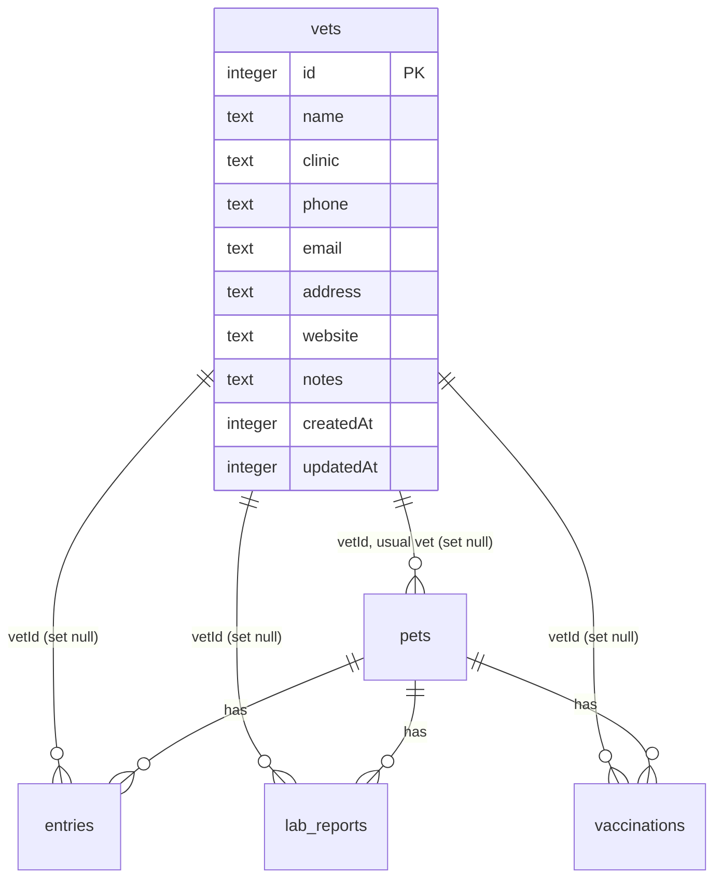
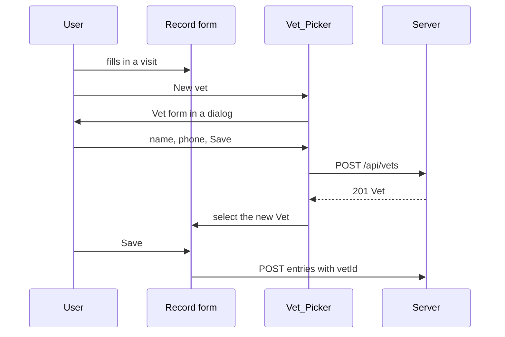

# Requirements Document: Vets

## Introduction

A vet used to exist in Whiskerfile only as text typed onto each record: a clinic and a vet name on a visit, a clinic on a vaccination, and nothing on a lab report. The same vet was retyped and respelled on every record, and their phone number, email and address were stored nowhere.

This spec makes a vet a record of its own, with contact details, that other records point at: visits, lab reports, vaccinations, and a pet's usual vet. A vet's page shows how to reach them and everything they have been involved in, across pets.

Four decisions shape the feature:

- A vet and their practice are one record. A Vet carries its clinic's name and contact details; two vets at one practice each repeat them. There is no separate clinics table.
- The earlier free-text clinic and vet values were migrated into Vets and the text columns dropped, so there is one way to name a vet.
- Vaccinations and a pet's usual vet are linked in the same way as visits and lab reports.
- The lab document import does not read or match a vet; the vet is picked in the lab form.

Visits, lab reports, health records, pet profiles and PDF reports have their own specs. This spec covers them only where they meet a Vet. Where a criterion is proven by a test, the test file is named. Criteria checked only by hand are marked "(manual)".

## Glossary

- **Vet**: a row in `vets`: a name, and optionally a clinic name, phone, email, address, website and notes.
- **Vet_Link**: a nullable `vetId` on an Entry (`entries`), a lab report (`lab_reports`), a vaccination (`vaccinations`) or a pet (`pets`, the Usual_Vet).
- **Linked_Record**: an Entry, lab report or vaccination whose Vet_Link names a Vet.
- **Usual_Vet**: the Vet a pet's `vetId` names.
- **Vet_Label**: how a Vet is named in lists and on records: its name, followed by " · " and its clinic when it has one.
- **Vet_Picker**: the form control that chooses a saved Vet, or none, and can add a new Vet without leaving the form.
- **Vets screen**: `/vets`, the list of Vets. **Vet page**: `/vets/:id`, one Vet's contact details and Linked_Records.

## Requirements

### Requirement 1: Vet records

**User Story:** As a household member, I want to save each vet once with their contact details, so that I never retype them and can always find how to reach them.

#### Acceptance Criteria

1. WHEN `POST /api/vets` receives a valid body, THE System SHALL store the Vet and answer 201 with it. (`src/server/routes/vets.test.ts`)
2. WHEN `PUT /api/vets/:id` receives a valid body, THE System SHALL replace the Vet's fields, set `updatedAt` and answer 200. (`src/server/routes/vets.test.ts`)
3. WHEN `GET /api/vets` is called, THE System SHALL return every Vet in case-insensitive name order. (`src/server/routes/vets.test.ts`)
4. IF the Vet does not exist, THE System SHALL answer 404 to `GET`, `PUT` and `DELETE` of `/api/vets/:id` and write nothing. (`src/server/routes/vets.test.ts`)
5. THE System SHALL allow two Vets with the same name, since two practices can each have a "Dr. Lee". (manual)
6. THE System SHALL reject every request to these routes without a valid Access token with 401. (`src/server/app.test.ts`)

### Requirement 2: Contact field validation

**User Story:** As a household member, I want mistyped contact details refused, so that a phone link dials and an email link sends.

#### Acceptance Criteria

1. THE `vetInput` schema in `src/shared/vets.ts` SHALL require a name of 1 to 120 characters after trimming, and SHALL accept `clinic` (up to 120 characters), `phone` (40), `email` (254), `address` (300), `website` (200) and `notes` (2,000) as optional text, trimming each and storing a blank one as null. (`src/shared/vets.test.ts`)
2. IF a phone is not blank, THE schema SHALL accept it only when it holds at least three digits and nothing but digits, spaces, `+ ( ) - . /` and an extension written `x` or `ext`. (`src/shared/vets.test.ts`)
3. IF an email is not blank, THE schema SHALL accept it only when it is one address of the form `name@domain.tld`. (`src/shared/vets.test.ts`)
4. IF a website is not blank, THE schema SHALL accept it only when it is a full `http://` or `https://` address. (`src/shared/vets.test.ts`)
5. THE same schema SHALL validate in the Vet form before sending and on the server, and a rejected body SHALL answer 400 naming each invalid field and write nothing. (`src/server/routes/vets.test.ts`)
6. `telHref` SHALL turn a stored phone into a `tel:` address holding only its digits and a leading `+`, with an extension as `;ext=`. (`src/shared/vets.test.ts`)

### Requirement 3: Linking records to a vet

**User Story:** As a household member, I want to say which vet a visit, test result or vaccination came from, so that I can reach the vet behind any record.

#### Acceptance Criteria

1. THE bodies of `POST /api/pets/:id/entries` and `PUT /api/entries/:id` SHALL carry a `vetId` that is a Vet's id or null, and THE System SHALL store it as the Entry's Vet_Link, so a later save changes or removes the link. (`src/server/routes/records.test.ts`)
2. WHEN an Entry is saved as a home exam, THE System SHALL store no Vet_Link whatever the body names. (`src/server/routes/records.test.ts`)
3. THE bodies of `POST /api/pets/:id/labs` and `PUT /api/labs/:id` SHALL carry a `vetId` that is a Vet's id or null, stored as the lab report's Vet_Link. (`src/server/routes/labs.test.ts`)
4. THE bodies of `POST /api/pets/:id/vaccinations` and `PUT /api/vaccinations/:id` SHALL carry a `vetId` that is a Vet's id or null, stored as the vaccination's Vet_Link. (`src/server/routes/health.test.ts`)
5. THE bodies of `POST /api/pets` and `PUT /api/pets/:id` SHALL carry a `vetId` that is a Vet's id or null, stored as the pet's Usual_Vet. (`src/server/routes/pets.test.ts`)
6. IF a body names a `vetId` that is not a Vet, THE System SHALL answer 400 with `vetId: "Unknown vet"` and write nothing. (`src/server/routes/vets.test.ts`)
7. A lab report's Vet_Link SHALL be independent of its visit's: a report can name a Vet with no visit, or a different Vet from its visit's. (manual)

### Requirement 4: Deleting a vet

**User Story:** As a household member, I want to remove a vet I no longer use without losing any record, so that tidying the list is safe.

#### Acceptance Criteria

1. WHEN `DELETE /api/vets/:id` is called, THE System SHALL delete the Vet and answer 204. (`src/server/routes/vets.test.ts`)
2. WHEN a Vet is deleted, THE System SHALL keep every Entry, lab report, vaccination and pet that named it and clear their Vet_Link. (`src/server/routes/vets.test.ts`)
3. THE Vet form SHALL ask for a second, confirming press before deleting. (manual)

### Requirement 5: A vet's page

**User Story:** As a household member, I want one page per vet with their contact details and everything they were involved in, so that I can call them with the history in front of me.

#### Acceptance Criteria

1. WHEN `GET /api/vets/:id` is called, THE System SHALL return the Vet with its Linked_Records across all pets: Entries (id, pet, date, reason), lab reports (id, pet, date, source, lab) and vaccinations (id, pet, vaccine, date given), each newest first and each naming its pet, and the pets whose Usual_Vet it is in name order. (`src/server/routes/vets.test.ts`)
2. THE Vets screen SHALL list every Vet by Vet_Label with its phone and email, each row leading to the Vet page, and SHALL offer **Add vet**. With no Vets it SHALL say so. (manual)
3. THE Vet page SHALL show the Vet's name, clinic, phone, email, website, address and notes, omitting what is not set. The phone SHALL be a `tel:` link, the email a `mailto:` link, and the website SHALL open in a new tab. (manual)
4. THE Vet page SHALL list the Vet's test results, visits and vaccinations, each with its pet's name and date, and the pets it is the Usual_Vet for. A test result SHALL lead to that report, a visit to the pet's timeline, a vaccination to the pet's Health tab, and a pet to its page. A list with nothing in it SHALL be omitted, and with no Linked_Records at all the page SHALL say so. (manual)
5. THE Vet page SHALL offer **Edit**, opening the Vet form with **Delete**. After a delete THE web app SHALL return to the Vets screen. (manual)
6. IF the address names no Vet, THE Vet page SHALL say "Vet not found". (manual)
7. THE navigation SHALL offer **Vets** beside Pets, Compare and Settings, in the sidebar and in the phone's bottom tabs. (manual)

### Requirement 6: Choosing a vet in the forms

**User Story:** As a household member, I want to pick a saved vet in each form, or add one on the spot, so that linking a record takes one tap.

#### Acceptance Criteria

1. THE visit form (for a vet visit), the lab form, the vaccination form and the pet form SHALL each offer a Vet_Picker listing "No vet" and every Vet by Vet_Label, pre-selected to the record's Vet_Link when editing. (manual; `src/web/routes/lab-form.test.tsx` proves the lab form sends the chosen `vetId`)
2. THE Vet_Picker SHALL offer **New vet**, opening the Vet form in a dialog over the form. WHEN the new Vet is saved, THE Vet_Picker SHALL select it, and the form underneath SHALL keep everything typed into it and SHALL not be submitted. (manual)
3. THE visit form SHALL show the Vet_Picker only for a vet visit, SHALL send `vetId: null` for a home exam, and SHALL warn "Saving as a home exam removes the vet." WHEN a visit with a Vet chosen is switched to a home exam. (manual)
4. THE pet form SHALL label its Vet_Picker "Usual vet". (manual)

### Requirement 7: Showing the linked vet

**User Story:** As a household member, I want the vet named on each record and one tap from their contact details, so that I can call about a result while looking at it.

#### Acceptance Criteria

1. THE Timeline SHALL show a visit's Vet_Label under its reason, and a vaccination's Vet_Label after its date, each as a link to the Vet page. (manual)
2. THE lab report view SHALL show "Vet" with the Vet_Label as a link to the Vet page. (manual)
3. THE Health tab SHALL show a dose's Vet_Label, on the latest dose and on earlier doses, as a link to the Vet page. (manual)
4. THE pet's Details card SHALL show "Usual vet" with the Vet_Label as a link to the Vet page, and with the Vet's phone as a `tel:` link. (manual)
5. THE PDF health report's Vaccinations table SHALL show each dose's Vet_Label in a "Vet" column. (`src/server/routes/reports.test.ts`)
6. A record with no Vet_Link SHALL show no vet. (manual)

### Requirement 8: Migrating the free-text values

**User Story:** As a household member with years of records, I want the clinics and vets I already typed turned into vets, so that nothing is lost and old visits are linked from day one.

#### Acceptance Criteria

1. THE migration SHALL create one Vet for each distinct pair of vet and clinic text on an Entry, compared without regard to ASCII letter case: named after the vet with the clinic as its clinic, or named after the clinic alone when no vet was typed. (`src/server/db/vets-migration.test.ts`)
2. THE migration SHALL create one Vet, named after the clinic, for each distinct vaccination clinic that no such Vet already covers. (`src/server/db/vets-migration.test.ts`)
3. THE migration SHALL link every Entry and vaccination that had vet or clinic text to its Vet, and SHALL leave the others unlinked. (`src/server/db/vets-migration.test.ts`)
4. THE migration SHALL then drop `entries.clinic`, `entries.vet` and `vaccinations.clinic`, changing no other column and deleting no row of any table. (`src/server/db/vets-migration.test.ts`)
5. Lab reports and pets SHALL start with no Vet_Link. (`src/server/db/vets-migration.test.ts`)

## Diagrams

### Data Model

### Adding a vet from a form

## Constraints

- Contact validation and the Vet_Label live in `src/shared/vets.ts`, shared by the server and the browser.
- Every route is wrapped in `authed()` and listed in the 401 tests in `src/server/app.test.ts`.
- Foreign keys are on. Each Vet_Link is `on delete set null`, so deleting a Vet never deletes a record; deleting a pet or a record never deletes a Vet.
- A Vet belongs to the household, not to a pet or a person: every member sees and edits every Vet.
- The browser names a record's vet from the Vet list (`GET /api/vets`), which it refetches after any Vet is added, changed or deleted; the record routes return only the `vetId`.
- The app never invents medical or contact facts: nothing pre-fills a Vet's details or guesses a record's vet.
- Each screen works at desktop and phone widths, and the UI is dark only.

## Correctness Properties

### Property 1: Deleting a vet deletes nothing else

*For any* Vet and any set of records linked to it, deleting the Vet leaves the row counts of `entries`, `lab_reports`, `vaccinations` and `pets` unchanged and leaves no row naming the deleted id.

**Validates: Requirements 4.1, 4.2**

### Property 2: A link always names a vet

*For any* accepted save of an Entry, lab report, vaccination or pet, its `vetId` is null or the id of an existing Vet.

**Validates: Requirements 3.1, 3.3, 3.4, 3.5, 3.6**

### Property 3: The migration loses no name

*For any* Entry or vaccination that had vet or clinic text before the migration, the Vet it is linked to afterwards carries that text, differing at most in ASCII letter case, as its name and clinic.

**Validates: Requirements 8.1, 8.2, 8.3**

### Property 4: Phone links dial what was typed

*For any* phone the schema accepts, `telHref` keeps every digit in order and nothing else but a leading `+` and an `;ext=` separator.

**Validates: Requirements 2.2, 2.6**

## Out of Scope

- A separate clinic record shared by several vets, and merging two Vets into one. Duplicates left by differently spelled text are tidied by relinking records and deleting the spare Vet.
- Reading the vet named on an imported lab document and matching it to a saved Vet.
- A vet on medications, conditions, standalone weigh-ins or files.
- Pre-selecting a pet's Usual_Vet in new records.
- Searching or filtering the Vets screen, and opening a visit or vaccination directly from the Vet page.
- Vets on the PDF health report beyond the Vaccinations table.
- Per-user permissions. Every household member can edit or delete any Vet.
