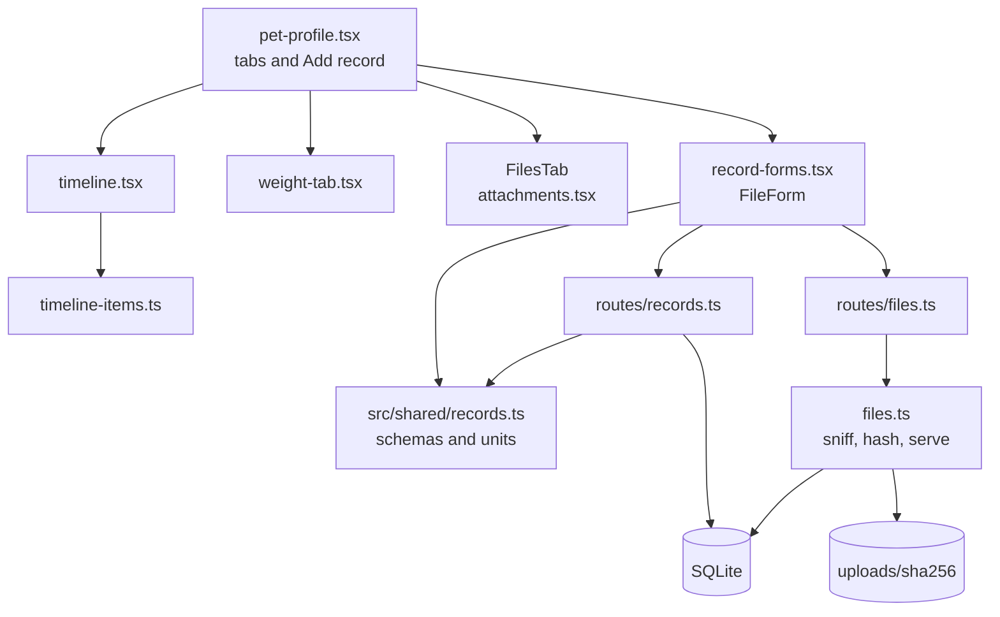
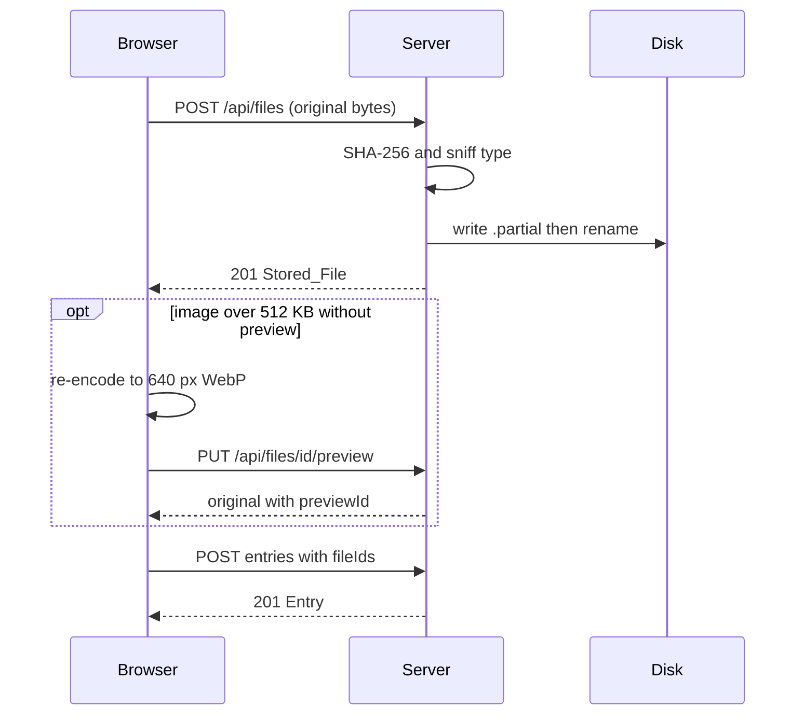

# Requirements Document: Visits, Measurements and Files

## Introduction

This spec covers the day-to-day medical record for each pet in Whiskerfile: vet visits and home exams with their vitals, standalone weigh-ins, and uploaded files. A few household members share the app behind Cloudflare Access with equal access, and every record they add names its author.

Measurements are stored in one canonical unit each (grams and °C) and converted only for display and input, in units each person chooses. Files are stored once per distinct content, typed by their bytes rather than by what the client claims, and served so that no upload can run script on the app's origin.

On a pet's page these records appear on the Timeline (with lab reports and health records), the Weight tab and the Files tab, and are added through the **Add record** chooser. Pet profiles, lab reports, trends, health records, PDF reports, AI lab import and the platform (auth, backups, serving) have their own specs. This spec covers them only where they meet these records.

The spec describes the system as built. Where a criterion is proven by a test, the test file is named. Criteria checked only by hand are marked "(manual)".

## Glossary

- **Entry**: a row in `entries`, either a vet visit (`kind: "vet"`) or a home exam (`kind: "home"`), with a date, vet (a link to a saved vet, see `docs/specs/vets/spec.md`), reason and notes.
- **Vital**: one of `weight`, `temperature`, `heart_rate`, `respiratory_rate`, `body_condition`.
- **Measurement**: one reading of a Vital in `measurements`. A Visit_Reading has an `entryId`; a Standalone_Reading (such as a weigh-in) does not.
- **Stored_Unit**: grams for weight, °C for temperature, per minute for heart and respiratory rate, a 1–9 score for body condition.
- **Display_Units**: a person's weight unit (`lb`/`kg`) and temperature unit (`f`/`c`). A null preference falls back to the browser locale.
- **Stored_File**: a row in `files` whose bytes live at `uploads/<sha256>` in the data directory and never change; rows with the same content share one stored copy.
- **Attachment**: a row in `attachments` that files a Stored_File under a pet: on an Entry (Visit_File), on a lab report (Lab_Document, see the lab-results spec), or on its own (Standalone_File, which has a label and its own date).
- **Preview**: a small image Stored_File linked from a large image's `previewId`. Lists show it in place of the original.
- **Inline_Type**: JPEG, PNG, WebP, GIF or PDF. These are the only types the browser is allowed to display.

## Requirements

### Requirement 1: Vet visits and home exams

**User Story:** As a household member, I want to record vet visits and home exams with their details, so that each pet's care history is in one place.

#### Acceptance Criteria

1. WHEN `POST /api/pets/:id/entries` receives a valid body, THE System SHALL store the Entry with the caller as `createdBy` and answer 201. (`src/server/routes/records.test.ts`)
2. THE System SHALL require `kind`, `date`, `vetId`, `reason`, `notes` and a `vitals` object in the body, SHALL trim the text fields, and SHALL store empty text as null. (manual)
3. WHEN `PUT /api/entries/:id` receives a valid body, THE System SHALL replace the Entry's fields and answer 200. (`src/server/routes/records.test.ts`) The replaced fields SHALL include `kind`, and `updatedAt` SHALL be set. (manual)
4. WHEN `DELETE /api/entries/:id` is called, THE System SHALL delete the Entry and its Visit_Readings (`src/server/routes/records.test.ts`) and unlink any lab report linked to it (`src/server/routes/labs.test.ts`). It SHALL also delete the Entry's Attachments and answer 204. (manual)
5. IF the pet does not exist, or the Entry does not exist on `PUT`, THE System SHALL answer 404 and write nothing. (`src/server/routes/records.test.ts`) A `DELETE` of an unknown Entry SHALL also answer 404. (manual)
6. WHEN `GET /api/pets/:id/records` is called, THE System SHALL return the pet's Entries, each with its author's name, its Vitals keyed by kind, and its Visit_Files. (`src/server/routes/records.test.ts`, `src/server/routes/attachments.test.ts`) The Entries SHALL be ordered newest date first and then newest id first. (manual)
7. WHEN a pet is deleted, THE System SHALL delete its Entries and Measurements. (`src/server/routes/records.test.ts`)
8. THE System SHALL reject every request to these routes without a valid Access token with 401. (`src/server/app.test.ts`)

### Requirement 2: Vitals recorded at a visit

**User Story:** As a household member, I want the vitals taken at a visit saved with it, so that they move, change and disappear together with it.

#### Acceptance Criteria

1. WHEN an Entry is saved, THE System SHALL save its Entry row, Visit_Readings and Visit_Files in one transaction, after validating the body and its file ids. (manual; `src/server/routes/records.test.ts` and `src/server/routes/attachments.test.ts` prove that a rejected body writes nothing)
2. WHEN an Entry is saved, THE System SHALL give each of its Visit_Readings the Entry's date. (`src/server/routes/records.test.ts`)
3. WHEN an edit omits a Vital or sends it as null, THE System SHALL delete that Visit_Reading. (`src/server/routes/records.test.ts`)
4. WHEN an edit keeps a Vital, THE System SHALL update the existing Measurement row in place rather than replace it, so that its id, and so which same-day reading counts as latest, does not change. (`src/server/routes/records.test.ts`)
5. THE System SHALL store at most one Visit_Reading per Vital per Entry. (manual)

### Requirement 3: Standalone readings

**User Story:** As a household member, I want to log a quick weigh-in outside any visit, so that weight is tracked between vet trips.

#### Acceptance Criteria

1. WHEN `POST /api/pets/:id/measurements` receives a valid `{ date, kind: "weight", value }`, THE System SHALL store a Standalone_Reading with the caller as author and answer 201. (`src/server/routes/records.test.ts`)
2. THE System SHALL let `PUT` and `DELETE` on `/api/measurements/:id` change or remove only Standalone_Readings. A Visit_Reading SHALL answer 404 and stay unchanged. A `PUT` SHALL keep the reading's kind: a body with a different kind answers 400 and changes nothing. (`src/server/routes/records.test.ts`)
3. WHEN `GET /api/pets/:id/measurements?kind=<Vital>` is called, THE System SHALL return every reading of that kind, from visits or standalone, oldest date first and then oldest id first. (`src/server/routes/records.test.ts`)
4. IF `kind` is not a Vital, THE System SHALL answer 400. (`src/server/routes/records.test.ts`)
5. THE records response SHALL list only Standalone_Readings under `measurements` (`src/server/routes/records.test.ts`), each with its author's name. (manual)
6. THE API SHALL accept only `weight` as a standalone `kind` and answer 400 for any other Vital, matching the UI, which creates and edits only weights. (`src/server/routes/records.test.ts`)

### Requirement 4: Units, conversion and rounding

**User Story:** As a household member, I want to read and type weights and temperatures in my own units, so that I don't have to convert numbers in my head.

#### Acceptance Criteria

1. THE System SHALL convert typed weights to whole grams (1 lb = 453.59237 g) and typed temperatures to °C rounded to 0.01. (`src/shared/records.test.ts`)
2. THE System SHALL display weight to two decimals and temperature to one decimal in the reader's Display_Units, formatted as `10.25 lb`, `38.6 °C`, `180 bpm`, `20 /min` and `5/9`. (`src/shared/records.test.ts`)
3. WHEN a form field is left exactly as it was shown, THE System SHALL keep the stored value rather than convert the rounded text back. (`src/shared/records.test.ts`)
4. THE System SHALL accept a comma as the decimal separator. It SHALL read empty input as "not measured" and unparseable input as invalid. (`src/shared/records.test.ts`)
5. WHEN `PATCH /api/me` receives `weightUnit` (`kg`, `lb` or null) and `temperatureUnit` (`c`, `f` or null), THE System SHALL store them for that user only. Any other value SHALL answer 400. (`src/server/routes/records.test.ts`)
6. WHILE a preference is null, THE System SHALL use lb and °F for an `en-US` browser and kg and °C for any other. (manual)
7. WHILE a form is open, THE System SHALL read typed numbers in the units in effect when it opened. (manual)

### Requirement 5: Validation limits

**User Story:** As a household member, I want typos rejected, so that a misplaced decimal point doesn't become a reading.

#### Acceptance Criteria

1. THE System SHALL accept a Vital only within these limits, in Stored_Units: weight from 1 to 200,000 g (whole), temperature from 25 to 45 °C, heart rate from 10 to 400 (whole), respiratory rate from 2 to 200 (whole), body condition from 1 to 9 (whole). (`src/shared/records.test.ts`, `src/server/routes/records.test.ts`)
2. THE System SHALL accept only real calendar dates in `YYYY-MM-DD` form, and SHALL refuse an Entry, measurement or Standalone_File date later than tomorrow in UTC with "Can't be in the future" (`isFutureDate`, `src/shared/dates.ts`: the server doesn't know the browser's time zone, and tomorrow in UTC covers every zone's today). (`src/shared/records.test.ts`, `src/server/routes/records.test.ts`, `src/server/routes/attachments.test.ts`)
3. THE System SHALL limit reason to 200 characters, notes to 8,000, a Standalone_File label to 120, and an Entry's `fileIds` to 50 positive integers. (manual)
4. IF a body is invalid, THE System SHALL answer 400 `Some fields are invalid` with a message per field, keyed by path (such as `vitals.temperature`), and SHALL write nothing. (`src/server/routes/records.test.ts`)
5. WHEN a form is submitted, THE web app SHALL run the same schema first and SHALL also reject a date after the browser's local today with "Can't be in the future", a stricter bound than the schema's own UTC one. (manual)

### Requirement 6: Uploading and storing files

**User Story:** As a household member, I want to upload receipts, scans and photos exactly as they are, so that the original document is always kept.

#### Acceptance Criteria

1. WHEN `POST /api/files` receives a multipart `file` field, THE System SHALL store its bytes unchanged and answer 201 with the Stored_File row. (`src/server/routes/files.test.ts`, `src/server/routes/attachments.test.ts`)
2. THE System SHALL name each stored copy by the SHA-256 of its bytes and SHALL keep one copy per distinct content, with one row per distinct (content, name, uploader): an exact repeat of an upload not yet attached to a record returns the existing row, while the same bytes uploaded under another name, by another member, or again after the first upload was attached get their own row carrying that name and uploader. (`src/server/routes/files.test.ts`)
3. THE System SHALL write each copy under a `.partial` name and rename it once complete. (`src/server/routes/files.test.ts` checks that nothing is left over)
4. WHEN the stored copy is missing or a different size, THE System SHALL write the bytes again on the next upload of the same content. (`src/server/routes/files.test.ts`)
5. THE System SHALL set the type from the file's first bytes (JPEG, PNG, WebP, GIF or PDF, and `application/octet-stream` for anything else) and SHALL never take it from the client. (`src/server/routes/files.test.ts`)
6. IF the field is missing, THE System SHALL answer 400. IF the file is empty, it SHALL answer 400. IF the file is larger than 25 MB, it SHALL answer 413. (`src/server/routes/files.test.ts`) IF `Content-Length` is more than 25 MB plus 64 KB, it SHALL answer 413 before reading the body. (manual)
7. THE System SHALL store the original name cut to 200 characters, or `upload` when there is none. (manual)

### Requirement 7: Serving files

**User Story:** As a household member, I want to open images and PDFs in the browser and download anything else, so that viewing is easy and uploads stay harmless.

#### Acceptance Criteria

1. WHEN `GET /api/files/:id` is called, THE System SHALL answer with the stored bytes, the stored type and `X-Content-Type-Options: nosniff`. (`src/server/routes/files.test.ts`)
2. THE System SHALL serve Inline_Types as `inline` and every other type as `attachment`. With `?download` it SHALL always serve `attachment`. The filename SHALL be sent as `filename*=UTF-8''<encoded name>`. (`src/server/routes/files.test.ts`)
3. THE System SHALL send `Cache-Control: private, max-age=31536000, immutable`. (manual)
4. IF the file does not exist, THE System SHALL answer 404. (manual)

### Requirement 8: Previews for large images

**User Story:** As a household member on a phone, I want lists to show small thumbnails, so that the Files tab doesn't download every full-size photo.

#### Acceptance Criteria

1. WHEN `PUT /api/files/:id/preview` receives an image of at most 512 KB for an image original larger than 512 KB, THE System SHALL store it and set the original's `previewId`, answering with the updated original. (`src/server/routes/files.test.ts`)
2. IF the original is not an image or is itself at most 512 KB (it is its own preview), or the preview is larger than 512 KB, or its first bytes are not an image, THE System SHALL answer 400 and store nothing. IF the original does not exist, it SHALL answer 404. (`src/server/routes/files.test.ts`)
3. WHEN the browser uploads an image larger than 512 KB that has no Preview, THE web app SHALL re-encode it at most 640 px on its longer side (WebP, or JPEG when the browser cannot encode WebP) and upload that as its Preview. If this fails, the original SHALL remain and lists SHALL show an icon. (manual)
4. THE web app SHALL show a file in lists as its Preview if it has one, otherwise as the image itself when it is an image of at most 512 KB, otherwise as an icon. It SHALL never show the original of a large image. (manual)

### Requirement 9: Attaching files to a visit or to the pet

**User Story:** As a household member, I want to attach files to a visit or file a document on its own, so that receipts, results and papers sit with the right record.

#### Acceptance Criteria

1. WHEN an Entry is saved without `fileIds`, THE System SHALL keep its Visit_Files. WHEN it is saved with a list, the list SHALL replace them. (`src/server/routes/attachments.test.ts`) Duplicate ids in the list SHALL be attached once. (manual)
2. WHEN an Entry is saved, THE System SHALL give its Visit_Files the Entry's date. (`src/server/routes/attachments.test.ts`)
3. IF `fileIds` names an unknown file, THE System SHALL answer 400 with `{ fileIds: "Unknown file" }` and change nothing. (`src/server/routes/attachments.test.ts`)
4. WHEN `POST /api/pets/:id/attachments` receives `{ fileId, label, date }`, THE System SHALL file a Standalone_File and answer 201. An unknown file SHALL answer 400 `{ fileId: "Unknown file" }`, and an unknown pet 404. (`src/server/routes/attachments.test.ts`)
5. THE System SHALL let `PUT /api/attachments/:id` change only the label and date of a Standalone_File. A Visit_File SHALL answer 404 (`src/server/routes/attachments.test.ts`), and so SHALL a Lab_Document. (manual)
6. WHEN `DELETE /api/attachments/:id` is called on a Standalone_File, THE System SHALL remove it, answer 204 and keep the Stored_File. A Visit_File or Lab_Document SHALL answer 404 and stay attached, as on `PUT`: a visit's files change with the visit, a report's documents with the report. (`src/server/routes/attachments.test.ts`)
7. WHEN a pet is deleted, THE System SHALL delete its Attachments and keep the Stored_Files. (`src/server/routes/attachments.test.ts`)
8. THE records response SHALL list under `attachments` only Standalone_Files, each with its author and the file's type, size, original name and `previewId`. (`src/server/routes/attachments.test.ts`)

### Requirement 10: Timeline

**User Story:** As a household member, I want every record of a pet in one dated list, so that I can see what happened and when.

#### Acceptance Criteria

1. THE Timeline SHALL list Entries, Standalone_Readings, Standalone_Files, lab reports, vaccine doses (by date given), medications (by start date) and conditions (by the date they began). (`src/web/lib/timeline-items.test.ts`)
2. THE Timeline SHALL order items newest date first and, within a day, newest `createdAt` first. (`src/web/lib/timeline-items.test.ts`)
3. THE Timeline SHALL show an Entry as a card with its kind badge, date, reason as the heading, its vet (a link to the vet's page), its Vitals in the reader's Display_Units, its notes, its Visit_Files as chips, "Added by <author>" and an edit button. (manual)
4. THE Timeline SHALL show a Standalone_Reading as a row with its Vital, formatted value, date and author, with an edit button only for weight. (manual)
5. THE Timeline SHALL show a Standalone_File as a chip (label, or the original name when there is none, and its size) that opens the file in a new tab, followed by its date, author and an edit button. (manual)
6. THE Timeline SHALL show lab-report and health rows as their own specs describe. (manual)
7. WHEN a pet has no records, THE Timeline SHALL show a prompt to use "Add record". (manual)

### Requirement 11: Weight tab and Files tab

**User Story:** As a household member, I want a weight history and a gallery of every file, so that I can follow trends and find documents quickly.

#### Acceptance Criteria

1. THE Weight tab SHALL show the latest weight with its date, the lowest and highest weights, and a chart once there are two or more weights. (manual)
2. THE Weight tab SHALL list every weight, from visits and weigh-ins, newest first. Each row SHALL show its date, its weight to two decimals, its signed change from the previous weight (`+0.12`, `−0.30`, `0.00` when under 0.005, `—` for the first), and its source (Vet visit, Home exam or Weigh-in). The source column SHALL be hidden at phone widths. (manual)
3. THE Weight tab SHALL show "No weights recorded yet." when there are none, and SHALL offer no edit controls. (manual)
4. THE Files tab SHALL show the pet's Standalone_Files, Visit_Files and Lab_Documents as a grid of 2, 3 or 4 columns, newest date first and then newest Attachment id first. (manual)
5. THE Files tab SHALL show each tile with its thumbnail or icon (opening the file in a new tab), its name, its date, its source (the visit's reason or "Visit", "Lab report" or "Filed") and its size. Only Standalone_Files SHALL have an edit button. (manual)

### Requirement 12: Add record chooser and record forms

**User Story:** As a household member, I want one button that offers every kind of record and forms that work on a phone, so that logging is quick wherever I am.

#### Acceptance Criteria

1. WHEN "Add record" is pressed, THE web app SHALL offer Vet visit, Home exam, Weight, Lab results, Vaccination, Medication, Condition and File. Lab results SHALL open `/pets/:id/labs/new`; each of the others SHALL open its form in the dialog. (manual)
2. THE dialog SHALL close on a backdrop click only while it shows the chooser, never while it shows a form. (manual)
3. THE visit form SHALL switch between Vet visit and Home exam, with the dialog title following the selected kind. It SHALL show the vet picker only for a vet visit, and SHALL send no vet for a home exam, warning first that saving as a home exam removes a vet already chosen. (manual)
4. THE visit form SHALL label the weight and temperature fields with the reader's Display_Units, and offer body condition 1–9 with 5 marked "(ideal)". (manual)
5. THE visit form SHALL upload picked files one after another, skip a file already attached, and refuse to save until every upload has finished; a document the saved visit already carries, picked again, is skipped when the visit is saved. (manual; `src/server/routes/attachments.test.ts` for the save)
6. THE weight form SHALL require a weight. The file form SHALL require a file and fill the label from the file name without its extension. WHEN a form opens for a new record, its date SHALL default to today. (manual)
7. WHEN deleting an Entry or a weigh-in, THE web app SHALL require a second click on "Confirm delete". A Standalone_File's "Remove" SHALL act on one click. (manual)
8. WHILE at phone widths, THE dialog SHALL fill the screen with Save pinned to its bottom edge. (manual)
9. WHEN a record is saved or deleted, THE web app SHALL refresh the pet's queries. (manual)

## Diagrams

### Component Diagram

### Data Flow

Uploading a large photo and attaching it to a visit:

## Constraints

- Measurements are stored only in Stored_Units. Conversion lives in `src/shared/records.ts`, which the server and browser share, and the same zod schemas validate on both sides.
- Calendar dates are `YYYY-MM-DD` text, never timestamps (`src/shared/dates.ts`).
- Stored_Files are never modified. Their bytes live in the data directory under `uploads/`, which the backup copies (platform spec).
- Every route is wrapped in `authed()` and listed in the 401 tests in `src/server/app.test.ts`.
- Foreign keys are on. Deleting a pet cascades to its Entries, Measurements and Attachments, and deleting an Entry cascades to its Visit_Readings and Attachments. Stored_Files are never deleted.
- Integration points: the pet list reads each pet's last twelve weights and last vet visit from these tables (`src/server/routes/records.test.ts`), and trend charts and PDF reports read the weight Measurements.
- Each screen works at desktop and phone widths, and the UI is dark only.

## Correctness Properties

### Property 1: Weight round-trip at display precision

*For any* weight typed with two decimals in lb or kg, `fromGrams(toGrams(x, unit), unit)` equals `x`.

**Validates: Requirements 4.1, 4.2**

### Property 2: Temperature round-trip at display precision

*For any* temperature typed with one decimal in °F or °C, `fromCelsius(toCelsius(x, unit), unit)` equals `x`.

**Validates: Requirements 4.1, 4.2**

### Property 3: Untouched fields keep their stored value

*For any* stored reading and unit, saving a form whose field still shows `String(from<Unit>(stored))` sends exactly `stored`.

**Validates: Requirements 4.3**

### Property 4: Visit records share the visit's date

*For any* saved Entry, every Visit_Reading and Visit_File it owns has the Entry's date.

**Validates: Requirements 2.2, 9.2**

### Property 5: Rejected saves write nothing

*For any* Entry body that fails validation or names an unknown file, the `entries`, `measurements` and `attachments` tables are unchanged.

**Validates: Requirements 2.1, 5.4, 9.3**

### Property 6: Content addressing

*For any* two uploads with identical bytes, the System keeps exactly one copy, named by its SHA-256, with no `.partial` file left behind; the second upload returns the existing row when its name and uploader match the first's and that row is not yet attached to a record, and otherwise a new row naming the same copy. A visit or lab report never attaches the same bytes and name twice.

**Validates: Requirements 6.2, 6.3**

### Property 7: No upload runs as active content

*For any* upload whose first bytes are not a JPEG, PNG, WebP, GIF or PDF signature, whatever type the client declares, the System serves it as `application/octet-stream` with `attachment` and `nosniff`.

**Validates: Requirements 6.5, 7.1, 7.2**

### Property 8: Timeline order

*For any* set of records, each Timeline item's date is on or before the date of the item above it, and items with equal dates are in descending `createdAt` order.

**Validates: Requirements 10.2**

## Out of Scope

- Deleting a Stored_File. Removing an Attachment or a pet leaves the bytes and the row in place, and nothing cleans up unused files or replaced Previews.
- Standalone readings other than weight: the API refuses to create them, and rows that predate that rule can only be changed or removed through the API.
- Labels on Visit_Files, and dates for them independent of the visit.
- Image resizing or format conversion of originals on the server. Previews are made only by the uploading browser.
- Types beyond the five Inline_Types (such as HEIC, SVG or Office documents) being recognised or displayed.
- Per-user permissions or ownership. Every household member can edit or delete any record.
- Unit choices beyond lb/kg and °F/°C, such as stone or ounces.
- Lab-report rows, health-record rows, trend charts and PDF reports, which have their own specs.
